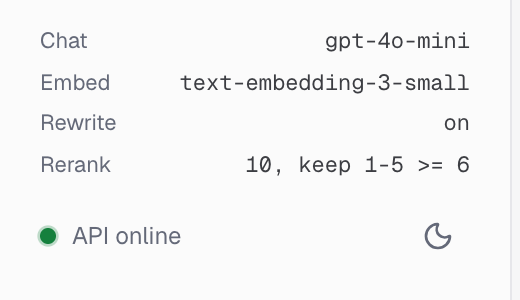
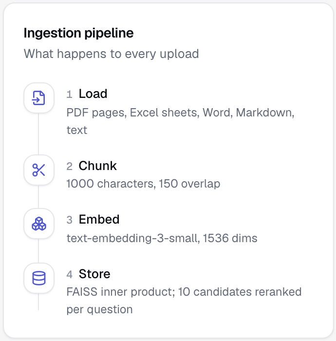
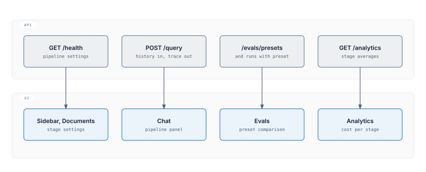
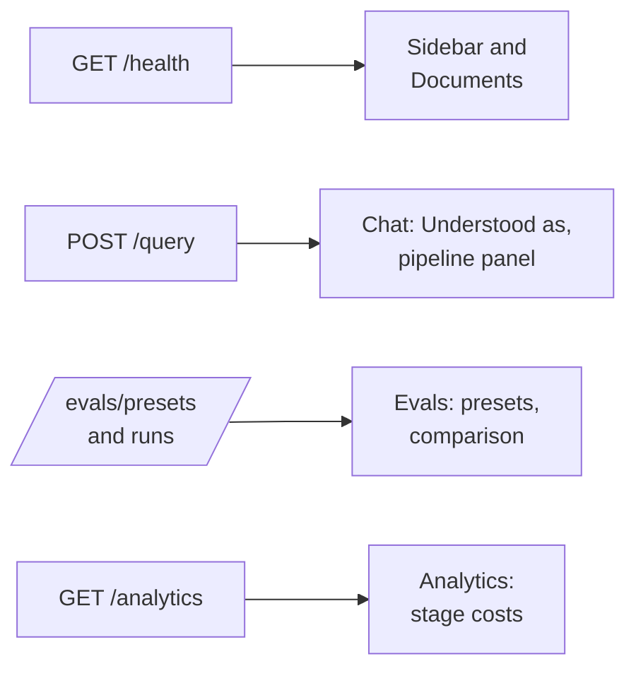

# 06. Stage Settings Display and UI Overview

In this doc:

- Where the stage settings are shown, and why
- The whole Advanced RAG UI on one map: feature, page, API field
- What stayed from the Naive UI
- Screenshots and privacy
- Final checks

Files: [src/components/layout/Sidebar.jsx](../src/components/layout/Sidebar.jsx), [src/features/documents/IndexOverview.jsx](../src/features/documents/IndexOverview.jsx)

## Stage Settings in the UI

Every answer and every evaluation depends on the stage settings in the API `.env` (API doc 02). If a user changes RERANK_THRESHOLD or switches rewriting off, the UI should show it without opening the API.

<table width="100%">
<thead><tr><th>Sidebar footer</th><th>Documents page: ingestion card</th></tr></thead>
<tbody>
<tr><td></td><td></td></tr>
</tbody>
</table>

<table width="100%">
<thead><tr><th>Place</th><th>Shows</th><th>From</th></tr></thead>
<tbody>
<tr><td>Sidebar footer</td><td>Chat and embedding models; "Rewrite on"; "Rerank 10, keep 1-5 &gt;= 6" (candidates, chunk limits, threshold), or "off"</td><td>GET /health pipeline</td></tr>
<tr><td>Documents, ingestion card, step 4</td><td>"FAISS inner product; 10 candidates reranked per question" (or "top 4 per question" with reranking off)</td><td>GET /health pipeline</td></tr>
</tbody>
</table>

GET /health is polled every 30 seconds, so a restarted API with new settings shows up without reloading the page.

## The UI on One Map

<table width="100%">
<thead><tr><th>Advanced RAG feature</th><th>Where in the UI</th><th>API field</th><th>Doc</th></tr></thead>
<tbody>
<tr><td>Follow-up questions</td><td>Chat: history sent, "Understood as" line, follow-up label</td><td>history, trace.standalone_question</td><td>02</td></tr>
<tr><td>Rewrite, rerank, threshold per answer</td><td>Chat: pipeline panel, reranker score on source cards</td><td>trace</td><td>03</td></tr>
<tr><td>Ablation runs</td><td>Evals: preset menu, comparison card, preset in summary and history</td><td>/evals/presets, preset, pipeline</td><td>04</td></tr>
<tr><td>Cost per stage</td><td>Analytics: cost and time per stage</td><td>stages</td><td>05</td></tr>
<tr><td>Stage settings</td><td>Sidebar footer, Documents ingestion card</td><td>health pipeline</td><td>06</td></tr>
</tbody>
</table>

## What Stayed From the Naive UI

Unchanged and still working against the Advanced API: citations with hover previews and the PDF viewer at the cited passage, the source panel, Evaluate in chat, Documents upload and drawer, the analytics charts, the test cases table and test set card, light and dark themes (Naive UI docs 03 to 11).

## Screenshots and Privacy

All screenshots are from the running app with real answers (gpt-4o-mini, text-embedding-3-small, FAISS, the same 6 indexed files as Naive RAG). The library in the sidebar and the Documents table include a personal file, so screenshots in these docs are cropped to the chat, the cards or the sidebar footer and never show the file list.

## Final Checks

<table width="100%">
<thead><tr><th>Check</th><th>Result</th></tr></thead>
<tbody>
<tr><td>npm test</td><td>37 tests pass (citations, highlight, format, client, analytics, scores, history, pipeline, compare)</td></tr>
<tr><td>npm run lint</td><td>No warnings</td></tr>
<tr><td>npm run build</td><td>Builds</td></tr>
<tr><td>Live</td><td>Chat with follow-up, pipeline panel in light and dark, Evals comparison of runs A to E, Analytics stage costs, all against the API on port 8001</td></tr>
</tbody>
</table>

## Key Points

- The sidebar and the Documents page show the stage settings from GET /health.
- Every Advanced RAG feature has a place in the UI, fed by one API field.
- The Naive UI features all still work; screenshots avoid personal files.
