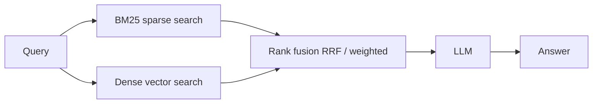

# 03. Hybrid Search RAG

> **Category:** Retrieval Optimization  
> **Core idea:** Combine sparse keyword search (BM25) and dense vector search, then fuse the ranked lists.  
> **Status:** Research collected. Implementation planned.

## Table of Contents

- [Overview](#overview)
- [Architecture](#architecture)
- [How It Works](#how-it-works)
- [When to Use](#when-to-use)
- [Limitations](#limitations)
- [Key Components](#key-components)
- [Research Papers](#research-papers)
- [Folder Structure](#folder-structure)
- [Navigation](#navigation)

## Overview

Dense embeddings capture meaning but miss exact terms such as product codes, names and acronyms. Sparse BM25 search catches exact terms but misses paraphrases. Hybrid Search RAG runs both retrievers and merges results with Reciprocal Rank Fusion (RRF) or weighted scores.

## Architecture



## How It Works

1. Build a BM25 (or SPLADE) index and a vector index over the same chunks.
2. Run both searches for each query.
3. Fuse the two ranked lists with RRF or a tuned alpha weight.
4. Optionally re-rank, then generate.

## When to Use

- Corpus has IDs, codes, legal or medical terms.
- Enterprise search with mixed query styles.

## Limitations

- Two indexes to maintain.
- Fusion weights need tuning per domain.

## Key Components

- BM25 / SPLADE index
- Vector DB
- RRF fusion
- Optional re-ranker

## Research Papers

<table width="100%">
<thead><tr><th>#</th><th>Paper</th><th>Year</th><th>Venue / Org</th><th>arXiv</th><th>Local copy</th></tr></thead>
<tbody>
<tr><td>1</td><td>Blended RAG: Improving RAG Accuracy with Semantic Search and Hybrid Query-Based Retrievers</td><td>2024</td><td>arXiv (IBM)</td><td><a href="https://arxiv.org/abs/2404.07220">2404.07220</a></td><td><a href="papers/2404.07220_Blended-RAG.pdf">PDF</a></td></tr>
</tbody>
</table>

## Folder Structure

```text
03-Hybrid-Search-RAG/
├── README.md        # This file
└── papers/         # Research papers (PDF)
```

Implementation code (`src/`, `notebooks/`, `requirements.txt`) will be added when this architecture is built end to end.

## Navigation

[← Advanced RAG](../02-Advanced-RAG/) | [Home](../README.md) | [HyDE RAG →](../04-HyDE-RAG/)
