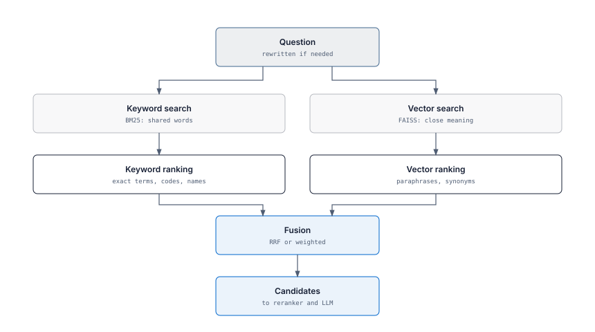
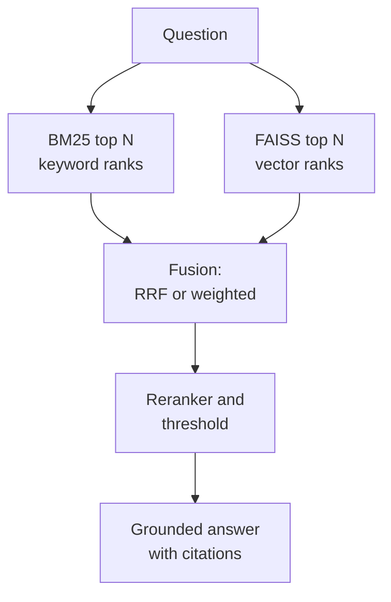
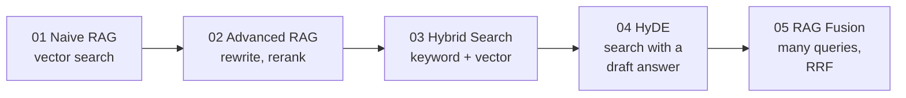

# 01. What is Hybrid Search RAG

In this note:

- The definition in plain words
- The two retrievers: keyword search and vector search
- Fusion: turning two rankings into one
- What Hybrid Search RAG keeps from Advanced RAG and what it adds
- The bookshop analogy
- Where it sits among the 22 architectures
- The papers behind it

## Definition

**Hybrid Search RAG** is RAG where every question is searched in two ways over the same chunks:

- **keyword search** (sparse retrieval, usually BM25): finds chunks that contain the question's words, giving more weight to rare words, and
- **vector search** (dense retrieval, embeddings): finds chunks whose meaning is close to the question, even with different words.

The two ranked lists are **fused** into one candidate list, which then goes through the same stages as Advanced RAG: reranking, threshold and grounded generation.

## Why two retrievers

<table width="100%">
<thead><tr><th>Question</th><th>Keyword search (BM25)</th><th>Vector search (embeddings)</th></tr></thead>
<tbody>
<tr><td>"What is error code E-4021?"</td><td>Strong: the rare token e-4021 matches exactly</td><td>Weak: the code has little meaning for the embedding model</td></tr>
<tr><td>"How many days off for illness?"</td><td>Weak: the policy says "sick leave", no shared words</td><td>Strong: "days off for illness" is close in meaning to "sick leave"</td></tr>
<tr><td>"What does RRF stand for?"</td><td>Strong: the acronym appears in the text</td><td>Mixed: depends on whether the model knows the acronym</td></tr>
<tr><td>"Which knowledge source does RAG use?"</td><td>Strong if the words "knowledge source" appear in the chunk</td><td>Can miss it when many chunks talk about RAG in general</td></tr>
</tbody>
</table>

Each retriever fails where the other is strong. Running both is cheap: BM25 is a local index lookup that takes milliseconds and costs nothing per query.

## Fusion in one paragraph

The two retrievers return scores on different scales (BM25 scores such as 12.4, cosine similarities such as 0.54), so they cannot simply be added. Two common methods:

- **Reciprocal Rank Fusion (RRF):** ignore the scores and use the ranks: score = 1 / (60 + keyword rank) + 1 / (60 + vector rank). A chunk ranked high by either list, or medium by both, rises to the top.
- **Weighted fusion:** normalise both scores to 0 to 1, then mix them: alpha x vector score + (1 - alpha) x keyword score.

Notes 08 to 10 explain both in detail.

## What stays and what is added

<table width="100%">
<thead><tr><th>Component</th><th>Advanced RAG</th><th>Hybrid Search RAG</th></tr></thead>
<tbody>
<tr><td>Loaders, chunking, embeddings, FAISS</td><td>Yes</td><td>Same</td></tr>
<tr><td>Keyword index</td><td>No</td><td>New: a BM25 index over the same chunks, built at ingestion</td></tr>
<tr><td>Query rewriting</td><td>Yes</td><td>Same (the rewritten search query feeds both retrievers)</td></tr>
<tr><td>Candidates</td><td>Top 10 by vector similarity</td><td>Top N from each retriever, fused into one list</td></tr>
<tr><td>Reranker, threshold, generator, trace</td><td>Yes</td><td>Same; the trace also shows both lists and the fused order</td></tr>
<tr><td>Extra model calls per question</td><td>Rewrite, rerank</td><td>None added: BM25 runs locally</td></tr>
</tbody>
</table>

## The bookshop analogy

You ask a bookshop for "the book about the boy wizard with the scar".

- One assistant searches the catalogue by **exact words**: they find every book whose title or blurb contains "wizard" and "scar".
- Another assistant **knows the books**: they think of stories that match your description, even if the blurb never uses your words.
- The manager takes both lists and puts a book near the top if **both** assistants suggested it, or if **one** of them was very sure. Then the expert (the reranker) checks the top few before handing one over.

Hybrid search is two assistants and a manager; the reranker from Advanced RAG is the expert.

## Where it sits

Hybrid Search improves the **retrieval** step itself, where Advanced RAG improved the steps around it. The next architectures keep changing what is searched: HyDE searches with a hypothetical answer, RAG Fusion searches with several queries and fuses the results with RRF.

## The papers behind it

<table width="100%">
<thead><tr><th>Paper</th><th>What it contributes</th></tr></thead>
<tbody>
<tr><td>Blended RAG (Sawarkar, Mangal, Solanki, IBM 2024)</td><td>Hybrid retrievers (keyword, dense, sparse encoder) with different query types, measured on retrieval and RAG benchmarks</td></tr>
<tr><td>An Analysis of Fusion Functions for Hybrid Retrieval (Bruch, Gai, Ingber 2022)</td><td>When weighted fusion beats RRF, and how sensitive each is to its parameters</td></tr>
<tr><td>Reciprocal Rank Fusion (Cormack, Clarke, Buettcher, SIGIR 2009)</td><td>The RRF formula and evidence that it beats each input ranking</td></tr>
</tbody>
</table>

They are explained section by section in [02. Research Paper Explained](../02.%20Research%20Paper%20Explained/).

## Key points

- Hybrid Search RAG searches every question with BM25 and with embeddings, over the same chunks.
- Keyword search is strong on exact and rare terms; vector search on paraphrases. They fail in different places.
- Fusion (RRF or weighted) merges the two rankings; the Advanced RAG reranker and threshold then choose what the LLM reads.
- No extra model calls: BM25 runs locally in milliseconds.

## Navigation

[Basic Concepts](README.md) | Next: [02. From Advanced RAG to Hybrid Search](02.%20From%20Advanced%20RAG%20to%20Hybrid%20Search.md)
