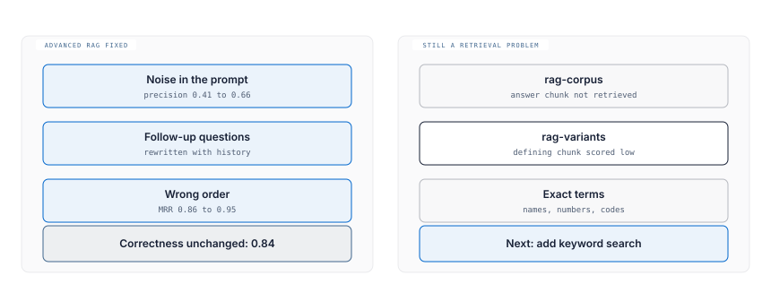
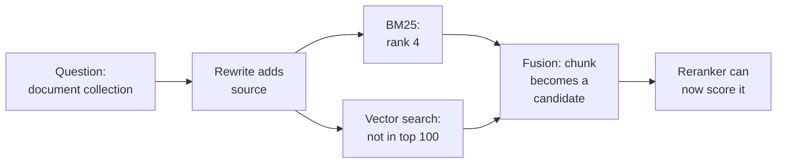

# 02. From Advanced RAG to Hybrid Search

In this note:

- What Advanced RAG fixed, and what it did not
- Why the remaining errors are retrieval errors
- A measured example: the answer chunk that vector search cannot find
- What keyword search adds, and what it cannot fix
- Targets for Hybrid Search RAG

## What Advanced RAG fixed

From the Advanced RAG evaluation ([API doc 11](../../../02.%20Advanced%20RAG/03.%20API/docs/11.%20Evaluation%20Results%20and%20Comparison%20with%20Naive%20RAG.md)), on the 11-question test set:

<table width="100%">
<thead><tr><th>Measure</th><th>Naive RAG</th><th>Advanced RAG</th><th>What changed</th></tr></thead>
<tbody>
<tr><td>Context precision</td><td>0.41</td><td>0.66</td><td>The threshold sends only chunks the reranker scores 6 or more</td></tr>
<tr><td>Hit rate (expected file sent)</td><td>90%</td><td>100%</td><td>Rewriting and 10 candidates</td></tr>
<tr><td>MRR (file level)</td><td>0.86</td><td>0.95</td><td>The reranker moves the right file up</td></tr>
<tr><td>Overall</td><td>0.79</td><td>0.87</td><td>Mostly from precision and the out-of-scope question</td></tr>
<tr><td>Correctness</td><td>0.84</td><td>0.84</td><td>Unchanged</td></tr>
</tbody>
</table>

Advanced RAG changed **what the generator reads**. It cannot change **what retrieval returns**: the reranker only reorders the 10 candidates, and a chunk that is not among them is lost.

## Why the remaining errors are retrieval errors

<table width="100%">
<thead><tr><th>Question id</th><th>Correctness (Advanced)</th><th>What happened</th></tr></thead>
<tbody>
<tr><td>rag-corpus</td><td>0.5</td><td>The chunk that names the corpus (RAG paper, page 4: "a single Wikipedia dump ... the December 2018 dump") was never a candidate</td></tr>
<tr><td>rag-variants</td><td>0.5</td><td>The chunk that defines RAG-Sequence and RAG-Token was retrieved but scored below the threshold; a better first ranking would give the reranker more right chunks to choose from</td></tr>
</tbody>
</table>

"Hit rate 100%" hid the first case: it is measured per **file** (any chunk of the RAG paper counts), not per **answer chunk**. Hybrid Search RAG will measure both.

## A measured example

Question: "What document collection does RAG retrieve from?". The answer is in RAG paper chunk 17 (page 4): "For all experiments, we use a single Wikipedia dump for our non-parametric knowledge source ... we use the December 2018 dump."

Using the same 410 chunks as Advanced RAG, a simple BM25 written for this check (lower-case words, common stop words removed, k1 = 1.2, b = 0.75) and the Advanced RAG vector search:

<table width="100%">
<thead><tr><th>Query sent to search</th><th>Vector rank of the answer chunk</th><th>BM25 rank of the answer chunk</th></tr></thead>
<tbody>
<tr><td>The question as typed</td><td>Not in the top 50</td><td>34</td></tr>
<tr><td>The Advanced RAG rewrite: "Retrieval-Augmented Generation RAG document collection source"</td><td>Not in the top 100</td><td>4</td></tr>
</tbody>
</table>

What this shows:

- **Vector search cannot find it at all.** The chunk talks mostly about decoding and starts the Experiments section; its embedding is not close to a question about "document collections". Many other chunks about RAG are closer.
- **BM25 with the raw question also fails (rank 34).** The question says "document collection"; the chunk says "knowledge source" and "Wikipedia dump". This is **vocabulary mismatch**: no shared rare words.
- **BM25 with the rewritten query finds it (rank 4).** The rewrite added "source", which matches "knowledge source", a rare enough pair in this corpus. With hybrid search the chunk would enter the candidate list, and the reranker could then score it.

This is one question and a quick check, not an evaluation; the API will implement BM25 properly and the evaluation will measure the effect on all questions.

## What keyword search adds

<table width="100%">
<thead><tr><th>Gap</th><th>Does BM25 help?</th><th>Why</th></tr></thead>
<tbody>
<tr><td>Exact names, codes, numbers, acronyms</td><td>Yes</td><td>Rare tokens get a high IDF and match exactly</td></tr>
<tr><td>Chunks whose overall topic differs from the question but contain the key words</td><td>Yes</td><td>BM25 scores word overlap, not the whole chunk's meaning (rag-corpus)</td></tr>
<tr><td>Paraphrases and synonyms ("illness" vs "sick")</td><td>No</td><td>No shared words; vector search keeps covering this</td></tr>
<tr><td>Vocabulary mismatch with no shared words</td><td>Only with a good rewrite</td><td>Query rewriting or expansion must bring in the document's words (04. HyDE RAG goes further)</td></tr>
<tr><td>Information split across chunks</td><td>No</td><td>A chunking problem (06. Contextual Chunking RAG)</td></tr>
</tbody>
</table>

## Targets for Hybrid Search RAG

<table width="100%">
<thead><tr><th>Measure</th><th>Advanced RAG</th><th>Target</th></tr></thead>
<tbody>
<tr><td>Correctness</td><td>0.84</td><td>0.90 or higher</td></tr>
<tr><td>Answer-chunk hit rate among candidates</td><td>Not measured</td><td>Measured; higher than vector-only</td></tr>
<tr><td>Context precision</td><td>0.66</td><td>0.65 or higher (unchanged reranker and threshold)</td></tr>
<tr><td>Cost per question</td><td>Rs 0.048</td><td>No increase (BM25 is free; same number of reranked candidates)</td></tr>
<tr><td>Time per question</td><td>2.7 s</td><td>Under 3 s</td></tr>
</tbody>
</table>

## Key points

- Advanced RAG fixed the context sent to the LLM; correctness stayed at 0.84 because some answer chunks never became candidates.
- File-level hit rate hides this; Hybrid Search RAG will measure whether the answer chunk itself is a candidate.
- Measured on rag-corpus: vector search cannot find the answer chunk in its top 100, BM25 with the rewritten query ranks it 4th.
- Keyword search helps exact terms and word overlap; it does not help paraphrases or splits across chunks.

## Navigation

Previous: [01. What is Hybrid Search RAG](01.%20What%20is%20Hybrid%20Search%20RAG.md) | [Basic Concepts](README.md) | Next: [03. Sparse Retrieval and BM25](03.%20Sparse%20Retrieval%20and%20BM25.md)
