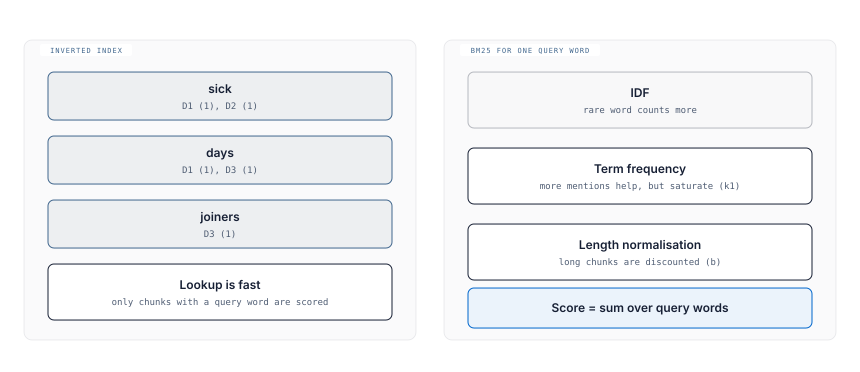
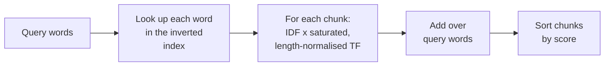

# 03. Sparse Retrieval and BM25

In this note:

- Why keyword search is called sparse retrieval
- The inverted index
- Term frequency and inverse document frequency (TF-IDF) in one step
- The BM25 formula, symbol by symbol
- A full worked example with three chunks
- What k1 and b do, with numbers
- Strengths and weaknesses of BM25

## Why "sparse"

Write a chunk as a vector with one position per word in the vocabulary. Our 410 chunks use thousands of different words, but one chunk uses only a hundred or so, so almost every position is 0. That vector is **sparse**. An embedding, in contrast, has 1536 positions that are all non-zero: a **dense** vector.

<table width="100%">
<thead><tr><th></th><th>Sparse (keyword) vector</th><th>Dense (embedding) vector</th></tr></thead>
<tbody>
<tr><td>Length</td><td>Vocabulary size (thousands to millions)</td><td>Fixed, for example 1536</td></tr>
<tr><td>Non-zero values</td><td>Only the words in the chunk</td><td>All</td></tr>
<tr><td>Meaning of one position</td><td>One specific word</td><td>No human-readable meaning</td></tr>
<tr><td>Matches</td><td>Shared words</td><td>Similar meaning</td></tr>
<tr><td>Built by</td><td>Counting words</td><td>A neural model</td></tr>
</tbody>
</table>

## The inverted index

A book's index lists, for each word, the pages where it appears. An **inverted index** does the same for chunks: for each word, the list of chunks containing it and how often.

To answer a query, the system looks up only the query's words and scores only the chunks in those lists. That is why keyword search over millions of documents takes milliseconds.

## TF-IDF in one step

Two ideas decide how much a word in a chunk should count:

- **Term frequency (TF):** a chunk that mentions "sick" three times is probably more about sickness than one that mentions it once.
- **Inverse document frequency (IDF):** a word found in almost every chunk ("the", "model") says little; a rare word ("joiners", "E-4021") is a strong signal.

TF-IDF multiplies the two. BM25 (Best Matching 25, Robertson and colleagues, Okapi system, 1990s) keeps the idea but fixes two problems of raw TF: it lets repeated words saturate, and it corrects for chunk length.

## The BM25 formula

For a query Q with words q1, ..., qn and a chunk D:

$$\text{BM25}(D, Q) = \sum_{i=1}^{n} \text{IDF}(q_i) \cdot \frac{f(q_i, D) \cdot (k_1 + 1)}{f(q_i, D) + k_1 \cdot \left(1 - b + b \cdot \frac{|D|}{\text{avgdl}}\right)}$$

$$\text{IDF}(q_i) = \ln\left(1 + \frac{N - n(q_i) + 0.5}{n(q_i) + 0.5}\right)$$

<table width="100%">
<thead><tr><th>Symbol (plain text)</th><th>Meaning</th><th>Typical value</th></tr></thead>
<tbody>
<tr><td>f(qi, D)</td><td>How many times query word qi appears in chunk D</td><td>0, 1, 2, ...</td></tr>
<tr><td>|D|</td><td>Length of chunk D in words</td><td>About 140 words on average for our 1000-character chunks (22 to 296)</td></tr>
<tr><td>avgdl</td><td>Average chunk length in the collection</td><td>-</td></tr>
<tr><td>N</td><td>Number of chunks in the collection</td><td>410 in this project</td></tr>
<tr><td>n(qi)</td><td>Number of chunks containing qi</td><td>-</td></tr>
<tr><td>k1</td><td>How fast repeated words saturate</td><td>1.2 to 2.0 (1.2 in Lucene and Elasticsearch)</td></tr>
<tr><td>b</td><td>How strongly long chunks are discounted</td><td>0.75</td></tr>
</tbody>
</table>

This IDF form, with the "1 +" inside the logarithm, is the one Lucene and Elasticsearch use; it never goes negative, even for words in more than half of the chunks.

## Worked example

Three tiny chunks:

<table width="100%">
<thead><tr><th>Chunk</th><th>Text</th><th>Length</th></tr></thead>
<tbody>
<tr><td>D1</td><td>employees get 8 sick days per year</td><td>7</td></tr>
<tr><td>D2</td><td>sick leave must be approved by the line manager</td><td>9</td></tr>
<tr><td>D3</td><td>new joiners get 12 days of paid leave</td><td>8</td></tr>
</tbody>
</table>

N = 3, avgdl = (7 + 9 + 8) / 3 = 8. Query: "sick days". k1 = 1.2, b = 0.75.

**Step 1: IDF.** "sick" is in 2 chunks, "days" is in 2 chunks:

IDF = ln(1 + (3 - 2 + 0.5) / (2 + 0.5)) = ln(1.6) = 0.470 for both.

For comparison, "joiners" (in 1 chunk) has IDF = ln(1 + 2.5 / 1.5) = 0.981, and a word in all 3 chunks would have ln(1 + 0.5 / 3.5) = 0.134.

**Step 2: length normalisation** k1 x (1 - b + b x |D| / avgdl):

- D1: 1.2 x (0.25 + 0.75 x 7/8) = 1.0875
- D2: 1.2 x (0.25 + 0.75 x 9/8) = 1.3125
- D3: 1.2 x (0.25 + 0.75 x 8/8) = 1.2

**Step 3: score each word, add them up.** Each matching word appears once (f = 1), so its part is IDF x 2.2 / (1 + normalisation):

<table width="100%">
<thead><tr><th>Chunk</th><th>"sick"</th><th>"days"</th><th>BM25</th><th>Rank</th></tr></thead>
<tbody>
<tr><td>D1</td><td>0.470 x 2.2 / 2.0875 = 0.495</td><td>0.495</td><td>0.991</td><td>1</td></tr>
<tr><td>D3</td><td>0 (not present)</td><td>0.470 x 2.2 / 2.2 = 0.470</td><td>0.470</td><td>2</td></tr>
<tr><td>D2</td><td>0.470 x 2.2 / 2.3125 = 0.447</td><td>0 (not present)</td><td>0.447</td><td>3</td></tr>
</tbody>
</table>

D1 contains both words and wins. D3 and D2 each contain one; D3 edges out D2 because it is shorter (9 words in D2 dilute the single match more than 8 in D3).

## What k1 and b do

**k1: saturation.** With an average-length chunk, the term-frequency part is f x (k1 + 1) / (f + k1). With k1 = 1.2:

<table width="100%">
<thead><tr><th>Times the word appears (f)</th><th>1</th><th>2</th><th>3</th><th>5</th><th>10</th></tr></thead>
<tbody>
<tr><td>TF part</td><td>1.000</td><td>1.375</td><td>1.571</td><td>1.774</td><td>1.964</td></tr>
</tbody>
</table>

The tenth mention adds very little: the part can never exceed k1 + 1 = 2.2. A chunk cannot win just by repeating a word. Raw TF-IDF would score 10 mentions ten times higher than one.

**b: length.** With b = 0, length is ignored; with b = 1, scores are fully normalised by length. 0.75 is a middle ground: a long chunk that mentions a word once is discounted, because one mention in a long text is weaker evidence.

## Strengths and weaknesses

<table width="100%">
<thead><tr><th>Strengths</th><th>Weaknesses</th></tr></thead>
<tbody>
<tr><td>Exact matches for names, codes, numbers and acronyms</td><td>No synonyms: "illness" does not match "sick"</td></tr>
<tr><td>No training, no model calls, no cost per query</td><td>Word order and meaning ignored: "dog bites man" = "man bites dog"</td></tr>
<tr><td>Fast: only chunks containing a query word are scored</td><td>Sensitive to text analysis: tokenising, stemming, stop words (note 04)</td></tr>
<tr><td>Explainable: you can show which words matched</td><td>Vague questions with common words match many chunks weakly</td></tr>
<tr><td>Strong baseline: often competitive with neural retrievers on new domains (the BEIR benchmark found this across many datasets)</td><td>Scores are unbounded and differ per query, so they cannot be compared with cosine similarities directly (note 08)</td></tr>
</tbody>
</table>

In this project's data, BM25 scores range from 0 to around 19 for a query, while cosine similarities range from about 0.1 to 0.8. That difference is why fusion needs care.

## Key points

- Keyword search uses sparse vectors and an inverted index; only chunks containing a query word are scored.
- BM25 adds, for each query word, IDF (rarity) times a term frequency that saturates (k1) and is corrected for chunk length (b).
- Worked example: "sick days" ranks D1 (both words, 0.991) above D3 (0.470) and D2 (0.447).
- BM25 is free, fast and exact, but blind to synonyms and meaning; that is what vector search adds.

## Navigation

Previous: [02. From Advanced RAG to Hybrid Search](02.%20From%20Advanced%20RAG%20to%20Hybrid%20Search.md) | [Basic Concepts](README.md) | Next: [04. Text Analysis for Keyword Search](04.%20Text%20Analysis%20for%20Keyword%20Search.md)
