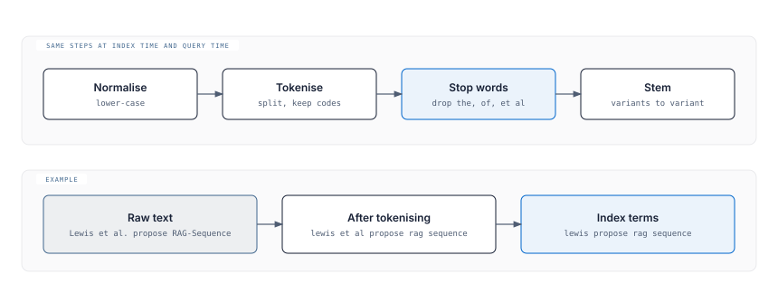
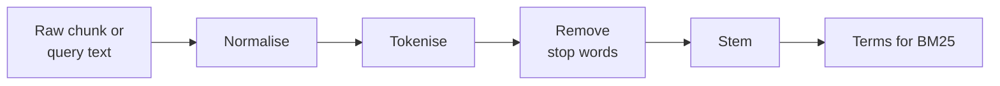

# 04. Text Analysis for Keyword Search

In this note:

- Why BM25 is only as good as the words it is given
- The four steps: normalise, tokenise, remove stop words, stem
- A measured example: two stop words move the right paper from rank 30 to rank 2
- Hard cases: hyphens, codes, numbers, decimals, possessives
- The choices for this project

## Why text analysis matters

BM25 compares **terms**, not text. Before a chunk is indexed and before a query is searched, both are turned into a list of terms by the same procedure, called **text analysis** (or an analyser). Two words match only if analysis turns them into the same term. "Variants" and "variant", "RAG-Sequence" and "rag sequence", "E-4021" and "e 4021": whether these match is decided here, not by BM25.

**Rule one:** use exactly the same analysis at index time and at query time. If chunks are stemmed and queries are not, "variants" in a query never matches "variant" in the index.

## The four steps

<table width="100%">
<thead><tr><th>Step</th><th>What it does</th><th>Example</th><th>Risk</th></tr></thead>
<tbody>
<tr><td>Normalise</td><td>Lower-case; optionally fold accents and unify quotes and dashes</td><td>"RAG" to "rag"</td><td>Case can carry meaning ("US" vs "us"), usually acceptable</td></tr>
<tr><td>Tokenise</td><td>Split text into tokens</td><td>"Lewis et al. propose" to lewis, et, al, propose</td><td>Splitting codes and compounds ("E-4021", "gpt-4o-mini")</td></tr>
<tr><td>Stop words</td><td>Drop very common words that carry little meaning</td><td>the, of, is, and; in papers also et, al</td><td>Dropping a word that matters ("not", "to be or not to be")</td></tr>
<tr><td>Stem or lemmatise</td><td>Reduce words to a common root</td><td>"variants" to "variant", "retrieved" to "retriev"</td><td>Over-stemming joins unrelated words ("university" and "universe" to "univers")</td></tr>
</tbody>
</table>

### Stemming vs lemmatising

- **Stemming** cuts endings by rules (the Porter stemmer): fast, sometimes produces non-words ("retriev"), language-specific.
- **Lemmatising** maps a word to its dictionary form with a vocabulary ("better" to "good", "retrieved" to "retrieve"): more accurate, slower, needs a language model or dictionary.

For technical English documents, a light stemmer (or just removing plural "s") is often enough.

## A measured example

Test question rag-variants: "What are the two RAG model variants proposed by Lewis et al.?". Expected file: the RAG paper. Same 410 chunks and a simple BM25 (k1 = 1.2, b = 0.75), changing only the analysis:

<table width="100%">
<thead><tr><th>Analysis</th><th>First RAG paper chunk at rank</th></tr></thead>
<tbody>
<tr><td>A. Lower-case, split on non-letters, small English stop list</td><td>30</td></tr>
<tr><td>B. A + "et" and "al" as stop words</td><td>2</td></tr>
<tr><td>C. B + remove plural "s"</td><td>2</td></tr>
<tr><td>D. C + keep hyphenated words as one token</td><td>2</td></tr>
</tbody>
</table>

Why "et al" mattered so much: "et" and "al" appear in 111 and 113 of the 410 chunks, because every paper cites "X et al.". Their IDF is moderate, not near zero, and the reference lists of other papers contain "Lewis et al." many times, so those citation-heavy chunks outranked the RAG paper itself. Treating "et" and "al" as stop words removes this citation noise. In a corpus of research papers, this is a domain-specific stop list.

## Hard cases

How a simple tokeniser that splits on anything that is not a letter or digit handles real strings:

<table width="100%">
<thead><tr><th>Text</th><th>Split on non-alphanumerics</th><th>Keep hyphenated words</th><th>Comment</th></tr></thead>
<tbody>
<tr><td>RAG-Sequence and RAG-Token</td><td>rag, sequence, rag, token</td><td>rag-sequence, rag-token</td><td>Splitting lets "RAG sequence" match; keeping is more exact</td></tr>
<tr><td>error code E-4021</td><td>error, code, e, 4021</td><td>error, code, e-4021</td><td>The split form also matches "E-4021" written as "E 4021"</td></tr>
<tr><td>gpt-4o-mini</td><td>gpt, 4o, mini</td><td>gpt-4o-mini</td><td>Split form matches "gpt-4o" questions too</td></tr>
<tr><td>Self-RAG's reflection tokens</td><td>self, rag, s, reflection, tokens</td><td>self-rag, s, reflection, tokens</td><td>Possessive "s" should be removed</td></tr>
<tr><td>k1 = 1.2, b = 0.75</td><td>k1, 1, 2, b, 0, 75</td><td>Same</td><td>Decimals are broken into meaningless pieces</td></tr>
<tr><td>December 2018 dump, 21M documents</td><td>december, 2018, dump, 21m, documents</td><td>Same</td><td>Years and counts survive</td></tr>
</tbody>
</table>

A robust choice is to **index both**: the whole hyphenated or decimal token ("e-4021", "1.2") and its parts ("e", "4021"). A query in either form then matches, and the whole token, being rare, gets a high IDF when it matches exactly.

## The choices for this project

<table width="100%">
<thead><tr><th>Choice</th><th>Decision</th><th>Reason</th></tr></thead>
<tbody>
<tr><td>Case</td><td>Lower-case everything</td><td>Questions are typed in any case</td></tr>
<tr><td>Tokens</td><td>Split on non-alphanumerics, and also keep hyphenated and decimal tokens whole</td><td>Codes, model names and numbers match in both forms</td></tr>
<tr><td>Possessives</td><td>Drop a lone "s" token</td><td>"Self-RAG's" should match "Self-RAG"</td></tr>
<tr><td>Stop words</td><td>Small English list plus "et" and "al"</td><td>Measured: citation words pushed the RAG paper from rank 2 to 30</td></tr>
<tr><td>Stemming</td><td>Light: remove plural "s" (not after "ss")</td><td>"variants" matches "variant" without the errors of aggressive stemming</td></tr>
<tr><td>Same analysis for chunks and queries</td><td>One function used at ingestion and at query time</td><td>Rule one</td></tr>
</tbody>
</table>

These are decisions for the API step; the evaluation will check them on all test questions.

## Key points

- BM25 matches terms produced by text analysis; analysis decides what can match.
- Normalise, tokenise, remove stop words and stem, identically at index and query time.
- Measured: adding "et" and "al" as stop words moved the RAG paper from rank 30 to rank 2 for one test question.
- Codes, hyphenated names and decimals need care: index both the whole token and its parts.

## Navigation

Previous: [03. Sparse Retrieval and BM25](03.%20Sparse%20Retrieval%20and%20BM25.md) | [Basic Concepts](README.md) | Next: [05. Dense Retrieval Strengths and Blind Spots](05.%20Dense%20Retrieval%20Strengths%20and%20Blind%20Spots.md)
