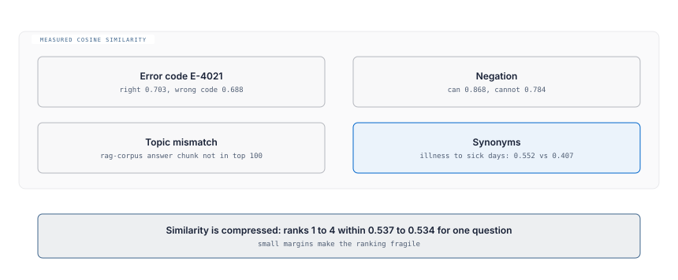
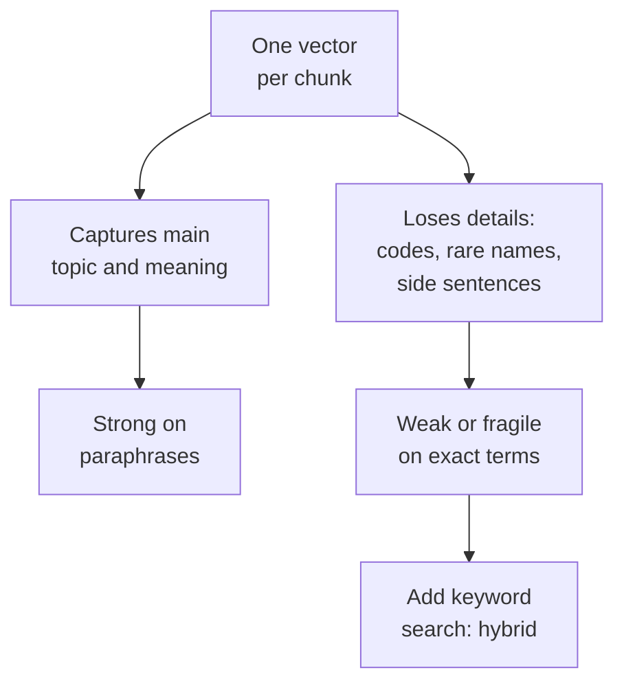

# 05. Dense Retrieval Strengths and Blind Spots

In this note:

- A short recap of dense retrieval
- What embeddings do well
- Five blind spots, each measured with text-embedding-3-small
- Why small similarity margins matter in a large corpus
- What this means for hybrid search

## Recap

Dense retrieval embeds each chunk and the question into vectors (1536 numbers with text-embedding-3-small) and ranks chunks by cosine similarity (Naive RAG notes on embeddings and retrieval). One vector must summarise the whole chunk, so it captures **overall meaning** well and **individual details** less well.

## What embeddings do well

<table width="100%">
<thead><tr><th>Strength</th><th>Example</th></tr></thead>
<tbody>
<tr><td>Synonyms and paraphrases</td><td>"days off for illness" finds "sick days"</td></tr>
<tr><td>Questions phrased differently from the text</td><td>"How does the model decide to search?" finds a passage about "retrieval on demand"</td></tr>
<tr><td>Different languages (multilingual models)</td><td>A Hindi question can find an English passage</td></tr>
<tr><td>Typos and word forms</td><td>A misspelling such as "retreival" usually stays close to "retrieval"</td></tr>
<tr><td>Unrelated questions get low similarity</td><td>"Who won the FIFA World Cup in 2018?": best chunk only 0.23 in our index</td></tr>
</tbody>
</table>

## Five blind spots, measured

Each test embeds one question and three short candidate sentences with text-embedding-3-small and compares cosine similarities.

### 1. Codes and identifiers

<table width="100%">
<thead><tr><th>Question: "What does error E-4021 mean?"</th><th>Similarity</th></tr></thead>
<tbody>
<tr><td>Error E-4021 means the disk is full.</td><td>0.703</td></tr>
<tr><td>Error E-4012 means the network is down.</td><td>0.688</td></tr>
<tr><td>Error codes are listed in the user manual.</td><td>0.426</td></tr>
</tbody>
</table>

The right code wins by only 0.015. With hundreds of error codes in a manual, dozens of wrong ones would sit within that margin. BM25 gives "e-4012" no credit at all for the query term "e-4021".

### 2. Negation

<table width="100%">
<thead><tr><th>Question: "Can employees carry over unused leave?"</th><th>Similarity</th></tr></thead>
<tbody>
<tr><td>Employees can carry over unused leave to next year.</td><td>0.868</td></tr>
<tr><td>Employees cannot carry over unused leave to next year.</td><td>0.784</td></tr>
<tr><td>Unused leave is paid out in December.</td><td>0.614</td></tr>
</tbody>
</table>

The opposite statement is still a very close match. Embeddings encode topic more than truth value. (BM25 does not understand negation either; here the generator, reading the chunk, must get it right.)

### 3. Numbers

<table width="100%">
<thead><tr><th>Question: "Who gets 21 days of paid leave?"</th><th>Similarity</th></tr></thead>
<tbody>
<tr><td>Managers get 21 days of paid leave.</td><td>0.807</td></tr>
<tr><td>New joiners get 12 days of paid leave.</td><td>0.688</td></tr>
<tr><td>Paid leave must be approved.</td><td>0.585</td></tr>
</tbody>
</table>

Here the right number wins clearly (0.12 margin). Numbers are handled better than codes, but "12" and "21" are still both high.

### 4. Names

<table width="100%">
<thead><tr><th>Question: "What did Karpukhin propose?"</th><th>Similarity</th></tr></thead>
<tbody>
<tr><td>Karpukhin et al. proposed Dense Passage Retrieval (DPR).</td><td>0.435</td></tr>
<tr><td>Lewis et al. proposed retrieval-augmented generation.</td><td>0.271</td></tr>
<tr><td>Dense retrievers encode questions and passages.</td><td>0.126</td></tr>
</tbody>
</table>

The right sentence wins, but with a low absolute similarity (0.435): rare names carry little meaning for the model. In a long chunk where the name appears once among other topics, it can be lost; for BM25 a rare name is the strongest possible signal.

### 5. A chunk whose main topic differs from the question

From note 02: the RAG paper chunk that says "we use a single Wikipedia dump for our non-parametric knowledge source" talks mostly about decoding and the start of the Experiments section. For "What document collection does RAG retrieve from?", vector search does not rank it in the top 100 of 410 chunks. One vector per chunk represents the chunk's **main** topic; a key sentence on a different topic is diluted.

## Similarity is compressed

For "Which retriever and generator does the original RAG model combine?", ranks 1 to 4 had similarities 0.537, 0.536, 0.535 and 0.534 (Advanced RAG doc 05). Small differences decide the order, so small changes in wording reorder the list. That is why Advanced RAG added a reranker, and why a second, independent signal (keywords) helps choose candidates.

## What this means for hybrid search

<table width="100%">
<thead><tr><th>Blind spot</th><th>Does BM25 cover it?</th></tr></thead>
<tbody>
<tr><td>Codes and identifiers</td><td>Yes: exact rare tokens</td></tr>
<tr><td>Rare names</td><td>Yes: high IDF</td></tr>
<tr><td>Key sentence inside an off-topic chunk</td><td>Yes, if the words match (rag-corpus with the rewritten query: rank 4)</td></tr>
<tr><td>Numbers</td><td>Partly: exact numbers match, but "21" also matches unrelated "21"s</td></tr>
<tr><td>Negation</td><td>No: neither retriever handles it; the generator must read carefully</td></tr>
<tr><td>Synonyms</td><td>No: this stays the job of vector search</td></tr>
</tbody>
</table>

## Key points

- Dense retrieval captures overall meaning: synonyms, paraphrases and unrelated questions are handled well.
- Measured blind spots: a wrong error code scores 0.688 against 0.703 for the right one; a negated sentence 0.784 against 0.868; an answer sentence inside an off-topic chunk is not in the top 100.
- Similarities are compressed, so rankings are fragile.
- Keyword search covers codes, names and key words in off-topic chunks; synonyms remain with vector search.

## Navigation

Previous: [04. Text Analysis for Keyword Search](04.%20Text%20Analysis%20for%20Keyword%20Search.md) | [Basic Concepts](README.md) | Next: [06. Sparse vs Dense: When Each Wins](06.%20Sparse%20vs%20Dense%20When%20Each%20Wins.md)
