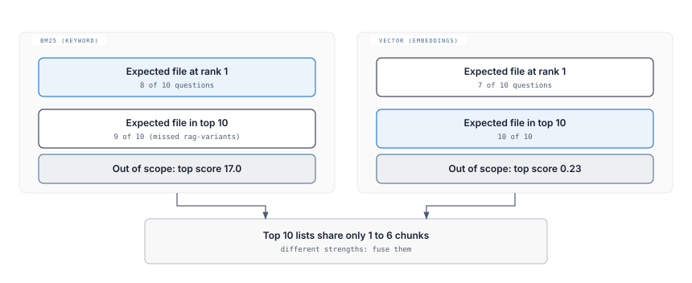
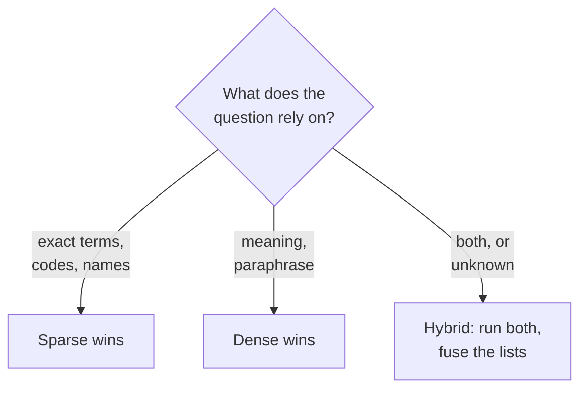

# 06. Sparse vs Dense: When Each Wins

In this note:

- Both retrievers on our 11 test questions, side by side
- How different their result lists are
- Which question types favour which retriever
- What happens with an out-of-scope question
- Why the answer is "both", and what fusion must handle

## Both retrievers on our test set

Each test question was searched as typed, over the same 410 chunks: BM25 with simple analysis (lower-case, small stop list, k1 = 1.2, b = 0.75) and the Advanced RAG vector search (text-embedding-3-small, FAISS). "First hit" is the rank of the first chunk from the expected file within the top 10.

<table width="100%">
<thead><tr><th>Question id</th><th>BM25 first hit</th><th>Vector first hit</th><th>Shared chunks in the two top 10s</th></tr></thead>
<tbody>
<tr><td>rag-variants</td><td>none in top 10</td><td>1</td><td>2</td></tr>
<tr><td>rag-components</td><td>1</td><td>3</td><td>1</td></tr>
<tr><td>rag-corpus</td><td>1</td><td>5</td><td>1</td></tr>
<tr><td>selfrag-reflection</td><td>1</td><td>1</td><td>5</td></tr>
<tr><td>selfrag-when</td><td>4</td><td>2</td><td>1</td></tr>
<tr><td>crag-evaluator</td><td>1</td><td>1</td><td>2</td></tr>
<tr><td>crag-incorrect</td><td>1</td><td>1</td><td>4</td></tr>
<tr><td>adaptive-routing</td><td>1</td><td>1</td><td>6</td></tr>
<tr><td>hr-sick-days</td><td>1</td><td>1</td><td>3</td></tr>
<tr><td>hr-new-joiner-leave</td><td>1</td><td>1</td><td>1</td></tr>
<tr><td>out-of-scope</td><td>-</td><td>-</td><td>3</td></tr>
</tbody>
</table>

<table width="100%">
<thead><tr><th>Summary (10 questions with an expected file)</th><th>BM25</th><th>Vector</th></tr></thead>
<tbody>
<tr><td>Expected file at rank 1</td><td>8</td><td>7</td></tr>
<tr><td>Expected file in top 10</td><td>9</td><td>10</td></tr>
</tbody>
</table>

- **BM25 is often sharper:** it puts the right file first for 8 questions, including rag-components (vector 3) and rag-corpus (vector 5), where the question's words are rare in other files.
- **Vector search is more robust:** it never misses the file entirely; BM25 missed rag-variants because citation words ("Lewis et al.") pulled in other papers' reference lists (fixed by text analysis in note 04, rank 2).
- **The lists are very different:** the two top 10s share only 1 to 6 chunks. Each retriever brings candidates the other does not.

These are file-level results from one simple configuration, a preview rather than the evaluation.

## Which questions favour which retriever

<table width="100%">
<thead><tr><th>Question type</th><th>Better retriever</th><th>Why</th><th>Example</th></tr></thead>
<tbody>
<tr><td>Exact identifiers (codes, versions, IDs)</td><td>Sparse</td><td>Rare tokens, exact match</td><td>"What is error E-4021?"</td></tr>
<tr><td>Rare names and acronyms</td><td>Sparse</td><td>High IDF</td><td>"What did Karpukhin propose?", "What is CRAG?"</td></tr>
<tr><td>Distinctive key words shared with the text</td><td>Sparse</td><td>Word overlap regardless of chunk topic</td><td>rag-corpus with the rewritten query</td></tr>
<tr><td>Paraphrased or conversational questions</td><td>Dense</td><td>Meaning over words</td><td>"How many days off for illness?"</td></tr>
<tr><td>Short, vague questions with common words</td><td>Dense</td><td>BM25 matches many chunks weakly</td><td>"how does it work?" (after rewriting both improve)</td></tr>
<tr><td>Questions using generic words also common in references or boilerplate</td><td>Dense</td><td>Sparse is distracted by frequent but not stop-listed words</td><td>rag-variants with basic analysis</td></tr>
<tr><td>Long, specific questions</td><td>Both</td><td>Enough words for BM25 and enough meaning for vectors</td><td>crag-incorrect, adaptive-routing</td></tr>
</tbody>
</table>

In practice you rarely know the question type in advance, which is the main argument for running both every time.

## The out-of-scope question

"Who won the FIFA World Cup in 2018?":

<table width="100%">
<thead><tr><th>Retriever</th><th>Top score</th><th>Why</th></tr></thead>
<tbody>
<tr><td>Vector</td><td>0.23 (low)</td><td>No chunk is close in meaning</td></tr>
<tr><td>BM25</td><td>17.0 (looks high)</td><td>Words such as "2018" and "world" appear in some chunks (for example "the December 2018 dump"); BM25 always finds some overlap</td></tr>
</tbody>
</table>

A BM25 score has no fixed scale: 17 is high for one query and low for another (the HR questions reached 45). BM25 never says "nothing relevant". In hybrid search, the Advanced RAG reranker and its not-found floor stay essential: they scored every candidate of this question 0 and sent nothing.

## Why "both", and what fusion must handle

<table width="100%">
<thead><tr><th>Fact</th><th>Consequence for fusion</th></tr></thead>
<tbody>
<tr><td>The lists overlap little</td><td>Fusion must take good chunks from either list, not only chunks in both</td></tr>
<tr><td>BM25 scores are unbounded and query-dependent (0 to 45 here); cosine similarities sit between about 0.1 and 0.8</td><td>Raw scores cannot be added; use ranks (RRF) or normalised scores (notes 08 to 10)</td></tr>
<tr><td>Each retriever is sometimes wrong at rank 1</td><td>A chunk ranked well by both should rise above one ranked first by only one</td></tr>
<tr><td>BM25 always returns something</td><td>The reranker and threshold, not fusion, decide whether anything is relevant</td></tr>
</tbody>
</table>

## Key points

- On our test set BM25 put the expected file first for 8 of 10 questions, vector search for 7; vector search found it within the top 10 for all 10, BM25 for 9.
- The two top 10 lists share only 1 to 6 chunks: the retrievers are complementary.
- Sparse wins on exact and rare terms; dense on paraphrases and vague questions; the type is rarely known in advance.
- BM25 scores have no fixed scale and never say "nothing relevant": fusion must use ranks or normalised scores, and the reranker keeps the final say.

## Navigation

Previous: [05. Dense Retrieval Strengths and Blind Spots](05.%20Dense%20Retrieval%20Strengths%20and%20Blind%20Spots.md) | [Basic Concepts](README.md) | Next: [07. Learned Sparse Retrieval (SPLADE)](07.%20Learned%20Sparse%20Retrieval%20SPLADE.md)
