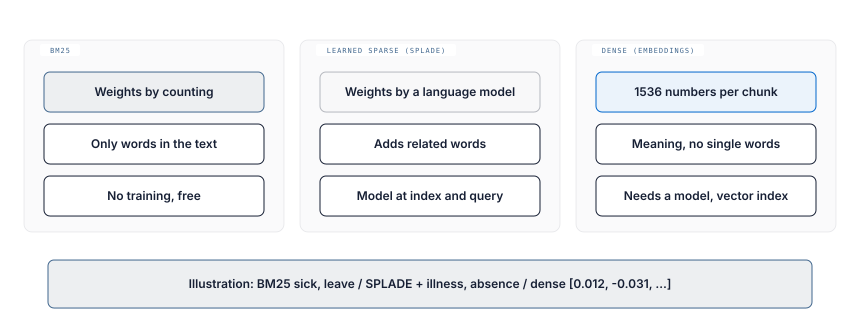
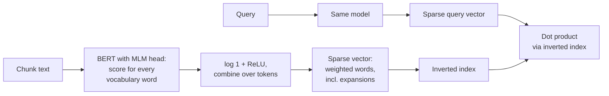

# 07. Learned Sparse Retrieval (SPLADE)

In this note:

- What "learned sparse" means
- How SPLADE builds a sparse vector with a language model
- Term weighting and term expansion, with an illustration
- Where it sits between BM25 and dense retrieval
- Learned sparse retrieval in practice (Elastic ELSER, used by Blended RAG)
- Why this project uses BM25 instead, for now

## What "learned sparse" means

BM25 vectors are sparse (one position per vocabulary word, mostly zeros) and their weights come from **counting** (term frequency, document frequency). A **learned sparse** model keeps the same shape, one position per vocabulary word, but a **neural model** decides the weights. Two things become possible:

- **Better weights:** a word that is central to the passage gets a high weight even if it appears once; a word that appears often but is incidental gets a low one.
- **Expansion:** the model can give a weight to words that are **not in the text** but are closely related, such as "illness" for a passage about "sick leave".

The result can still be searched with an inverted index, like BM25.

## How SPLADE works

SPLADE (Sparse Lexical and Expansion model; Formal, Piwowarski and Clinchant, SIGIR 2021) uses a BERT model with its masked-language-model head. For every input token, that head predicts a score for **every word in BERT's vocabulary** (about 30,000 word pieces): how well that word fits at this position.

For each vocabulary word j, SPLADE combines those predictions over the input tokens i:

$$w_j = \sum_{i \in \text{tokens}} \log\left(1 + \text{ReLU}(w_{ij})\right)$$

<table width="100%">
<thead><tr><th>Symbol (plain text)</th><th>Meaning</th></tr></thead>
<tbody>
<tr><td>w_ij</td><td>The model's score for vocabulary word j at input token i</td></tr>
<tr><td>ReLU</td><td>Keeps positive scores, sets negative ones to 0, so most words get exactly 0</td></tr>
<tr><td>log(1 + x)</td><td>Dampens large scores, like BM25's saturation</td></tr>
<tr><td>w_j</td><td>The final weight of word j for this passage or query (later versions take the maximum over tokens instead of the sum)</td></tr>
</tbody>
</table>

Training adds a **sparsity penalty** (the FLOPS regulariser), so the model learns to keep only a few dozen to a few hundred non-zero words per passage; otherwise the vectors would be dense and the inverted index useless.

## Illustration: weighting and expansion

For the chunk "Employees get 8 sick days per year", the three methods would represent it roughly like this (illustrative values, not computed):

<table width="100%">
<thead><tr><th>Method</th><th>Representation</th><th>Would match "days off for illness"?</th></tr></thead>
<tbody>
<tr><td>BM25</td><td>employees, get, 8, sick, days, year (weights from counts and IDF)</td><td>Partly: only "days"</td></tr>
<tr><td>Learned sparse</td><td>sick 2.1, days 1.6, leave 1.4, illness 0.9, absence 0.7, employees 0.8, ... (expanded)</td><td>Yes: "days" and the expansion "illness"</td></tr>
<tr><td>Dense</td><td>1536 numbers with no single meaning</td><td>Yes, by overall meaning (0.552 measured in note 05)</td></tr>
</tbody>
</table>

## Between BM25 and dense

<table width="100%">
<thead><tr><th></th><th>BM25</th><th>Learned sparse (SPLADE, ELSER)</th><th>Dense (embeddings)</th></tr></thead>
<tbody>
<tr><td>Exact terms and codes</td><td>Strong</td><td>Strong (keeps the original words)</td><td>Weak</td></tr>
<tr><td>Synonyms</td><td>None</td><td>Some, through expansion</td><td>Strong</td></tr>
<tr><td>Index</td><td>Inverted index</td><td>Inverted index</td><td>Vector index (FAISS)</td></tr>
<tr><td>Model needed</td><td>No</td><td>Yes, at indexing and at query time</td><td>Yes</td></tr>
<tr><td>Explainable</td><td>Yes: matched words</td><td>Yes: weighted words, including expansions</td><td>No</td></tr>
<tr><td>New domains without training</td><td>Robust</td><td>Good, depends on training data</td><td>Depends on the model</td></tr>
<tr><td>Cost per query</td><td>Free</td><td>One model pass</td><td>One embedding call</td></tr>
</tbody>
</table>

Learned sparse retrieval is sometimes used **instead of** BM25 in a hybrid system (learned sparse plus dense), or as a third retriever.

## In practice

- **Elastic ELSER** (Elastic Learned Sparse EncodeR) is a learned sparse model built into Elasticsearch. The Blended RAG paper uses three indexes: BM25 for keywords, a dense vector index (KNN), and ELSER for "sparse encoder based semantic search" (paper notes, coming next).
- SPLADE models are open source and run on CPU or GPU, but need PyTorch and a transformer model at both indexing and query time.

## Why this project uses BM25 for now

<table width="100%">
<thead><tr><th>Option</th><th>Fits the stack?</th><th>Decision</th></tr></thead>
<tbody>
<tr><td>BM25 written in Python</td><td>Yes: no new service, no model, free per query</td><td>Chosen for the API</td></tr>
<tr><td>SPLADE</td><td>No: needs PyTorch and a local model, which the stack rules exclude (the same reason a local cross-encoder was not used in Advanced RAG)</td><td>Not now</td></tr>
<tr><td>ELSER</td><td>No: needs an Elasticsearch deployment</td><td>Not now</td></tr>
</tbody>
</table>

The dense retriever already covers synonyms, which is the main gain of learned sparse over BM25. If the evaluation shows that BM25 plus dense still misses term-mismatch questions, learned sparse retrieval is the next candidate.

## Key points

- Learned sparse retrieval keeps BM25's shape (weighted words, inverted index) but a language model sets the weights and adds related words.
- SPLADE: BERT's masked-language-model scores, log(1 + ReLU), combined over tokens, trained with a sparsity penalty.
- It sits between BM25 and dense: exact terms plus some synonyms, still explainable.
- Blended RAG uses Elastic ELSER as its learned sparse index; this project uses BM25 because SPLADE and ELSER need a model or a service outside the stack.

## Navigation

Previous: [06. Sparse vs Dense: When Each Wins](06.%20Sparse%20vs%20Dense%20When%20Each%20Wins.md) | [Basic Concepts](README.md) | Next: [08. Why Retrieval Scores Cannot Be Added Directly](08.%20Why%20Retrieval%20Scores%20Cannot%20Be%20Added%20Directly.md)
