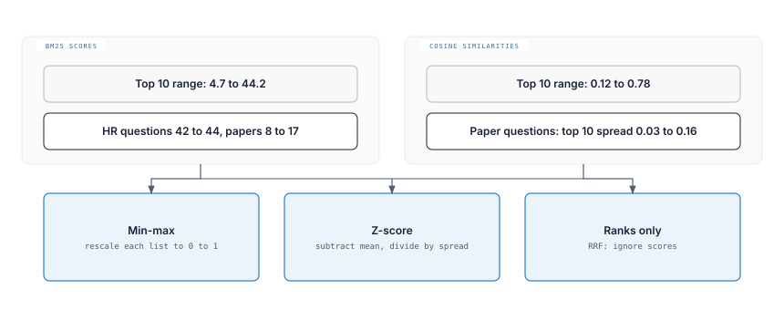
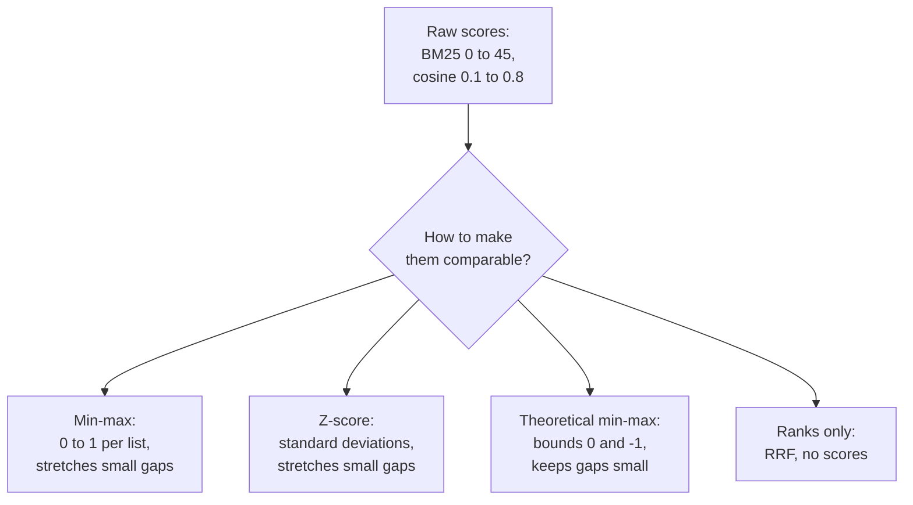

# 08. Why Retrieval Scores Cannot Be Added Directly

In this note:

- The two score scales, measured on our test set
- What goes wrong when raw scores are added
- Three normalisations: min-max, z-score, theoretical min-max, with real numbers
- The missing-score problem
- Why ranks are an alternative (RRF, note 09)

## Two scales

BM25 and cosine similarity measure different things on different scales. Over the 11 test questions, using the top 10 of each retriever:

<table width="100%">
<thead><tr><th></th><th>BM25 score</th><th>Cosine similarity</th></tr></thead>
<tbody>
<tr><td>Theoretical range</td><td>0 to unbounded (grows with query length and rare words)</td><td>-1 to 1</td></tr>
<tr><td>Observed top 10 range</td><td>4.7 to 44.2</td><td>0.12 to 0.78</td></tr>
<tr><td>Best score, paper questions</td><td>8.4 to 16.8</td><td>0.54 to 0.78</td></tr>
<tr><td>Best score, HR questions</td><td>42.8 and 44.2</td><td>0.57 and 0.66</td></tr>
<tr><td>Best score, out-of-scope question</td><td>16.9</td><td>0.23</td></tr>
<tr><td>Spread of the top 10, paper questions</td><td>About 1.5 to 7.8</td><td>About 0.03 to 0.16</td></tr>
</tbody>
</table>

Two facts stand out: BM25's scale **changes from query to query** (16.9 is the best score for the unanswerable question and also a typical best score for a paper question), and cosine similarities are **packed close together**.

## What goes wrong with raw scores

Take a chunk that BM25 ranks first (11.16) and a chunk that vector search ranks first (0.537) for "Which retriever and generator does the original RAG model combine?". Adding raw scores:

- BM25 hit: 11.16 + (its cosine, at most 1) = about 11 to 12
- Vector hit: (its BM25, maybe 0) + 0.537 = about 0.5

The vector score is invisible next to BM25; "hybrid" search becomes BM25 search. Multiplying the vector score by a constant (say 20) does not fix it, because BM25's scale changes per query.

## Three normalisations

Using the real top 10 lists of that question (BM25 11.16 down to 7.87, cosine 0.537 down to 0.509):

### Min-max

$$\text{norm}(s) = \frac{s - \min}{\max - \min}$$

<table width="100%">
<thead><tr><th>Rank</th><th>1</th><th>2</th><th>3</th><th>5</th><th>7</th><th>10</th></tr></thead>
<tbody>
<tr><td>BM25 min-max</td><td>1.00</td><td>0.68</td><td>0.49</td><td>0.22</td><td>0.19</td><td>0.00</td></tr>
<tr><td>Cosine min-max</td><td>1.00</td><td>0.96</td><td>0.93</td><td>0.82</td><td>0.25</td><td>0.00</td></tr>
</tbody>
</table>

Both lists now run from 0 to 1. But the cosine differences were tiny (0.537 to 0.509, a spread of 0.028): min-max **stretches noise** into a full 0 to 1 range, so the vector rank-7 chunk drops to 0.25 although its similarity is almost the same as rank 1. The result also depends on how many results are normalised: with top 20 instead of top 10, the minimum changes and every value moves.

### Z-score

$$\text{norm}(s) = \frac{s - \mu}{\sigma}$$

where mu and sigma are the mean and standard deviation of the list's scores.

<table width="100%">
<thead><tr><th>Rank</th><th>1</th><th>2</th><th>3</th><th>5</th><th>7</th><th>10</th></tr></thead>
<tbody>
<tr><td>BM25 z-score (mean 8.93, sd 1.01)</td><td>2.21</td><td>1.16</td><td>0.56</td><td>-0.34</td><td>-0.44</td><td>-1.05</td></tr>
<tr><td>Cosine z-score (mean 0.525, sd 0.011)</td><td>1.13</td><td>1.04</td><td>0.95</td><td>0.67</td><td>-0.82</td><td>-1.47</td></tr>
</tbody>
</table>

Z-scores have no fixed range but put both lists on "how many standard deviations above average". With a very small sigma (0.011 here), tiny cosine differences again become large.

### Theoretical min-max

The fusion paper (Bruch et al.) also normalises with the **theoretical** lower bound instead of the observed minimum: 0 for BM25, -1 for cosine similarity:

$$\text{norm}(s) = \frac{s - \inf}{\max - \inf}$$

<table width="100%">
<thead><tr><th>Rank</th><th>1</th><th>2</th><th>3</th><th>5</th><th>7</th><th>10</th></tr></thead>
<tbody>
<tr><td>BM25 (inf = 0)</td><td>1.000</td><td>0.905</td><td>0.850</td><td>0.770</td><td>0.761</td><td>0.705</td></tr>
<tr><td>Cosine (inf = -1)</td><td>1.000</td><td>0.999</td><td>0.999</td><td>0.997</td><td>0.986</td><td>0.982</td></tr>
</tbody>
</table>

This keeps small cosine differences small. It does not depend on how many results are taken. The trade-off moves into the weight: since cosine values barely differ after normalisation, the BM25 part decides the order unless the weight alpha favours the vector side (note 10).

<table width="100%">
<thead><tr><th>Method</th><th>Strength</th><th>Weakness</th></tr></thead>
<tbody>
<tr><td>Min-max (observed)</td><td>Simple, range 0 to 1</td><td>Depends on the list length and its extremes; stretches noise</td></tr>
<tr><td>Z-score</td><td>Uses the whole distribution</td><td>Unbounded; unstable with few or very similar scores</td></tr>
<tr><td>Theoretical min-max</td><td>Stable, keeps real gaps</td><td>Needs known bounds; BM25's upper bound still varies per query</td></tr>
<tr><td>Ranks (RRF)</td><td>No normalisation needed, robust</td><td>Throws away how much better rank 1 is than rank 2</td></tr>
</tbody>
</table>

## The missing-score problem

The two top 10 lists for this question share **no chunk at all**. A BM25 hit has no cosine score in the vector top 10, and a vector hit has no BM25 score in the BM25 top 10. Options:

- **Treat missing as the minimum (0 after normalisation).** Simple, but punishes a chunk for being rank 11 in the other list.
- **Compute the missing score.** Cosine similarity for a BM25 hit is a dot product with stored vectors; BM25 for a vector hit is a lookup. Exact, slightly more work.
- **Use ranks** and give missing ranks no contribution (RRF).

RRF simply ignores the missing list; how the fusion paper handles it is covered in its paper notes.

## Key points

- BM25 scores (0 to 45 here, scale changing per query) and cosine similarities (0.1 to 0.8, tightly packed) cannot be added raw: BM25 would decide everything.
- Min-max and z-score make them comparable but stretch tiny cosine differences; theoretical min-max (bounds 0 and -1) keeps real gaps.
- A chunk often appears in only one list; its missing score must be treated as minimum, computed, or ignored via ranks.
- Ranks avoid all of this: Reciprocal Rank Fusion, next.

## Navigation

Previous: [07. Learned Sparse Retrieval (SPLADE)](07.%20Learned%20Sparse%20Retrieval%20SPLADE.md) | [Basic Concepts](README.md) | Next: [09. Reciprocal Rank Fusion](09.%20Reciprocal%20Rank%20Fusion.md)
