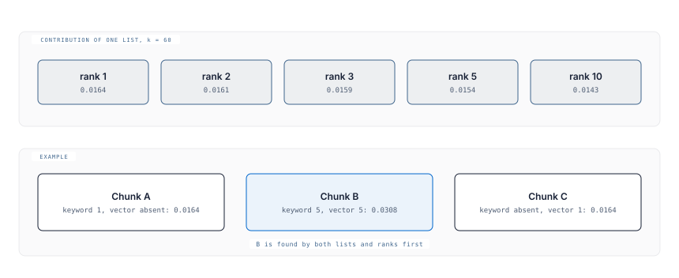
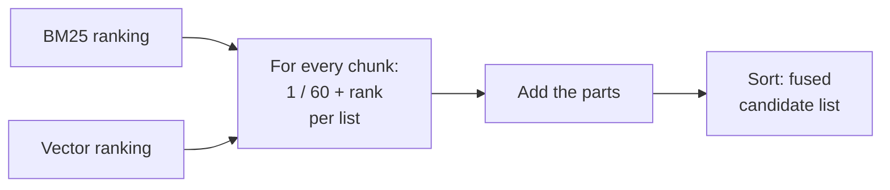

# 09. Reciprocal Rank Fusion

In this note:

- The RRF formula, from the 2009 paper
- Why the constant k = 60
- A worked example with three chunks
- RRF on a real question: the rag-corpus answer chunk enters the candidates
- What k changes, measured
- Strengths, weaknesses and when the lists do not overlap

## The formula

Reciprocal Rank Fusion (Cormack, Clarke and Buettcher, SIGIR 2009) merges several rankings using only the **positions** of each document:

> "Given a set D of documents to be ranked and a set of rankings R, each a permutation on 1..|D|, we compute RRFscore(d) = sum over r in R of 1 / (k + r(d)), where k = 60 was fixed during a pilot investigation and not altered during subsequent validation."

$$\text{RRF}(d) = \sum_{r \in R} \frac{1}{k + r(d)}$$

<table width="100%">
<thead><tr><th>Symbol (plain text)</th><th>Meaning</th><th>In hybrid search</th></tr></thead>
<tbody>
<tr><td>d</td><td>A document (chunk)</td><td>One chunk</td></tr>
<tr><td>R</td><td>The rankings to fuse</td><td>Two: the BM25 ranking and the vector ranking</td></tr>
<tr><td>r(d)</td><td>The position of d in ranking r, starting at 1</td><td>BM25 rank, vector rank</td></tr>
<tr><td>k</td><td>A constant that softens the advantage of top positions</td><td>60</td></tr>
</tbody>
</table>

A chunk missing from a ranking adds nothing for that ranking. Scores are never used, so the scale problems of note 08 disappear.

## Why k = 60

With k = 60 one list contributes:

<table width="100%">
<thead><tr><th>Rank</th><th>1</th><th>2</th><th>3</th><th>5</th><th>10</th><th>20</th></tr></thead>
<tbody>
<tr><td>1 / (60 + rank)</td><td>0.0164</td><td>0.0161</td><td>0.0159</td><td>0.0154</td><td>0.0143</td><td>0.0125</td></tr>
</tbody>
</table>

The difference between rank 1 and rank 10 is small (0.0164 against 0.0143). So a chunk found by **both** lists, even in middle positions, beats a chunk that is first in only one list. The paper's intuition: "while highly-ranked documents are more important, the importance of lower-ranked documents does not vanish as it would were, say, an exponential function used." The value 60 was chosen in a pilot study and then kept fixed.

## Worked example

<table width="100%">
<thead><tr><th>Chunk</th><th>BM25 rank</th><th>Vector rank</th><th>RRF score</th><th>Fused rank</th></tr></thead>
<tbody>
<tr><td>A</td><td>1</td><td>-</td><td>1/61 = 0.0164</td><td>2</td></tr>
<tr><td>B</td><td>5</td><td>5</td><td>1/65 + 1/65 = 0.0308</td><td>1</td></tr>
<tr><td>C</td><td>-</td><td>1</td><td>1/61 = 0.0164</td><td>2 (tie with A)</td></tr>
</tbody>
</table>

B is never first in either list but is the only chunk both retrievers agree on, so it comes first. A and C tie; a tie-break rule is needed (for example the better single rank, then the vector score).

## RRF on a real question

rag-corpus with the Advanced RAG rewritten query ("Retrieval-Augmented Generation RAG document collection source"), top 10 from each retriever over our 410 chunks (BM25 without stemming, "et" and "al" as stop words):

<table width="100%">
<thead><tr><th>Fused rank</th><th>Chunk</th><th>BM25 rank</th><th>Vector rank</th><th>RRF (k = 60)</th></tr></thead>
<tbody>
<tr><td>1</td><td>RAG paper, page 2</td><td>5</td><td>4</td><td>0.0310</td></tr>
<tr><td>2</td><td>Corrective RAG, page 2</td><td>-</td><td>1</td><td>0.0164</td></tr>
<tr><td>3</td><td>Corrective RAG, page 2</td><td>1</td><td>-</td><td>0.0164</td></tr>
<tr><td>4</td><td>Self-RAG, page 2</td><td>2</td><td>-</td><td>0.0161</td></tr>
<tr><td>5</td><td>Corrective RAG, page 1</td><td>-</td><td>2</td><td>0.0161</td></tr>
<tr><td>6</td><td>Adaptive-RAG, page 9</td><td>3</td><td>-</td><td>0.0159</td></tr>
<tr><td>7</td><td>Corrective RAG, page 2</td><td>-</td><td>3</td><td>0.0159</td></tr>
<tr><td>8</td><td><strong>RAG paper, page 4 (the answer: "a single Wikipedia dump")</strong></td><td>4</td><td>-</td><td>0.0156</td></tr>
<tr><td>9</td><td>Corrective RAG, page 3</td><td>-</td><td>5</td><td>0.0154</td></tr>
<tr><td>10</td><td>Corrective RAG, page 3</td><td>-</td><td>6</td><td>0.0152</td></tr>
</tbody>
</table>

- The answer chunk, absent from the vector top 100, enters the fused top 10 at rank 8 through BM25. In Advanced RAG it never reached the reranker; with hybrid search it does.
- The only chunk both lists found (RAG paper page 2) comes first.
- The two lists overlap in only 1 chunk, so the fused list mostly **alternates** between them: vector 1, BM25 1, BM25 2, vector 2, and so on.

## What k changes

Same question with k = 1 instead of 60:

<table width="100%">
<thead><tr><th>Chunk</th><th>Fused rank, k = 60</th><th>Fused rank, k = 1</th></tr></thead>
<tbody>
<tr><td>RAG paper page 2 (both lists: 5 and 4)</td><td>1</td><td>3</td></tr>
<tr><td>Corrective RAG page 2 (vector 1 only)</td><td>2</td><td>1</td></tr>
<tr><td>Corrective RAG page 2 (BM25 1 only)</td><td>3</td><td>2</td></tr>
<tr><td>Answer chunk (BM25 4 only)</td><td>8</td><td>8</td></tr>
</tbody>
</table>

With a small k, rank 1 is worth much more (1/2 against 1/5 for rank 4), so "first in one list" beats "found by both". A large k rewards agreement. The fusion paper (Bruch et al.) reports that RRF is in fact sensitive to k, contrary to the common view that it needs no tuning (paper notes, coming next).

## Strengths and weaknesses

<table width="100%">
<thead><tr><th>Strengths</th><th>Weaknesses</th></tr></thead>
<tbody>
<tr><td>No score normalisation: works with any retrievers</td><td>Ignores how much better one result is: a clear BM25 winner and a narrow one get the same credit</td></tr>
<tr><td>No training data needed</td><td>k still matters, and the default 60 is a convention, not a law</td></tr>
<tr><td>Robust: the 2009 paper found it beat each input ranking and Condorcet Fuse on TREC data</td><td>With little overlap it becomes simple interleaving</td></tr>
<tr><td>Simple to explain and implement (a few lines)</td><td>Ties are common and need a tie-break rule</td></tr>
<tr><td>Easy to add a third list (a second query, learned sparse retrieval)</td><td>Cannot express "trust the vector retriever more" except with weights per list</td></tr>
</tbody>
</table>

A common extension is **weighted RRF**: multiply each list's contribution by a weight. The next note covers weighted fusion of normalised scores, the main alternative.

## Key points

- RRF score = sum over the lists of 1 / (60 + rank); scores are ignored, so no normalisation is needed.
- With k = 60, agreement between lists beats a single first place; with small k, first places dominate.
- Real example: the rag-corpus answer chunk, invisible to vector search, reaches fused rank 8 through BM25 and becomes a reranker candidate.
- With little overlap RRF interleaves the lists; ties need a rule; k is a real parameter.

## Navigation

Previous: [08. Why Retrieval Scores Cannot Be Added Directly](08.%20Why%20Retrieval%20Scores%20Cannot%20Be%20Added%20Directly.md) | [Basic Concepts](README.md) | Next: [10. Weighted Score Fusion and Alpha Tuning](10.%20Weighted%20Score%20Fusion%20and%20Alpha%20Tuning.md)
