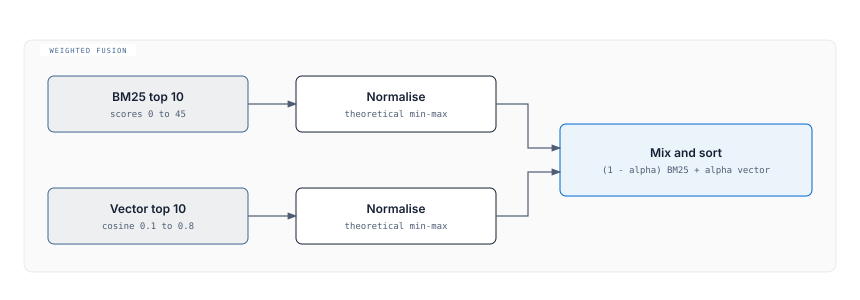
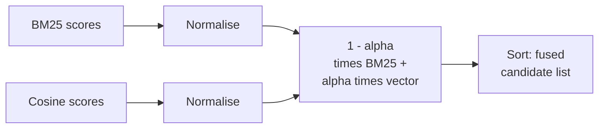
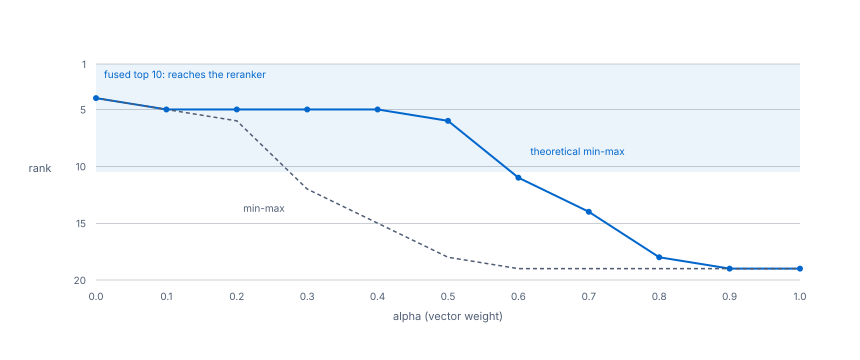

# 10. Weighted Score Fusion and Alpha Tuning

In this note:

- The weighted fusion formula (a convex combination)
- What alpha means and which side it favours
- An alpha sweep on our test set, with two normalisations
- Why the file-level numbers barely move and the answer chunk does
- How to choose alpha, and when to prefer RRF

## The formula

Weighted fusion normalises each retriever's scores (note 08) and mixes them with one weight:

$$\text{score}(d) = \alpha \cdot \text{norm}_{\text{vector}}(d) + (1 - \alpha) \cdot \text{norm}_{\text{BM25}}(d)$$

<table width="100%">
<thead><tr><th>Symbol (plain text)</th><th>Meaning</th></tr></thead>
<tbody>
<tr><td>alpha</td><td>Weight of the vector side, between 0 and 1</td></tr>
<tr><td>norm_vector(d)</td><td>Normalised cosine similarity of chunk d</td></tr>
<tr><td>norm_BM25(d)</td><td>Normalised BM25 score of chunk d</td></tr>
<tr><td>alpha = 0</td><td>Pure keyword search</td></tr>
<tr><td>alpha = 1</td><td>Pure vector search</td></tr>
</tbody>
</table>

The two weights always add up to 1, so the combined score stays on the same scale for any alpha. The fusion paper (Bruch et al.) calls this a **convex combination** and compares it with RRF (paper notes, coming next).

Unlike RRF, weighted fusion keeps **how much** better one chunk is than another. A clear BM25 winner (score 16 against 8) gets more credit than a narrow one (9 against 8).

## Candidates and missing scores

The candidates are the union of the two top 10 lists (up to 20 chunks). For every candidate both scores are computed exactly: the cosine similarity of a BM25 hit is one dot product with its stored vector, and the BM25 score of a vector hit is a lookup in the inverted index. So no chunk is punished for missing from one list (the problem raised in note 08).

## Alpha sweep on our test set

Setup: the 10 answerable test questions, the 410 chunks of the Advanced RAG index, BM25 as in note 04 (no stemming, "et" and "al" as stop words), top 10 from each retriever, all scores computed for the union. Two measures:

- **File MRR:** 1 / rank of the first chunk from the expected file in the fused top 10, averaged over the 10 questions (1.0 = always first).
- **Answer chunk rank:** where the rag-corpus answer chunk ("a single Wikipedia dump", RAG paper page 4) lands for the rewritten query. It is absent from the vector top 100 and rank 4 in BM25.

<table width="100%">
<thead><tr><th>alpha (vector weight)</th><th>File MRR, theoretical min-max</th><th>Answer chunk rank, theoretical min-max</th><th>File MRR, min-max</th><th>Answer chunk rank, min-max</th></tr></thead>
<tbody>
<tr><td>0.0 (BM25 only)</td><td>0.875</td><td>4</td><td>0.875</td><td>4</td></tr>
<tr><td>0.1</td><td>0.875</td><td>5</td><td>0.858</td><td>5</td></tr>
<tr><td>0.2</td><td>0.875</td><td>5</td><td>0.798</td><td>6</td></tr>
<tr><td>0.3</td><td>0.858</td><td>5</td><td>0.798</td><td>12</td></tr>
<tr><td>0.4</td><td>0.808</td><td>5</td><td>0.817</td><td>15</td></tr>
<tr><td>0.5</td><td>0.808</td><td>6</td><td>0.767</td><td>18</td></tr>
<tr><td>0.6</td><td>0.798</td><td>11</td><td>0.800</td><td>19</td></tr>
<tr><td>0.7</td><td>0.796</td><td>14</td><td>0.833</td><td>19</td></tr>
<tr><td>0.8</td><td>0.817</td><td>18</td><td>0.833</td><td>19</td></tr>
<tr><td>0.9</td><td>0.783</td><td>19</td><td>0.817</td><td>19</td></tr>
<tr><td>1.0 (vector only)</td><td>0.803</td><td>19</td><td>0.803</td><td>19</td></tr>
</tbody>
</table>

For comparison on the same questions: vector top 10 alone has file MRR 0.803 and no answer chunk; BM25 alone 0.875 and rank 4; RRF (k = 60) 0.833 and rank 8 (note 09).

## What the sweep shows

- **The answer chunk survives much longer with theoretical min-max.** It stays in the fused top 10 up to alpha 0.5. With observed min-max it drops out at alpha 0.3. Reason (note 08): min-max stretches the tiny cosine differences of the 20 candidates to a full 0 to 1 range, so the vector side's opinion, which does not include this chunk, becomes loud quickly.
- **At alpha 1.0 the chunk ranks 19**, not "absent": it is in the candidate union through BM25, but pure vector ordering puts it near the bottom.
- **File-level numbers barely move.** Every setting finds the expected file in the top 10 for all 10 questions, and file MRR stays between 0.77 and 0.88. Our questions name their topic clearly, so both retrievers find the right paper. File-level scoring is too coarse to choose alpha; the next step (the API evaluation) adds chunk-level checks.
- **Per question, the best alpha differs.** rag-variants is best at alpha 1.0 (first chunk of the RAG paper at rank 1, against rank 2 at alpha 0). rag-corpus and rag-components are best at low alpha. A single alpha is a compromise.

## How to choose alpha

<table width="100%">
<thead><tr><th>Approach</th><th>How</th><th>When</th></tr></thead>
<tbody>
<tr><td>Start at 0.5 with theoretical min-max</td><td>Equal weight; the normalisation keeps gaps honest</td><td>No labelled data yet</td></tr>
<tr><td>Sweep alpha on a labelled set</td><td>Run the evaluation for alpha 0, 0.1, ..., 1 and pick the best chunk-level score</td><td>A test set with known answer chunks exists</td></tr>
<tr><td>Lean towards keywords (lower alpha)</td><td>For corpora of codes, names, IDs, legal text</td><td>Questions copy exact terms</td></tr>
<tr><td>Lean towards vectors (higher alpha)</td><td>For conversational questions, paraphrases</td><td>Users rarely use the document's words</td></tr>
<tr><td>Use RRF instead</td><td>No normalisation, no alpha</td><td>No labelled data and no wish to tune</td></tr>
</tbody>
</table>

The fusion paper's abstract states that a convex combination "outperforms RRF in in-domain and out-of-domain settings", that it is "sample efficient, requiring only a small set of training examples to tune its only parameter", and that learning it "is generally agnostic to the choice of score normalization". That last point fits our sweep: the two normalisations reach similar results, but at **different** alphas (rank 5 to 6 needs alpha 0.5 or less with theoretical min-max, 0.2 or less with min-max). The normalisation matters for a fixed, untuned alpha. Without labels, RRF is the safer default. This project starts with RRF and keeps weighted fusion (theoretical min-max, alpha 0.5) as a setting, so the evaluation can compare both.

## Weighted fusion vs RRF

<table width="100%">
<thead><tr><th></th><th>Weighted fusion</th><th>RRF</th></tr></thead>
<tbody>
<tr><td>Uses</td><td>Normalised scores</td><td>Ranks only</td></tr>
<tr><td>Parameters</td><td>alpha, normalisation method</td><td>k (60)</td></tr>
<tr><td>Keeps score margins</td><td>Yes</td><td>No</td></tr>
<tr><td>Needs labelled data to tune</td><td>Helps a lot</td><td>Works without</td></tr>
<tr><td>Missing scores</td><td>Must be computed or set to 0</td><td>Ignored</td></tr>
<tr><td>On our rag-corpus example</td><td>Rank 4 to 6 for alpha 0 to 0.5 (theoretical min-max)</td><td>Rank 8</td></tr>
</tbody>
</table>

These numbers come from a simple measurement script, not the final implementation, and one answer chunk is a small sample. They show the mechanism; the API evaluation measures it on all questions.

## Key points

- Weighted fusion: alpha times normalised vector score plus (1 - alpha) times normalised BM25 score.
- Measured: with theoretical min-max the rag-corpus answer chunk stays in the top 10 up to alpha 0.5; with min-max only up to 0.2.
- File-level hit rate is 10 of 10 for every alpha: too coarse to tune alpha; chunk-level checks are needed.
- The best alpha differs per question; without labelled data RRF is the safer default, weighted fusion stays a setting.

## Navigation

Previous: [09. Reciprocal Rank Fusion](09.%20Reciprocal%20Rank%20Fusion.md) | [Basic Concepts](README.md) | Next: [11. Hybrid Search Plus Reranking](11.%20Hybrid%20Search%20Plus%20Reranking.md)
