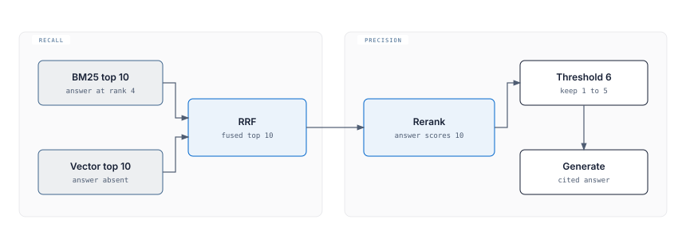
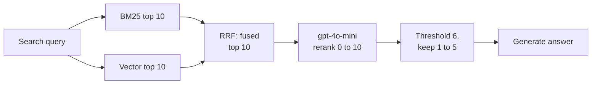

# 11. Hybrid Search Plus Reranking

In this note:

- Why fusion alone is not the end of the pipeline
- Division of work: fusion for recall, reranking for precision
- How many fused candidates to rerank
- Measured: vector candidates vs hybrid candidates through the same gpt-4o-mini reranker
- What got better, what got worse, and why

## Why rerank after fusion

Fusion decides **which chunks become candidates** and gives them an order. But both inputs to fusion are cheap, approximate signals: BM25 counts words, and vector search compares two vectors made separately for the question and the chunk. Neither reads the question and the chunk together.

The Advanced RAG reranker does: gpt-4o-mini reads the question and every candidate and gives each a score from 0 (unrelated) to 10 (answers the question). The threshold then keeps chunks scoring 6 or more (between 1 and 5 chunks). Hybrid Search RAG keeps this stage unchanged and only changes what goes into it.

## Division of work

<table width="100%">
<thead><tr><th>Stage</th><th>Job</th><th>Measure</th><th>Cost</th></tr></thead>
<tbody>
<tr><td>BM25 + vector search</td><td>Find chunks that might answer, in two different ways</td><td>Recall of each list</td><td>BM25 free, one embedding call</td></tr>
<tr><td>Fusion (RRF)</td><td>Merge into one short candidate list</td><td>Is the answer chunk in the candidates?</td><td>Free, milliseconds</td></tr>
<tr><td>Reranker</td><td>Read question and chunk together, score relevance</td><td>Are the best chunks on top?</td><td>One gpt-4o-mini call</td></tr>
<tr><td>Threshold</td><td>Keep only chunks scoring 6 or more (1 to 5 chunks)</td><td>Context precision</td><td>Free</td></tr>
</tbody>
</table>

With a reranker behind it, fusion only has to put the answer chunk **somewhere** in the candidates. Whether it lands at fused rank 4 or 8 matters little, because the reranker reorders everything. This is why the choice between RRF and weighted fusion (note 10) matters less in a pipeline with a reranker than in one without.

## How many fused candidates

<table width="100%">
<thead><tr><th>Option</th><th>Reranker input</th><th>Trade-off</th></tr></thead>
<tbody>
<tr><td>Fused top 10</td><td>10 chunks, as in Advanced RAG</td><td>Same rerank cost and time as Advanced RAG; fusion must place the answer chunk in the top 10</td></tr>
<tr><td>Whole union (up to 20)</td><td>Up to 20 chunks</td><td>Nothing lost by fusion, but about twice the rerank input tokens and slower</td></tr>
<tr><td>Fused top 15</td><td>15 chunks</td><td>A middle ground</td></tr>
</tbody>
</table>

This project starts with the fused top 10, so cost per question stays at the Advanced RAG level (a target in the Hybrid README). The number becomes a setting the evaluation can test.

## Measured: vector candidates vs hybrid candidates

Setup: the same 410 chunks, the Advanced RAG reranker and selection (gpt-4o-mini, threshold 6, keep 1 to 5, not-found floor 2). Candidates are either the vector top 10 (Advanced RAG) or the RRF fused top 10 (BM25 as in note 04, k = 60). The question as asked is used for search and for reranking, plus one extra row with the rewritten rag-corpus query used for search. The table shows the second of two runs; the differences between runs are discussed below.

<table width="100%">
<thead><tr><th>Question</th><th>Vector: kept (from expected file)</th><th>Hybrid: kept (from expected file)</th><th>Best rerank score, vector / hybrid</th></tr></thead>
<tbody>
<tr><td>rag-variants</td><td>3 (3)</td><td>2 (2)</td><td>9 / 9</td></tr>
<tr><td>rag-components</td><td>2 (2)</td><td>3 (3)</td><td>7 / 10</td></tr>
<tr><td>rag-corpus</td><td>1 (1)</td><td>5 (1)</td><td>6 / 7</td></tr>
<tr><td>rag-corpus, rewritten query</td><td>3 (1)</td><td><strong>4 (2), includes the answer chunk, score 10</strong></td><td>9 / 10</td></tr>
<tr><td>selfrag-reflection</td><td>5 (5)</td><td>5 (5)</td><td>10 / 10</td></tr>
<tr><td>selfrag-when</td><td>5 (5)</td><td>2 (2)</td><td>10 / 10</td></tr>
<tr><td>crag-evaluator</td><td>5 (5)</td><td>5 (5)</td><td>10 / 10</td></tr>
<tr><td>crag-incorrect</td><td>5 (5)</td><td>5 (5)</td><td>10 / 10</td></tr>
<tr><td>adaptive-routing</td><td>5 (5)</td><td>5 (5)</td><td>10 / 10</td></tr>
<tr><td>hr-sick-days</td><td>1 (1)</td><td>1 (1)</td><td>10 / 10</td></tr>
<tr><td>hr-new-joiner-leave</td><td>1 (1)</td><td>1 (1)</td><td>10 / 10</td></tr>
</tbody>
</table>

## What the numbers show

- **The headline case works end to end.** With the rewritten rag-corpus query, the answer chunk ("a single Wikipedia dump") reaches the reranker only through BM25 (BM25 rank 4, not in the vector list), and the reranker gives it **10 out of 10** in both runs. It is kept for the generator. With vector candidates it never reaches the reranker.
- **rag-components improves.** All three kept chunks (RAG paper pages 2 and 3) come only from the BM25 list, which matched the exact words "retriever" and "generator". The best score rises from 7 to 10.
- **The raw rag-corpus question is unchanged.** Without rewriting, the answer chunk ranks 33 in BM25 and is not among the hybrid candidates. Hybrid search helps most when the search query contains the right words; query rewriting (from Advanced RAG) and keyword search work together.
- **Six questions are identical.** Where vector search was already right, hybrid search did not hurt.

### Two side effects

**Fewer kept chunks for two questions** (rag-variants 3 to 2, selfrag-when 5 to 2). There are two causes:

- **Displacement:** with only 10 slots, keyword candidates take the place of some vector candidates. rag-variants lost chunk 46 (vector score 6) and selfrag-when lost chunk 174 (score 9) this way.
- **Scores depend on the other candidates.** The reranker scores all 10 candidates in one call, so a chunk's score is partly relative to its neighbours. The same selfrag-when chunks scored 7 and 6 among vector candidates but 2 and 1 among hybrid candidates; for rag-components one chunk fell from 7 to 3. For the raw rag-corpus question it went the other way: four Corrective RAG chunks rose from 2 or 3 to 7 and were kept, which lowers precision.

**Run-to-run variation.** At temperature 0 the reranker still varies: between the two runs, rag-components (vector) kept 1 then 2 chunks, and rag-corpus rewritten (vector) kept 4 then 3. The answer chunk score (10) and every best score stayed the same.

The lesson for the API: the rerank threshold of 6 is not an absolute bar; it moves with the candidate set. Ways to reduce the side effects, for the evaluation to test: rerank the fused top 15 instead of 10, give the vector list more weight in fusion, and judge settings on several runs, not one.

## Key points

- Fusion is for recall (get the answer chunk into the candidates); the reranker is for precision (put it on top).
- With a reranker, the exact fused rank matters little as long as the answer chunk is in the candidates.
- Fused top 10 keeps the Advanced RAG rerank cost; the candidate count is a setting.
- Measured: the rag-corpus answer chunk, found only by BM25, gets rerank score 10 and is kept; rag-components improves; six questions are unchanged.
- Side effects: two questions keep fewer chunks, because keyword candidates displace vector candidates and because listwise rerank scores depend on the other candidates.

## Navigation

Previous: [10. Weighted Score Fusion and Alpha Tuning](10.%20Weighted%20Score%20Fusion%20and%20Alpha%20Tuning.md) | [Basic Concepts](README.md) | Next: [12. Hybrid Search RAG Architecture End to End](12.%20Hybrid%20Search%20RAG%20Architecture%20End%20to%20End.md)
