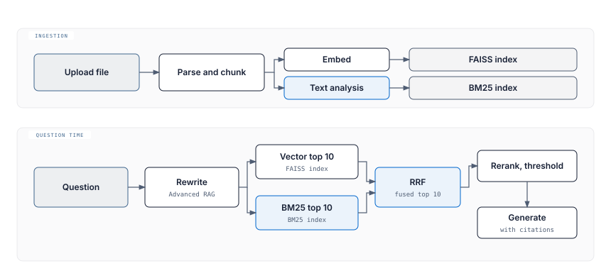
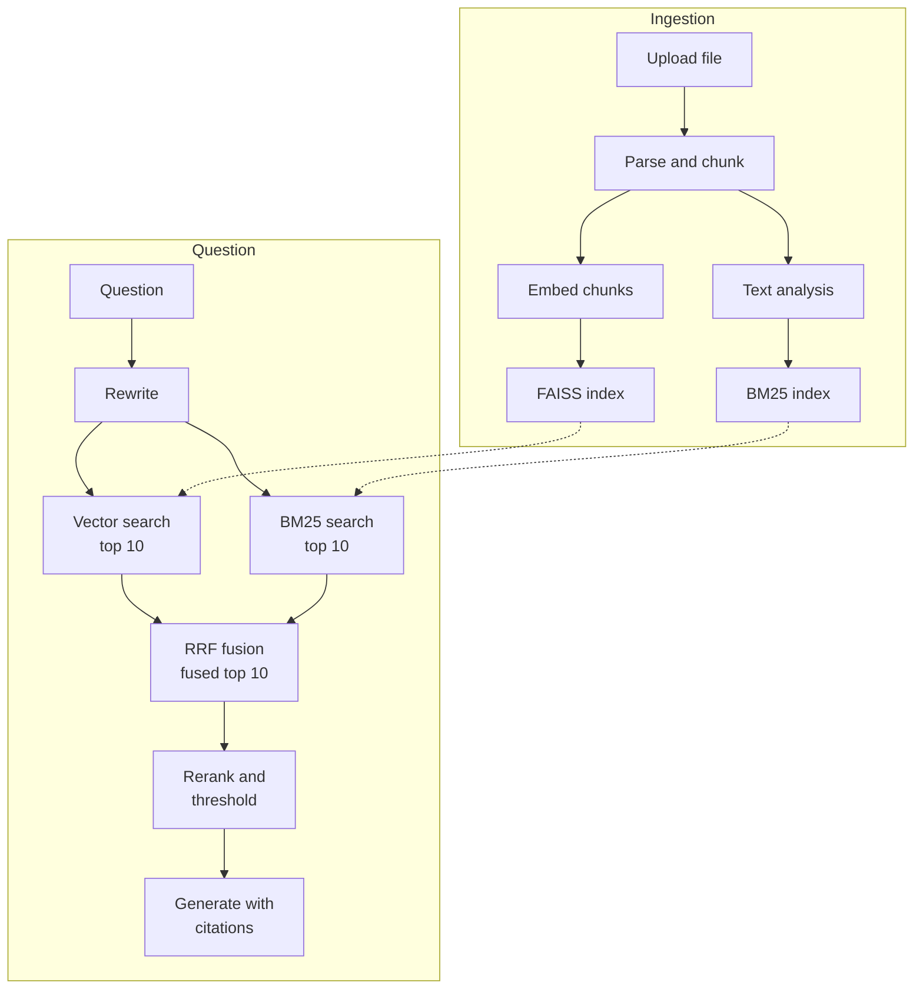
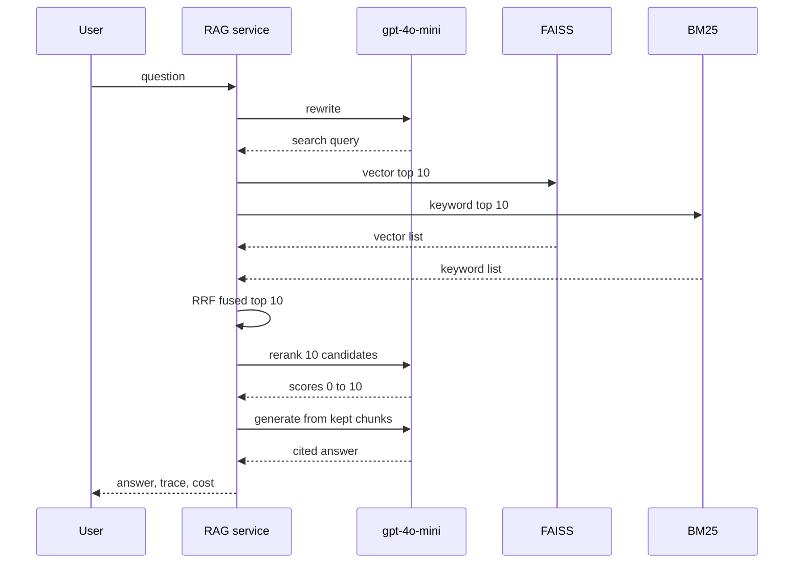

# 12. Hybrid Search RAG Architecture End to End

In this note:

- The full architecture, ingestion and question time
- What is new and what is reused from Advanced RAG
- Ingestion: one set of chunks, two indexes
- Question time, step by step, with the decisions from notes 01 to 11
- Settings, trace and failure behaviour
- How it maps to the API build steps

## The architecture

Hybrid Search RAG is Advanced RAG with a second retriever and a fusion step in front of the reranker. Everything after the candidate list (reranker, threshold, compression, generation, citations) stays the same.

## New and reused

<table width="100%">
<thead><tr><th>Part</th><th>Status</th><th>Note</th></tr></thead>
<tbody>
<tr><td>Parsing, chunking, embeddings, FAISS</td><td>Reused from Naive and Advanced RAG</td><td>Same chunks feed both indexes</td></tr>
<tr><td>Query rewriting</td><td>Reused from Advanced RAG</td><td>Its keyword-rich search query also helps BM25 (note 11)</td></tr>
<tr><td>Text analysis</td><td>New</td><td>Note 04: lower-case, split, keep codes whole, stop words incl. "et" and "al", no stemming by default</td></tr>
<tr><td>BM25 index</td><td>New</td><td>Note 03: inverted index, k1 = 1.2, b = 0.75</td></tr>
<tr><td>Keyword retrieval</td><td>New</td><td>Top 10 by BM25 score</td></tr>
<tr><td>Fusion</td><td>New</td><td>RRF k = 60 by default (note 09); weighted fusion as a setting (note 10)</td></tr>
<tr><td>Reranker, threshold, compression, generation</td><td>Reused from Advanced RAG</td><td>Input is now the fused top 10</td></tr>
<tr><td>Trace and per-stage cost</td><td>Extended</td><td>Shows both lists and the fused order</td></tr>
<tr><td>Evaluation</td><td>Extended</td><td>Chunk-level hit rate, presets vector, keyword, hybrid</td></tr>
</tbody>
</table>

## Ingestion: one set of chunks, two indexes

1. **Parse and chunk** the file exactly as before. Each chunk gets an id, its text and metadata (source, page).
2. **Embed** every chunk and add the vectors to FAISS (unchanged).
3. **Analyse** every chunk's text into terms and add them to the BM25 index: per term, the chunks containing it and how often (the postings), plus each chunk's length and the average length.
4. **Save both** next to each other, keyed by the same chunk ids, so a result from either index points to the same chunk.

Deleting a file removes its chunks from both indexes; the BM25 statistics (document frequencies, average length) are updated so IDF stays correct. Keeping the two indexes in sync is the main new operational duty (Hybrid README, Limitations).

## Question time, step by step

<table width="100%">
<thead><tr><th>Step</th><th>What happens</th><th>Decision and source</th><th>Cost and time</th></tr></thead>
<tbody>
<tr><td>1. Rewrite</td><td>Follow-ups made standalone; short questions turned into a search query</td><td>Advanced RAG rules, unchanged</td><td>One gpt-4o-mini call when not skipped</td></tr>
<tr><td>2. Vector search</td><td>Embed the search query, FAISS top 10 by cosine</td><td>Unchanged</td><td>One embedding call</td></tr>
<tr><td>3. Keyword search</td><td>Analyse the search query with the same function as at ingestion, BM25 top 10</td><td>Notes 03 and 04</td><td>Local, milliseconds</td></tr>
<tr><td>4. Fusion</td><td>RRF with k = 60, keep the fused top 10; ties broken by best single rank</td><td>Notes 09 and 11</td><td>Local, under a millisecond</td></tr>
<tr><td>5. Rerank</td><td>gpt-4o-mini scores the 10 candidates from 0 to 10</td><td>Advanced RAG reranker</td><td>One gpt-4o-mini call</td></tr>
<tr><td>6. Threshold</td><td>Keep scores of 6 or more, 1 to 5 chunks; nothing if best is below 2</td><td>Advanced RAG selector</td><td>Free</td></tr>
<tr><td>7. Generate</td><td>Answer with numbered citations from the kept chunks</td><td>Unchanged</td><td>One gpt-4o-mini call</td></tr>
</tbody>
</table>

Steps 2 and 3 are independent and can run at the same time. Since BM25 takes milliseconds, the expected added time per question is small, and the number of model calls is the same as in Advanced RAG.

## Settings

<table width="100%">
<thead><tr><th>Setting</th><th>Default</th><th>Options and reason</th></tr></thead>
<tbody>
<tr><td>retrieval_mode</td><td>hybrid</td><td>vector (Advanced RAG behaviour), keyword, hybrid; lets the evaluation compare all three</td></tr>
<tr><td>fusion_method</td><td>rrf</td><td>rrf or weighted; RRF needs no labelled data (note 10)</td></tr>
<tr><td>rrf_k</td><td>60</td><td>The value from the RRF paper; note 09 shows what a small k does</td></tr>
<tr><td>fusion_alpha</td><td>0.5</td><td>Vector weight for weighted fusion, with theoretical min-max</td></tr>
<tr><td>vector_top_k, keyword_top_k</td><td>10, 10</td><td>Length of each list before fusion</td></tr>
<tr><td>candidate_k</td><td>10</td><td>Fused candidates sent to the reranker; same rerank cost as Advanced RAG</td></tr>
<tr><td>keyword_stemming</td><td>off</td><td>Measured trade-off in note 04</td></tr>
<tr><td>bm25_k1, bm25_b</td><td>1.2, 0.75</td><td>Standard values (note 03)</td></tr>
</tbody>
</table>

## Trace

For every candidate the trace records where it came from, so a wrong answer can be traced to the stage that failed:

<table width="100%">
<thead><tr><th>Field</th><th>Example</th><th>Answers the question</th></tr></thead>
<tbody>
<tr><td>vector_rank, vector_score</td><td>-, -</td><td>Did vector search find it?</td></tr>
<tr><td>keyword_rank, keyword_score</td><td>4, 7.33</td><td>Did BM25 find it?</td></tr>
<tr><td>fused_rank, fused_score</td><td>8, 0.0156</td><td>Did it survive fusion?</td></tr>
<tr><td>rerank_score, kept</td><td>10, yes</td><td>Did the reranker judge it relevant?</td></tr>
</tbody>
</table>

The example row is the rag-corpus answer chunk from notes 09 and 11, with the measured values for the rewritten query.

## Failure behaviour

<table width="100%">
<thead><tr><th>Failure</th><th>Behaviour</th></tr></thead>
<tbody>
<tr><td>BM25 index missing or empty</td><td>Fall back to vector-only candidates and note it in the trace</td></tr>
<tr><td>Embedding call fails</td><td>Fall back to keyword-only candidates and note it in the trace</td></tr>
<tr><td>Query has no index terms (only stop words)</td><td>Keyword list is empty; fusion returns the vector list</td></tr>
<tr><td>Rerank call fails</td><td>Keep the fused order (as Advanced RAG keeps retrieval order)</td></tr>
<tr><td>Nothing relevant</td><td>Best rerank score below 2: answer "not found in the documents" (unchanged)</td></tr>
</tbody>
</table>

## From notes to API steps

<table width="100%">
<thead><tr><th>API step</th><th>Built from</th></tr></thead>
<tbody>
<tr><td>1. Project base</td><td>Advanced RAG API</td></tr>
<tr><td>2. Text analysis</td><td>Note 04</td></tr>
<tr><td>3. BM25 index</td><td>Note 03, ingestion section above</td></tr>
<tr><td>4. Keyword retrieval</td><td>Notes 03 and 06</td></tr>
<tr><td>5. Fusion</td><td>Notes 08, 09 and 10</td></tr>
<tr><td>6. Pipeline integration</td><td>Note 11 and this note</td></tr>
<tr><td>7. Settings and logs</td><td>Settings and trace sections above</td></tr>
<tr><td>8. Evaluation</td><td>Note 13 (next)</td></tr>
</tbody>
</table>

## Key points

- Hybrid Search RAG = Advanced RAG + BM25 index + keyword retrieval + fusion; reranker and generation are unchanged.
- Ingestion builds two indexes over the same chunk ids; deletes must update both.
- At question time vector and keyword search run side by side, RRF fuses them into 10 candidates, and the reranker and threshold pick the context.
- Same number of model calls as Advanced RAG; BM25 and fusion are local and fast.
- The trace records vector, keyword, fused and rerank positions for every candidate.

## Navigation

Previous: [11. Hybrid Search Plus Reranking](11.%20Hybrid%20Search%20Plus%20Reranking.md) | [Basic Concepts](README.md) | Next: [13. Evaluating Hybrid Search](13.%20Evaluating%20Hybrid%20Search.md)
