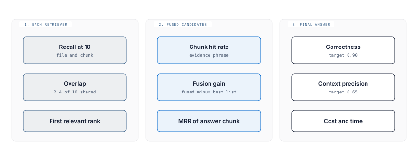
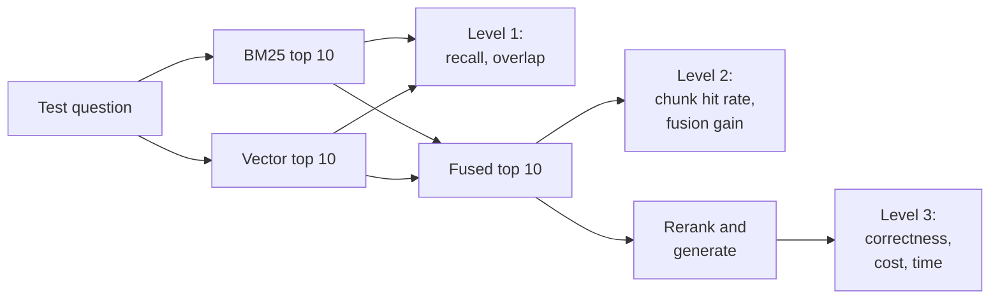

# 13. Evaluating Hybrid Search

In this note:

- Why the Advanced RAG evaluation is not enough for hybrid search
- Three levels of measurement: each retriever, fusion, the full answer
- Measured now: recall and overlap of BM25 and vector search on our test set
- Chunk-level labels: what they are and how to add them
- Presets and the ablation plan for the API evaluation
- Run-to-run variation and how to handle it

## Why a new evaluation

The Advanced RAG evaluation checks retrieval at **file level**: is a chunk from the expected file among the candidates? Notes 10 and 11 showed that this is too coarse for hybrid search:

- Every alpha from 0 to 1 found the expected file for all 10 questions (note 10), so file-level hit rate cannot tell settings apart.
- The real gain of hybrid search was one specific chunk (the rag-corpus answer chunk) entering the candidates. A file-level check cannot see this, because other chunks of the same file were already there.

So the hybrid evaluation adds **chunk-level** checks and measures each stage separately.

## Three levels

<table width="100%">
<thead><tr><th>Level</th><th>Metric</th><th>Question it answers</th></tr></thead>
<tbody>
<tr><td>1. Each retriever</td><td>Recall at 10 (file and chunk), rank of first relevant chunk</td><td>What does BM25 find, what does vector search find?</td></tr>
<tr><td>1. Each retriever</td><td>Overlap of the two top 10 lists</td><td>Do they find different things? (No overlap = most to gain from fusion)</td></tr>
<tr><td>2. Fusion</td><td>Chunk-level hit rate of the fused top 10</td><td>Is the answer chunk among the reranker's candidates?</td></tr>
<tr><td>2. Fusion</td><td>Fusion gain: fused hit rate minus the better single list</td><td>Does fusion add something, or just reshuffle?</td></tr>
<tr><td>2. Fusion</td><td>MRR of the answer chunk</td><td>How high does fusion place it?</td></tr>
<tr><td>3. After reranking</td><td>Answer chunk kept, context precision</td><td>Does the reranker keep it and drop noise?</td></tr>
<tr><td>3. Answer</td><td>Correctness, faithfulness, cost, time (from Advanced RAG)</td><td>Is the final answer better, and at what price?</td></tr>
</tbody>
</table>

## Measured now: each retriever on our test set

The 10 answerable questions, top 10 from each retriever over the 410 chunks (BM25 as in note 04). "Expected" means chunks from the expected file; the HR policy file has only one chunk.

<table width="100%">
<thead><tr><th>Question</th><th>BM25: expected in top 10, first at</th><th>Vector: expected in top 10, first at</th><th>Shared chunks</th><th>Union size</th></tr></thead>
<tbody>
<tr><td>rag-variants</td><td>3, rank 2</td><td>3, rank 1</td><td>1</td><td>19</td></tr>
<tr><td>rag-components</td><td>7, rank 1</td><td>6, rank 3</td><td>1</td><td>19</td></tr>
<tr><td>rag-corpus</td><td>5, rank 1</td><td>4, rank 5</td><td>1</td><td>19</td></tr>
<tr><td>selfrag-reflection</td><td>10, rank 1</td><td>10, rank 1</td><td>5</td><td>15</td></tr>
<tr><td>selfrag-when</td><td>4, rank 4</td><td>8, rank 2</td><td>1</td><td>19</td></tr>
<tr><td>crag-evaluator</td><td>10, rank 1</td><td>7, rank 1</td><td>2</td><td>18</td></tr>
<tr><td>crag-incorrect</td><td>10, rank 1</td><td>10, rank 1</td><td>3</td><td>17</td></tr>
<tr><td>adaptive-routing</td><td>10, rank 1</td><td>10, rank 1</td><td>6</td><td>14</td></tr>
<tr><td>hr-sick-days</td><td>1, rank 1</td><td>1, rank 1</td><td>3</td><td>17</td></tr>
<tr><td>hr-new-joiner-leave</td><td>1, rank 1</td><td>1, rank 1</td><td>1</td><td>19</td></tr>
</tbody>
</table>

What this shows:

- **Both retrievers find the right file for every question.** BM25 puts it first for 8 of 10, vector search for 7 of 10. File-level recall is saturated.
- **The two lists are very different.** They share 2.4 chunks out of 10 on average, and only 1 for half the questions. So fusion has a lot to work with: the union holds 14 to 19 distinct chunks.
- **Different chunks of the right file.** For rag-components the union holds 13 chunks of the RAG paper against 7 and 6 in the single lists. More of the right document reaches the fusion step.

## Chunk-level labels

To measure level 2 properly, each test question needs a label for the chunk (or chunks) that contain the answer, not only the file. Two ways to label:

<table width="100%">
<thead><tr><th>Method</th><th>How</th><th>Trade-off</th></tr></thead>
<tbody>
<tr><td>Evidence phrase</td><td>Store a short phrase that only the answer chunk contains, for example "single Wikipedia dump" for rag-corpus; a chunk is relevant if its text contains the phrase</td><td>Survives re-chunking and re-indexing; needs care to pick a unique phrase</td></tr>
<tr><td>Chunk id</td><td>Store the id of the answer chunk</td><td>Exact, but breaks whenever the chunking changes</td></tr>
</tbody>
</table>

This project uses **evidence phrases**, added to `testset.json` in the API evaluation step. A question can have several phrases when the answer spans chunks (rag-variants needs both "RAG-Sequence" and "RAG-Token" described). The rag-corpus phrase is checked already: exactly 1 of the 410 chunks contains "single Wikipedia dump".

## Presets and ablation plan

<table width="100%">
<thead><tr><th>Preset</th><th>Retrieval</th><th>What it isolates</th></tr></thead>
<tbody>
<tr><td>A. Vector (Advanced RAG)</td><td>Vector top 10</td><td>Baseline: the current default</td></tr>
<tr><td>B. Keyword</td><td>BM25 top 10</td><td>BM25 alone, same reranker</td></tr>
<tr><td>C. Hybrid RRF</td><td>RRF k = 60, fused top 10</td><td>The planned default</td></tr>
<tr><td>D. Hybrid weighted</td><td>Theoretical min-max, alpha 0.5, fused top 10</td><td>Score fusion vs rank fusion</td></tr>
<tr><td>E. Hybrid RRF, 15 candidates</td><td>RRF, fused top 15</td><td>Fewer chunks displaced (note 11), at a higher rerank cost</td></tr>
</tbody>
</table>

All presets keep the Advanced RAG rewriting, reranker, threshold and generator, so only retrieval differs. Settings that the notes left open (stemming, rrf_k, alpha) can be swept afterwards with the same runner.

## Run-to-run variation

Note 11 found that the gpt-4o-mini reranker gave different keep counts in two runs at temperature 0. The answer generator and the judge are model calls too, so their results can vary in the same way. With 10 questions, one changed answer moves correctness by 0.1. Rules for this evaluation:

- Run each preset **3 times** and report the mean and the range.
- Treat a difference smaller than the range between runs as no difference.
- Retrieval-only metrics (levels 1 and 2) need no model, so they are exact and need only one run.

## Targets

From the Hybrid README: correctness 0.90 or more (Advanced RAG 0.84), file-level hit rate stays at 100%, chunk-level hit rate measured and improved, context precision 0.65 or more, cost no higher than Rs 0.048 per question, time under 3 s.

## Key points

- File-level checks are saturated on our test set; hybrid search needs chunk-level labels (evidence phrases).
- Measure three levels: each retriever, the fused candidates, the final answer.
- Measured: BM25 and vector top 10 lists share only 2.4 chunks on average; the union holds 14 to 19 chunks.
- Five presets compare vector, keyword, RRF, weighted fusion and a larger candidate list; three runs each because the model stages vary.

## Navigation

Previous: [12. Hybrid Search RAG Architecture End to End](12.%20Hybrid%20Search%20RAG%20Architecture%20End%20to%20End.md) | [Basic Concepts](README.md) | Next: [14. Cost, Latency and Limitations](14.%20Cost%20Latency%20and%20Limitations.md)
