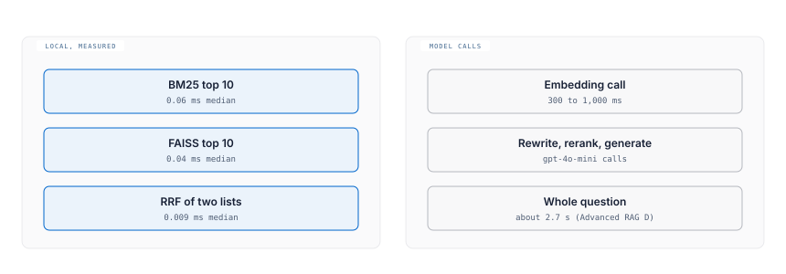
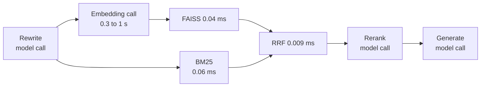

# 14. Cost, Latency and Limitations

In this note:

- What hybrid search adds in money: nothing per question
- What it adds in time, measured on our index
- Index size and how updates work
- How it scales beyond a few hundred chunks
- Limitations, and when hybrid search does not help

## Cost per question

<table width="100%">
<thead><tr><th>Stage</th><th>Advanced RAG</th><th>Hybrid Search RAG</th></tr></thead>
<tbody>
<tr><td>Rewrite</td><td>0 or 1 gpt-4o-mini call</td><td>Same</td></tr>
<tr><td>Vector search</td><td>1 embedding call</td><td>Same</td></tr>
<tr><td>Keyword search</td><td>-</td><td>Local, no model, free</td></tr>
<tr><td>Fusion</td><td>-</td><td>Local, free</td></tr>
<tr><td>Rerank</td><td>1 call, 10 candidates</td><td>1 call, 10 fused candidates</td></tr>
<tr><td>Generate</td><td>1 call</td><td>Same</td></tr>
</tbody>
</table>

The number of model calls and the number of reranked candidates are unchanged, so the expected cost stays near Rs 0.048 per question (Advanced RAG preset D). It can move a little because the fused candidates are different chunks with different lengths, and because the threshold may keep a different number of chunks for the generator (note 11). Reranking 15 candidates instead of 10 (preset E in note 13) would raise the rerank input by about half.

## Time per question, measured

Measured on the 410-chunk index with a plain Python BM25 (the measurement script of notes 09 to 11), 20 runs over the 11 test questions:

<table width="100%">
<thead><tr><th>Step</th><th>Median time</th><th>Note</th></tr></thead>
<tbody>
<tr><td>BM25 search, top 10</td><td>0.06 ms (max 0.1 ms)</td><td>Only the postings of the query terms are read</td></tr>
<tr><td>FAISS search, top 10</td><td>0.04 ms</td><td>Exact search over 410 vectors</td></tr>
<tr><td>RRF of two lists of 10</td><td>0.009 ms</td><td>A few dictionary updates and one sort</td></tr>
<tr><td>Embedding call (network)</td><td>300 to 1,000 ms</td><td>Five calls: 1,009, 303, 315, 332, 459 ms</td></tr>
<tr><td>Whole question, Advanced RAG preset D</td><td>2.7 s</td><td>From the Advanced RAG evaluation</td></tr>
</tbody>
</table>

Keyword search and fusion add well under a millisecond, against seconds spent in model calls. Running BM25 at the same time as the embedding call is possible but would save nothing noticeable at this size. The time target (under 3 s) depends on the model calls, as in Advanced RAG.

## Index size and updates

<table width="100%">
<thead><tr><th>Item</th><th>Measured</th></tr></thead>
<tbody>
<tr><td>Chunks</td><td>410</td></tr>
<tr><td>Index terms after analysis</td><td>45,082 in total, 6,368 distinct</td></tr>
<tr><td>Postings (term, chunk, count)</td><td>33,400</td></tr>
<tr><td>BM25 index as JSON</td><td>About 398 KB</td></tr>
<tr><td>FAISS index (410 x 1536 floats)</td><td>2.5 MB</td></tr>
<tr><td>Chunk texts and metadata</td><td>414 KB</td></tr>
<tr><td>Time to build the BM25 index from scratch</td><td>16 ms</td></tr>
</tbody>
</table>

**Updates.** BM25 statistics are global: adding or removing a file changes the number of chunks, the document frequency of its words and the average chunk length, so the IDF of many terms changes. The simplest correct approach is to **rebuild the whole BM25 index** after every upload or delete. At 16 ms for 410 chunks this costs nothing here. FAISS, by contrast, is updated in place (vectors added or removed), as in Advanced RAG.

## Scaling

<table width="100%">
<thead><tr><th>Corpus size</th><th>BM25 option</th></tr></thead>
<tbody>
<tr><td>Hundreds to tens of thousands of chunks</td><td>Plain Python inverted index in memory, saved as JSON; rebuild on change</td></tr>
<tr><td>Larger, or many updates</td><td>A compiled library or an incremental index, so a change does not require a full rebuild</td></tr>
<tr><td>Millions of chunks, many users</td><td>A search engine with BM25 built in (Elasticsearch, OpenSearch) or a vector database with hybrid search</td></tr>
</tbody>
</table>

Query time grows with the length of the posting lists of the query terms, so common words are the expensive ones; stop words keep the lists short. This project's corpus is small, so the plain Python index fits the stack rules (no new service).

## Limitations

<table width="100%">
<thead><tr><th>Limitation</th><th>Seen in these notes</th></tr></thead>
<tbody>
<tr><td>BM25 needs the right words in the query</td><td>Raw rag-corpus question: answer chunk at BM25 rank 33; after rewriting: rank 4 (note 11)</td></tr>
<tr><td>Text analysis is language- and domain-specific</td><td>"et" and "al" had to become stop words for research papers (note 04)</td></tr>
<tr><td>Stemming and similar choices cut both ways</td><td>Stemming moved one question up and another down (note 04)</td></tr>
<tr><td>Fusion parameters depend on the data</td><td>Best alpha differs per question; k changes the order (notes 09 and 10)</td></tr>
<tr><td>Fewer slots for vector results</td><td>Two questions kept fewer chunks with hybrid candidates (note 11)</td></tr>
<tr><td>Two indexes to keep in sync</td><td>Every upload and delete must update both</td></tr>
<tr><td>No synonyms or paraphrases on the keyword side</td><td>Covered by the vector side, not by BM25 (notes 05 and 06)</td></tr>
<tr><td>Still one retrieval round</td><td>Multi-hop questions need iterative methods (later architectures)</td></tr>
</tbody>
</table>

## When hybrid search does not help

- **When vector search already finds everything.** Six of our ten questions gave identical results with and without hybrid search (note 11).
- **Conversational or paraphrased questions** that share few words with the documents: BM25 adds noise rather than recall.
- **Multilingual corpora** where questions and documents use different languages: word matching fails, embeddings may not.
- **Very short chunks or very short queries**: BM25 statistics become unreliable.

It helps most for exact terms (names, codes, numbers, rare words) and when the search query, original or rewritten, contains the document's own words.

## Key points

- No extra model calls: cost per question stays at the Advanced RAG level, with small changes from different candidates.
- Measured: BM25 0.06 ms, FAISS 0.04 ms, RRF 0.009 ms, against 300 to 1,000 ms for one embedding call.
- The BM25 index (about 398 KB, built in 16 ms) is rebuilt after every upload or delete because its statistics are global.
- Limitations: needs the right query words, domain-specific analysis, data-dependent fusion settings, fewer slots for vector results, two indexes to sync.

## Navigation

Previous: [13. Evaluating Hybrid Search](13.%20Evaluating%20Hybrid%20Search.md) | [Basic Concepts](README.md) | Next: [15. Glossary](15.%20Glossary.md)
