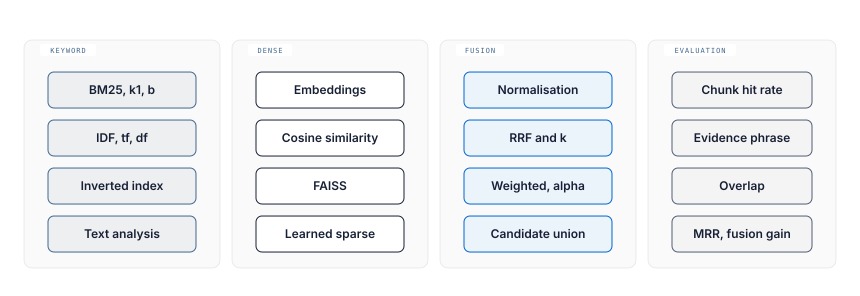
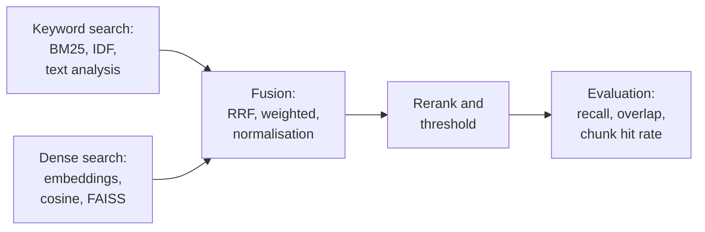

# 15. Glossary

Every term used in the Hybrid Search RAG notes, in alphabetical order, with the note that explains it. Terms already covered in the Advanced RAG glossary (rewriting, reranking, threshold, compression) appear here only where hybrid search changes them.

## Terms

<table width="100%">
<thead><tr><th>Term</th><th>Meaning</th><th>Note</th></tr></thead>
<tbody>
<tr><td>alpha</td><td>Weight of the vector side in weighted fusion, between 0 (keyword only) and 1 (vector only)</td><td>10</td></tr>
<tr><td>Analyser (text analysis)</td><td>The steps that turn text into index terms: normalise, tokenise, remove stop words, optionally stem</td><td>04</td></tr>
<tr><td>Average chunk length (avgdl)</td><td>Mean number of terms per chunk; BM25 compares each chunk's length with it</td><td>03</td></tr>
<tr><td>b</td><td>BM25 length normalisation parameter, 0 (ignore length) to 1 (full); default 0.75</td><td>03</td></tr>
<tr><td>BM25</td><td>Keyword ranking function: sum over query terms of IDF times saturated term frequency, adjusted for chunk length</td><td>03</td></tr>
<tr><td>Candidates</td><td>The chunks sent to the reranker; in hybrid search, the fused top 10</td><td>11</td></tr>
<tr><td>Chunk-level hit rate</td><td>Share of questions whose answer chunk is among the candidates; finer than file level</td><td>13</td></tr>
<tr><td>Convex combination</td><td>A weighted sum whose weights are non-negative and add up to 1; the fusion paper's name for weighted fusion</td><td>10</td></tr>
<tr><td>Cosine similarity</td><td>Similarity of two vectors from -1 to 1; the vector search score</td><td>05, 08</td></tr>
<tr><td>Dense retrieval</td><td>Search by embedding vectors that encode meaning; every position has a value</td><td>01, 05</td></tr>
<tr><td>Document frequency (df)</td><td>Number of chunks that contain a term</td><td>03</td></tr>
<tr><td>ELSER</td><td>Elastic Learned Sparse EncodeR, a learned sparse model in Elasticsearch; used by the Blended RAG paper</td><td>07</td></tr>
<tr><td>Evidence phrase</td><td>A short phrase that only the answer chunk contains, used as a chunk-level label in the test set</td><td>13</td></tr>
<tr><td>Expansion (term expansion)</td><td>Adding related words that are not in the text, as learned sparse models do</td><td>07</td></tr>
<tr><td>File-level hit rate</td><td>Share of questions with any chunk of the expected file among the candidates</td><td>13</td></tr>
<tr><td>FLOPS regulariser</td><td>Training penalty in SPLADE that keeps the sparse vectors sparse</td><td>07</td></tr>
<tr><td>Fusion</td><td>Merging two or more ranked lists into one</td><td>08 to 10</td></tr>
<tr><td>Fusion gain</td><td>Fused hit rate minus the hit rate of the better single list</td><td>13</td></tr>
<tr><td>Hybrid search</td><td>Running keyword and vector search over the same chunks and fusing the results</td><td>01</td></tr>
<tr><td>IDF (inverse document frequency)</td><td>Weight of a term: high for rare terms, low for common ones; here ln(1 + (N - n + 0.5) / (n + 0.5))</td><td>03</td></tr>
<tr><td>Inverted index</td><td>For every term, the list of chunks containing it and how often; makes keyword search fast</td><td>03</td></tr>
<tr><td>k (RRF constant)</td><td>Constant in 1 / (k + rank); 60 in the RRF paper; large k rewards agreement, small k rewards first places</td><td>09</td></tr>
<tr><td>k1</td><td>BM25 term frequency saturation parameter; default 1.2</td><td>03</td></tr>
<tr><td>Keyword search (lexical search)</td><td>Search by matching words of the query with words of the chunks</td><td>01, 03</td></tr>
<tr><td>Learned sparse retrieval</td><td>Sparse word vectors whose weights a language model sets, including expansions</td><td>07</td></tr>
<tr><td>Lemmatisation</td><td>Mapping a word to its dictionary form ("retrieved" to "retrieve") with a vocabulary</td><td>04</td></tr>
<tr><td>Listwise scoring</td><td>Scoring all candidates in one model call; a chunk's score can depend on its neighbours</td><td>11</td></tr>
<tr><td>Min-max normalisation</td><td>(s - min) / (max - min) over the observed scores; range 0 to 1, stretches small gaps</td><td>08</td></tr>
<tr><td>MRR (mean reciprocal rank)</td><td>Average of 1 / rank of the first relevant result; 1.0 means always first</td><td>10, 13</td></tr>
<tr><td>Normalisation</td><td>Rescaling scores so two retrievers can be compared</td><td>08</td></tr>
<tr><td>Overlap</td><td>Number of chunks two top-k lists share; 2.4 of 10 on average on our test set</td><td>13</td></tr>
<tr><td>Postings</td><td>The entries of an inverted index: (term, chunk, count); 33,400 for our 410 chunks</td><td>03, 14</td></tr>
<tr><td>Recall at k</td><td>Whether (or how many of) the relevant chunks appear in the top k</td><td>13</td></tr>
<tr><td>RRF (Reciprocal Rank Fusion)</td><td>Fusion by ranks only: score = sum over lists of 1 / (k + rank)</td><td>09</td></tr>
<tr><td>Saturation</td><td>BM25 property: each extra occurrence of a term adds less than the previous one</td><td>03</td></tr>
<tr><td>Semantic search</td><td>Another name for dense retrieval: search by meaning</td><td>01</td></tr>
<tr><td>Sparse retrieval</td><td>Search with vectors of one position per vocabulary word, mostly zeros; BM25 is the classic case</td><td>03, 06</td></tr>
<tr><td>SPLADE</td><td>Learned sparse model built on BERT's masked-language-model head, log(1 + ReLU) weights</td><td>07</td></tr>
<tr><td>Stemming</td><td>Cutting word endings by rules ("variants" to "variant"); off by default in this project</td><td>04</td></tr>
<tr><td>Stop words</td><td>Very common words removed before indexing; here a small English list plus "et" and "al"</td><td>04</td></tr>
<tr><td>Term frequency (tf)</td><td>Number of times a term occurs in a chunk</td><td>03</td></tr>
<tr><td>Theoretical min-max</td><td>Normalisation with fixed lower bounds (0 for BM25, -1 for cosine) instead of the observed minimum</td><td>08, 10</td></tr>
<tr><td>Tokenisation</td><td>Splitting text into tokens; here also keeping hyphenated codes and decimals whole</td><td>04</td></tr>
<tr><td>Union (candidate union)</td><td>All distinct chunks of both top 10 lists; 14 to 19 on our test set</td><td>10, 13</td></tr>
<tr><td>Weighted fusion</td><td>alpha times the normalised vector score plus (1 - alpha) times the normalised BM25 score</td><td>10</td></tr>
<tr><td>Weighted RRF</td><td>RRF with a weight per list</td><td>09</td></tr>
<tr><td>Z-score normalisation</td><td>(s - mean) / standard deviation; unbounded, unstable for tightly packed scores</td><td>08</td></tr>
</tbody>
</table>

## Key points

- Keyword side: BM25, IDF, k1, b, inverted index, text analysis.
- Fusion side: normalisation, RRF and its k, weighted fusion and alpha.
- Evaluation side: chunk-level hit rate with evidence phrases, overlap, fusion gain, MRR.

## Navigation

Previous: [14. Cost, Latency and Limitations](14.%20Cost%20Latency%20and%20Limitations.md) | [Basic Concepts](README.md) | Next: [Research Paper Explained](../02.%20Research%20Paper%20Explained/README.md)
