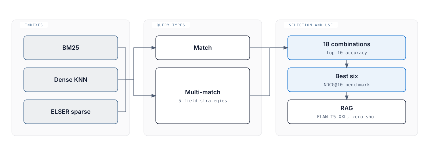
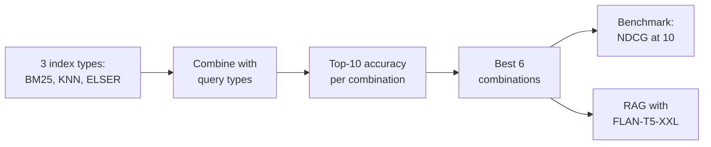

# 01. Abstract (Paper Section: Abstract)

In this note:

- The abstract split into its sentences
- Each sentence explained in simple words
- Words you need to know before reading further
- The paper in one picture

## The Abstract, Sentence by Sentence

<table width="100%">
<thead><tr><th>#</th><th>Sentence (from the paper)</th><th>In simple words</th></tr></thead>
<tbody>
<tr><td>1</td><td>"Retrieval-Augmented Generation (RAG) is a prevalent approach to infuse a private knowledge base of documents with Large Language Models (LLM) to build Generative Q&A (Question-Answering) systems."</td><td>RAG lets an LLM answer questions from your own documents.</td></tr>
<tr><td>2</td><td>"However, RAG accuracy becomes increasingly challenging as the corpus of documents scales up, with Retrievers playing an outsized role in the overall RAG accuracy by extracting the most relevant document from the corpus to provide context to the LLM."</td><td>The more documents there are, the harder it is to find the right one, and the retriever decides most of the final accuracy.</td></tr>
<tr><td>3</td><td>"In this paper, we propose the 'Blended RAG' method of leveraging semantic search techniques, such as Dense Vector indexes and Sparse Encoder indexes, blended with hybrid query strategies."</td><td>The method combines index types (dense vectors, learned sparse vectors, and BM25) with different kinds of search queries.</td></tr>
<tr><td>4</td><td>"Our study achieves better retrieval results and sets new benchmarks for IR (Information Retrieval) datasets like NQ and TREC-COVID datasets."</td><td>On two standard search benchmarks it beats the best published scores the authors compare against.</td></tr>
<tr><td>5</td><td>"We further extend such a 'Blended Retriever' to the RAG system to demonstrate far superior results on Generative Q&A datasets like SQUAD, even surpassing fine-tuning performance."</td><td>Used inside RAG, the better retriever gives better answers than RAG systems that were fine-tuned on the dataset.</td></tr>
</tbody>
</table>

## Words to Know

<table width="100%">
<thead><tr><th>Term</th><th>Meaning</th><th>Where in our notes</th></tr></thead>
<tbody>
<tr><td>Dense vector index (KNN)</td><td>Embeddings of every passage; search returns the k nearest neighbours of the question vector</td><td>Basic concepts 05</td></tr>
<tr><td>Sparse encoder index (ELSER)</td><td>Learned sparse vectors: weighted words plus expansions, built by a model inside Elasticsearch</td><td>Basic concepts 07</td></tr>
<tr><td>BM25 index</td><td>Keyword index with BM25 scoring</td><td>Basic concepts 03</td></tr>
<tr><td>Hybrid query</td><td>In this paper: an Elasticsearch query type that searches several text fields of a document at once (best fields, most fields, cross fields, phrase prefix, bool prefix)</td><td>Note 03</td></tr>
<tr><td>Top-k retrieval accuracy</td><td>Share of questions for which a relevant passage is in the top k results</td><td>Basic concepts 13 (recall at k)</td></tr>
<tr><td>NDCG@10</td><td>Normalised Discounted Cumulative Gain: a ranking score from 0 to 1 that rewards relevant results near the top</td><td>Note 05</td></tr>
<tr><td>EM, F1</td><td>Exact Match (answer identical to the reference) and word-overlap F1 between answer and reference</td><td>Note 06</td></tr>
<tr><td>NQ, TREC-COVID, SQuAD, HotPotQA, CoQA</td><td>Public question answering and search benchmarks</td><td>Notes 04 to 07</td></tr>
</tbody>
</table>

## The Paper in One Picture

## A Note on the Word "Hybrid"

In our basic concepts, hybrid search means running two retrievers (BM25 and vector search) and **fusing** their ranked lists. In this paper, "hybrid query" mostly means an Elasticsearch query that searches **several fields** of a document (for example title and text) in a particular way. Each tested retriever is one index type plus one query type. Note 03 looks at this closely; it changes how the results apply to our project.

## What This Means for Our Project

- The abstract's main claim, that the retriever decides most of RAG accuracy, matches what our Advanced RAG evaluation found: the remaining failures were retrieval failures.
- The paper's three index types are the three retrieval families of our basic concepts notes 03, 05 and 07. Our project uses two (BM25 and dense); ELSER needs Elasticsearch.

## Key Points

- Blended RAG combines three index types (BM25, dense KNN, ELSER sparse encoder) with several query types and picks the best combinations.
- Claims: new best scores on NQ and TREC-COVID retrieval, and better RAG answers on SQuAD and NQ than fine-tuned RAG.
- "Hybrid query" here means a multi-field Elasticsearch query, not fusion of two ranked lists.

## Navigation

[Paper index](README.md) | Next: [02. Introduction and Related Work](02.%20Introduction%20and%20Related%20Work.md)
