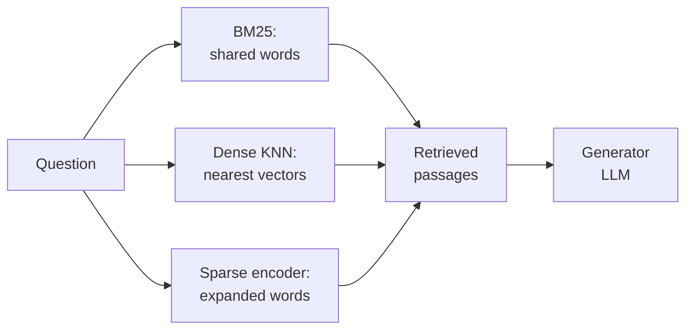
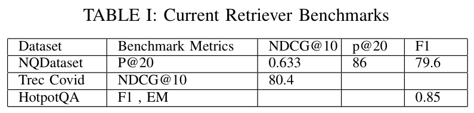

# 02. Introduction and Related Work (Paper Sections I and II)

In this note:

- I Introduction: the retriever and the generator
- II Related Work: BM25, dense vectors, sparse encoders
- II.A Limitations of current RAG systems, and Table I
- How to read Table I
- What this means for our project

## I Introduction

The paper splits RAG into two parts: the **Retriever (R)** and the **Generator (G)**, "the latter representing the size and type of LLM". Its picture of the retriever:

> "Think of the retriever as a researcher part of the AI, which feeds the contextually grounded text to generate knowledgeable answers to Generator (G). Without the retriever, RAG would be like a well-spoken individual who delivers irrelevant information."

In simple words: the LLM writes well, but only the retriever can give it the facts. A fluent answer built on the wrong passage is still wrong.

## II Related Work: Three Retrieval Families

<table width="100%">
<thead><tr><th>Family</th><th>What the paper says</th><th>Our basic concepts note</th></tr></thead>
<tbody>
<tr><td>BM25</td><td>"capitalizing on Term Frequency (TF), Inverse Document Frequency (IDF), and Document Length to compute a relevance score" (Robertson and Zaragoza 2009)</td><td>03. Sparse Retrieval and BM25</td></tr>
<tr><td>Dense vectors (KNN)</td><td>Turn text into vectors; "the model discerns the 'k' vectors closest in resemblance to the query vector", using cosine similarity or similar</td><td>05. Dense Retrieval Strengths and Blind Spots</td></tr>
<tr><td>Sparse encoders</td><td>Documents and queries are mapped "into an extensive array of associated terms" learned from training data, then "encoded into sparse vectors, an efficient data representation format when handling an extensive vocabulary"</td><td>07. Learned Sparse Retrieval (SPLADE)</td></tr>
</tbody>
</table>

The description of sparse encoders matches what note 07 calls **term expansion**: the model adds related terms to the document and the query, and stores the result as weighted words.

A caution on the citations in this section: the dense vector work is cited as "Johnson et al. (2019)", and the reference list gives "Knn algorithms for semantic search" at ICML 2019. The well-known Johnson, Douze and Jegou 2019 paper is the FAISS paper ("Billion-scale similarity search with GPUs"), published in IEEE Transactions on Big Data. The sparse encoder work is attributed to "Zaharia et al. (2010)", which is not in the reference list. These references are hard to trace, so the related-work section is best read as a summary of the three families, not as a literature review.

## II.A Limitations in Current RAG Systems

The authors make two arguments:

1. **Most retrieval in RAG pipelines is keyword or similarity search**, which "can restrict the RAG system's overall accuracy".
2. **Most effort goes into the generator**: "most of prior efforts in improving RAG accuracy is on G part, by tweaking LLM prompts, tuning etc." This has limited effect, "since if R part is feeding irreverent [irrelevant] context then answer would be inaccurate."

The goal of the study: "to enhance retriever and RAG accuracy by incorporating Semantic Search-Based Retrievers and Hybrid Search Queries."

## Table I: Current Retriever Benchmarks

Table I lists the scores the paper later tries to beat:

<table width="100%">
<thead><tr><th>Dataset</th><th>Value in Table I</th><th>How to read it</th></tr></thead>
<tbody>
<tr><td>NQ</td><td>NDCG@10 0.633, P@20 86, F1 79.6</td><td>The 0.633 reappears in Table II as the monoT5-3B NDCG@10 score, the NQ target</td></tr>
<tr><td>TREC-COVID</td><td>NDCG@10 80.4</td><td>Written as a percentage; Table II gives the same score as 0.804 (COCO-DR Large)</td></tr>
<tr><td>HotpotQA</td><td>F1, EM 0.85</td><td>One value for two metrics; not used again in the paper</td></tr>
</tbody>
</table>

The table mixes scales (0.633 next to 80.4) and leaves the "Benchmark Metrics" column inconsistent with the values (NQ's metric is given as P@20, but its first value is NDCG@10). Table II (note 05) is the clearer source for the targets.

## What This Means for Our Project

- The "R matters more than G" argument is the reason this project moved from Advanced RAG (better ranking of the same candidates) to Hybrid Search RAG (better candidates).
- The three retrieval families give a map: we implement BM25 and dense; learned sparse stays a later option (basic concepts note 07).
- When comparing against a benchmark number, check the metric and the scale; Table I shows how easily they get mixed.

## Key Points

- RAG = Retriever + Generator; the paper argues the retriever limits accuracy and gets too little attention.
- Related work covers BM25, dense KNN search and sparse encoders with term expansion; some citations are hard to trace.
- Table I gives the targets: NQ NDCG@10 0.633 and TREC-COVID NDCG@10 0.804, written on mixed scales.

## Navigation

Previous: [01. Abstract](01.%20Abstract.md) | [Paper index](README.md) | Next: [03. Blended Retrievers](03.%20Blended%20Retrievers.md)
