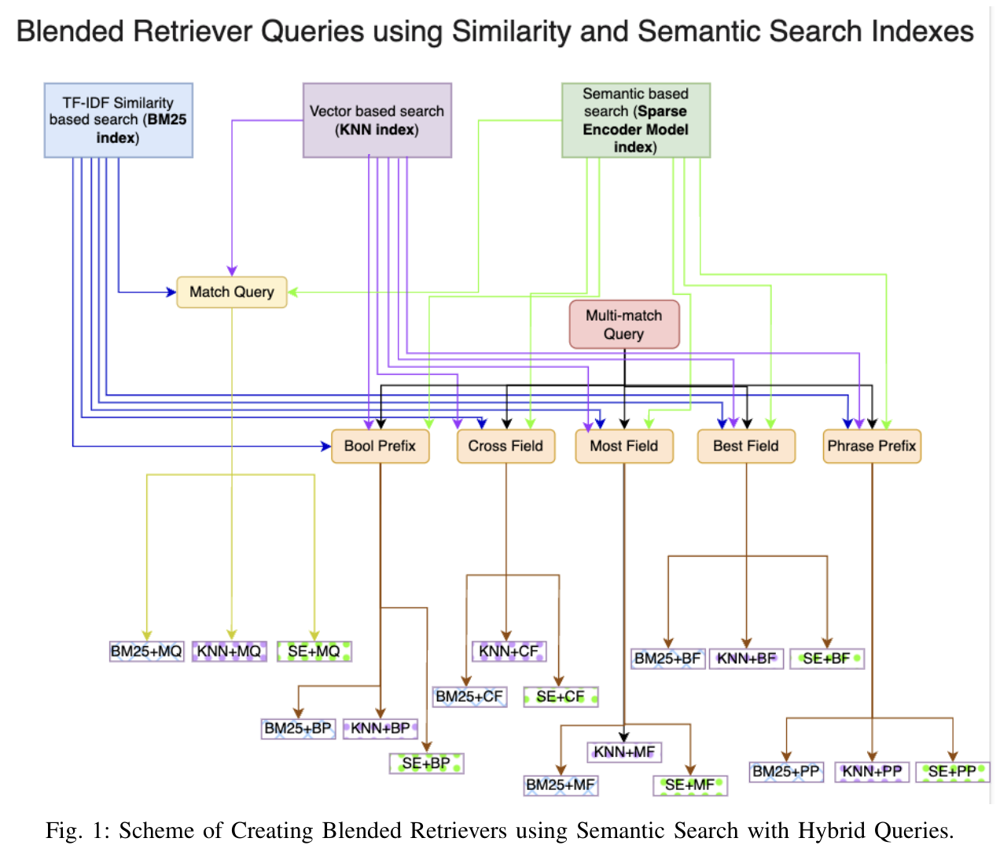
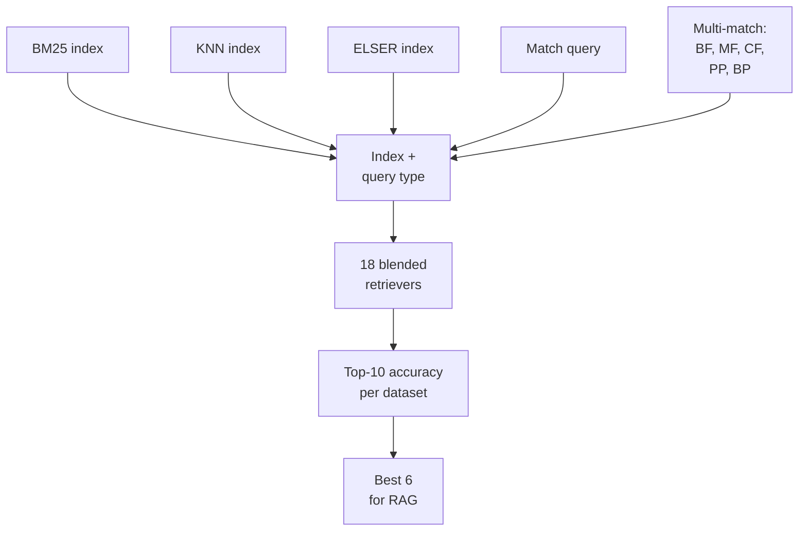

# 03. Blended Retrievers (Paper Section III)

In this note:

- The three indexes
- III.A Methodology: match and multi-match queries
- The five multi-match query types explained
- Figure 1: how indexes and queries become blended retrievers
- III.B Constructing the RAG system: the best six
- What the paper does not say
- What this means for our project

## The Three Indexes

The study evaluates "an array of search techniques across three primary indices":

<table width="100%">
<thead><tr><th>Index</th><th>Paper's description</th><th>In simple words</th></tr></thead>
<tbody>
<tr><td>BM25</td><td>"adept at employing full-text search capabilities enhanced by fuzzy matching techniques"</td><td>Keyword search; fuzzy matching also accepts small spelling differences</td></tr>
<tr><td>Dense vector (KNN)</td><td>"empowered by sentence transformers. It identifies the proximity of vector representations derived from document and query content"</td><td>Embedding search with a sentence-transformer model (the paper does not name it)</td></tr>
<tr><td>Sparse encoder (ELSER)</td><td>"an amalgam of semantic understanding and similarity-based retrieval to encapsulate the nuanced relationships between terms"</td><td>Elastic's learned sparse model: weighted, expanded words</td></tr>
</tbody>
</table>

All three run inside Elasticsearch (the acknowledgements thank Elastic for access to the platform and the ELSER index).

## III.A Methodology: From Match to Multi-Match

The method "unfolds in a sequence of progressive steps":

1. Start with the **elementary match query** on the BM25 index: search one text field.
2. Move to **hybrid queries** that "amalgamate diverse search techniques across multiple fields", using **multi-match** queries. These help "when the exact location of the query text within the document corpus is indeterminate": the answer words may be in the title, the text, or both.
3. Add the **dense vector (KNN)** and **sparse encoder** indexes, "each with their bespoke hybrid queries".
4. Measure **top-k retrieval accuracy** for every combination.

## The Query Types

The paper defines the multi-match types in one line each. Their meaning, as used in Elasticsearch:

<table width="100%">
<thead><tr><th>Query type</th><th>Paper's words</th><th>What it does</th></tr></thead>
<tbody>
<tr><td>Match</td><td>"elementary match query"</td><td>Search the query words in one field</td></tr>
<tr><td>Best fields</td><td>"Pursues the aggregation of words within a singular field"</td><td>Search several fields; a document's score comes mainly from its single best-matching field</td></tr>
<tr><td>Most fields</td><td>"Seeks text representation through different lenses across various fields"</td><td>Search several fields and add up their scores; rewards documents matching in many fields</td></tr>
<tr><td>Cross fields</td><td>"Targets concurrence across multiple fields"</td><td>Treat several fields as one big field, so query words may be spread across title and text</td></tr>
<tr><td>Phrase prefix</td><td>"prioritizes phrases over keywords"</td><td>Match the words as a phrase, the last word as a prefix</td></tr>
<tr><td>Bool prefix</td><td>Shown in Figure 1</td><td>Match the words in any order, the last word as a prefix</td></tr>
</tbody>
</table>

The datasets have more than one text field per document (for example a title and a passage), which is what makes multi-field queries matter.

## Figure 1: Creating Blended Retrievers

How to read Figure 1:

- **Top row:** the three indexes: "TF-IDF Similarity based search (BM25 index)" in blue, "Vector based search (KNN index)" in purple, "Semantic based search (Sparse Encoder Model index)" in green.
- **Middle:** the query types: Match Query on the left, and the Multi-match Query feeding Bool Prefix, Cross Field, Most Field, Best Field and Phrase Prefix.
- **Bottom:** every index joined with every query type gives one **blended retriever**, named index + query: BM25+MQ, KNN+MQ, SE+MQ, BM25+BP, ..., SE+PP. Three indexes times six query types give 18 combinations.

## III.B Constructing the RAG System: The Sextet

"From the plethora of possible permutations, a select sextet (top 6) of hybrid queries, those exhibiting paramount retrieval efficacy, were chosen for further scrutiny." These six are then:

1. benchmarked on IR datasets with NDCG@10 (note 05), and
2. "fed to generative question-answering systems" (note 06).

The datasets: Natural Questions (NQ), TREC-COVID, SQuAD and HotPotQA (CoQA appears later in the discussion).

## What the Paper Does Not Say

<table width="100%">
<thead><tr><th>Missing detail</th><th>Why it matters</th></tr></thead>
<tbody>
<tr><td>The exact query bodies (which fields, which weights)</td><td>"KNN + Best Field" could mean a KNN search combined with a best-fields text query in one request; the paper does not show how</td></tr>
<tr><td>How scores from a vector or ELSER part and a text part are combined</td><td>This is exactly the fusion question of basic concepts notes 08 to 10; Elasticsearch adds scores by default, with optional boosts</td></tr>
<tr><td>The sentence-transformer model for the KNN index</td><td>Dense results depend strongly on the model</td></tr>
<tr><td>Which fields each dataset has and which were indexed</td><td>Multi-field queries only help when there are several useful fields</td></tr>
<tr><td>No code or query examples</td><td>The experiments cannot be repeated exactly</td></tr>
</tbody>
</table>

## What This Means for Our Project

- The paper's "hybrid" is mostly **multi-field** search, not the two-list fusion of our notes 08 to 11. Its results show that the choice of index and query type matters, but they do not compare RRF against weighted fusion; paper 2 (Bruch et al.) does that.
- One idea transfers directly: **search more than one field**. Our chunks have metadata (file name, page). Adding the file name or a section title as a field for BM25 is a cheap form of "best fields" and can help questions that name a paper ("the original RAG model", "Self-RAG").
- Elasticsearch query types are not part of our stack (FastAPI, FAISS, plain Python BM25); we take the idea, not the tool.

## Key Points

- Three indexes (BM25, sentence-transformer KNN, ELSER) times six query types (match plus five multi-match types) give 18 blended retrievers.
- Multi-match types differ in how they combine fields: best single field, sum over fields, or fields treated as one.
- The best six by top-10 accuracy go on to benchmarking and RAG.
- The paper gives no query bodies, no score-combination rule and no embedding model name.

## Navigation

Previous: [02. Introduction and Related Work](02.%20Introduction%20and%20Related%20Work.md) | [Paper index](README.md) | Next: [04. Retriever Evaluation](04.%20Retriever%20Evaluation.md)
