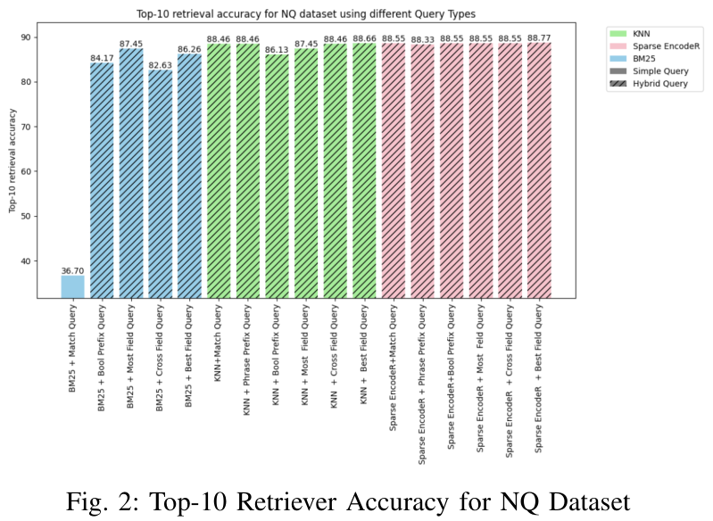
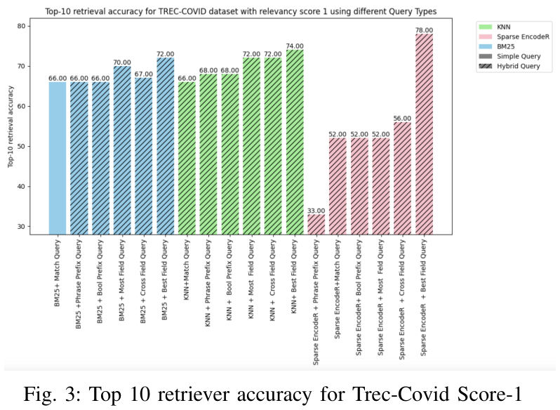
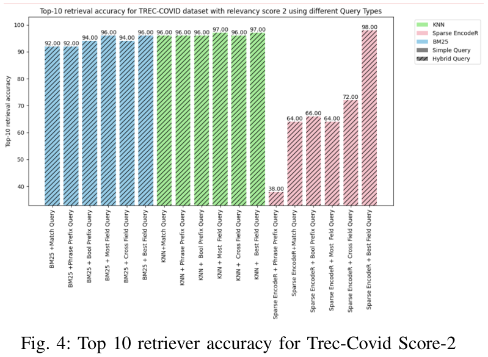
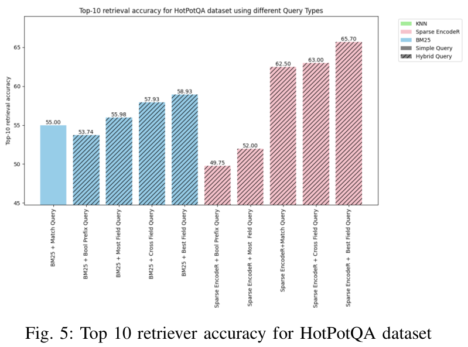
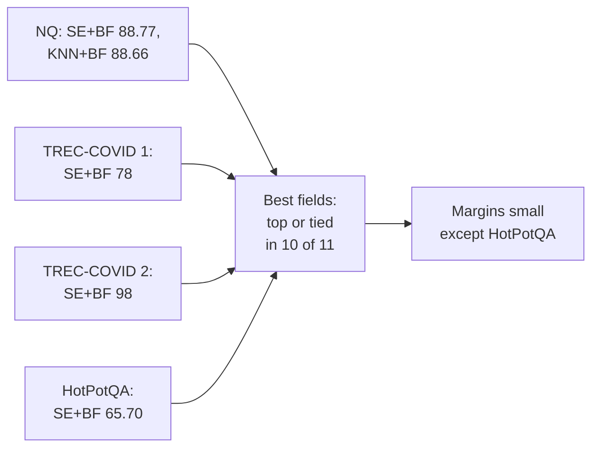

# 04. Retriever Evaluation (Paper Section IV, Figures 2 to 5)

In this note:

- The metric: top-10 retrieval accuracy
- Figure 2: NQ
- Figures 3 and 4: TREC-COVID at two relevance levels
- Figure 5: HotPotQA
- What the four figures show together
- What this means for our project

## The Metric

"We used top-10 retrieval accuracy to narrow down the six best types of blended retrievers (index + hybrid query) for comparison for each benchmark dataset."

Top-10 retrieval accuracy = the percentage of questions for which at least one relevant passage is in the top 10 results. It is the same idea as our hit rate at 10 (basic concepts note 13): it says whether the right passage was found, not where in the top 10 it is.

In every figure, bar colour shows the index (blue BM25, green KNN, pink sparse encoder) and hatching marks a hybrid (multi-match) query; plain bars are simple match queries.

## Figure 2: NQ

<table width="100%">
<thead><tr><th>Index</th><th>Lowest</th><th>Highest</th></tr></thead>
<tbody>
<tr><td>BM25</td><td>36.70 (match query)</td><td>87.45 (most fields)</td></tr>
<tr><td>KNN</td><td>86.13 (bool prefix)</td><td>88.66 (best fields)</td></tr>
<tr><td>Sparse encoder</td><td>88.33 (phrase prefix)</td><td><strong>88.77 (best fields)</strong>, the paper's best</td></tr>
</tbody>
</table>

The paper: the sparse encoder with best fields "attains the highest retrieval accuracy, reaching an impressive 88.77%".

Reading the figure closely:

- The one big jump is BM25 with a plain match query (36.70) against BM25 with any multi-match query (82.63 to 87.45). Searching several fields matters a lot for keyword search on NQ. The paper does not explain why the single-field match query is so low.
- All KNN and sparse encoder combinations sit between 86.13 and 88.77. The winner is ahead of KNN + best fields by **0.11 points**, which is within noise for most test sets.

## Figures 3 and 4: TREC-COVID

TREC-COVID labels documents from -1 (irrelevant) to 2 (highly relevant). The authors evaluate twice: counting documents with score 1 ("partially relevant") and with score 2 ("entirely pertinent").

<table width="100%">
<thead><tr><th>Index</th><th>Score 1: range</th><th>Score 2: range</th></tr></thead>
<tbody>
<tr><td>BM25 (6 query types)</td><td>66 to 72</td><td>92 to 96</td></tr>
<tr><td>KNN (6 query types)</td><td>66 to 74</td><td>96 to 97</td></tr>
<tr><td>Sparse encoder (6 query types)</td><td>33 to 78</td><td>38 to 98</td></tr>
<tr><td>Best</td><td>Sparse encoder + best fields, 78</td><td>Sparse encoder + best fields, 98</td></tr>
</tbody>
</table>

The paper reads both figures as "a superior performance of vector search hybrid queries over those based on keywords", with the sparse encoder and best fields on top (78% and 98%).

Reading the figures closely:

- **All values are whole even numbers** (66, 68, 72, ...). That fits a small question set: TREC-COVID has 50 topics, so one question is worth 2 points. The gap between the best KNN query and the winner (74 against 78, 97 against 98) is one or two questions.
- **The sparse encoder is unstable across query types:** with score 2 it ranges from 38 (phrase prefix) to 98 (best fields), while BM25 and KNN stay within a few points whatever the query type. The winning result depends on one specific query type.
- With score 2, BM25 with most fields or best fields (96) is close to KNN (96 to 97); the advantage of "vector search" over keywords is small here.

## Figure 5: HotPotQA

HotPotQA has "over 5M documents and a query set comprising 7,500 items", so "the assessment was confined to a select subset of hybrid queries". There are **no KNN bars**: the discussion (note 07) explains that the dense index for this corpus was about 50 GB.

- BM25: 53.74 (bool prefix) to 58.93 (best fields).
- Sparse encoder: 49.75 (bool prefix) to **65.70** (best fields).
- HotPotQA questions need two passages (multi-hop), and top-10 accuracy is much lower than on NQ for every retriever.

## The Four Figures Together

<table width="100%">
<thead><tr><th>Dataset</th><th>Best (sparse encoder + best fields)</th><th>Best KNN</th><th>Best BM25</th></tr></thead>
<tbody>
<tr><td>NQ</td><td>88.77</td><td>88.66</td><td>87.45</td></tr>
<tr><td>TREC-COVID, score 1</td><td>78</td><td>74</td><td>72</td></tr>
<tr><td>TREC-COVID, score 2</td><td>98</td><td>97</td><td>96</td></tr>
<tr><td>HotPotQA</td><td>65.70</td><td>not run</td><td>58.93</td></tr>
</tbody>
</table>

- **Best fields is the top or tied-top query type** for every index and dataset except one (BM25 on NQ, where most fields scores 87.45 against 86.26): searching several fields and scoring by the best one is the most consistent choice.
- **The index matters less than the query type** on NQ and TREC-COVID score 2: the best result of each index is within 1.3 and 2 points.
- **HotPotQA is where the sparse encoder clearly helps** (+6.8 points over BM25).
- No error bars or repeated runs are given; on TREC-COVID one question moves a score by 2 points.

## What This Means for Our Project

- Our own test set has 10 answerable questions, so one question is 10 points. Like TREC-COVID, small differences between settings will not be meaningful; basic concepts note 13 plans three runs per preset and chunk-level checks for this reason.
- The large BM25 gain from multi-field queries supports adding the file name or a title field to our BM25 text (note 03).
- Top-10 accuracy says nothing about rank; our reranker reorders the candidates anyway, so for us a recall-style metric at the candidate stage is the right one, with chunk-level labels.

## Key Points

- Metric: top-10 retrieval accuracy (a relevant passage in the top 10).
- Sparse encoder + best fields is the top combination on NQ (88.77), TREC-COVID (78 and 98) and HotPotQA (65.70).
- Margins over KNN + best fields are small (0.11 to 4 points) except on HotPotQA; TREC-COVID's 50 questions make 2 points one question.
- BM25 with a single-field match query is very low on NQ (36.70); multi-field queries fix most of that.

## Navigation

Previous: [03. Blended Retrievers](03.%20Blended%20Retrievers.md) | [Paper index](README.md) | Next: [05. Retriever Benchmarking](05.%20Retriever%20Benchmarking.md)
