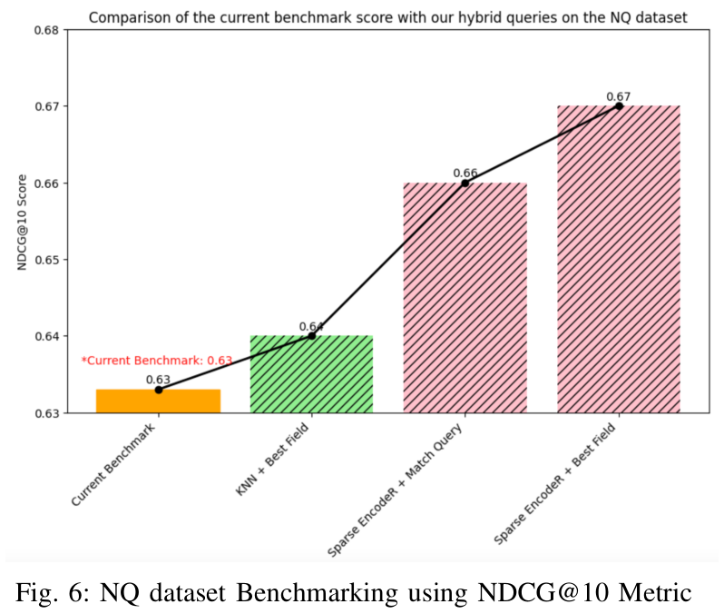
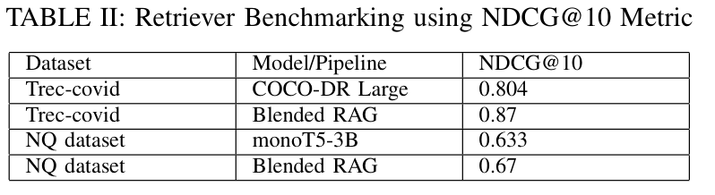
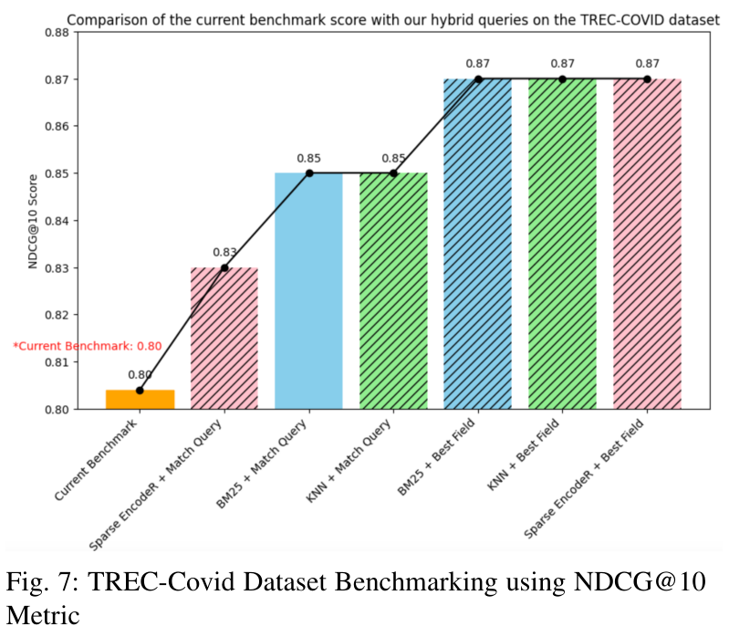
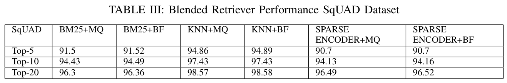
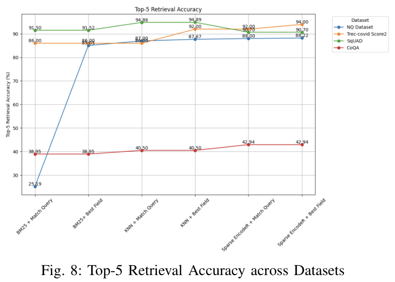
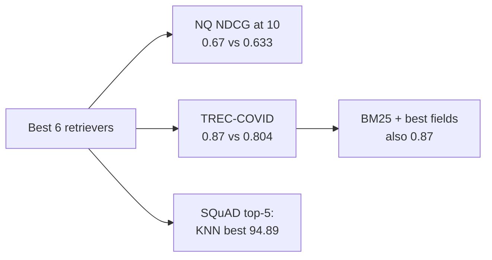

# 05. Retriever Benchmarking (Paper Sections IV.A and IV.B)

In this note:

- NDCG@10 explained
- Figure 6 and Table II: NQ
- Figure 7 and Table II: TREC-COVID
- Table III: SQuAD
- Figure 8: top-5 accuracy across datasets
- IV.B: the paper's summary, checked
- What this means for our project

## NDCG@10

After choosing the best six combinations with top-10 accuracy, the authors compare them with published results using **NDCG@10** (Normalised Discounted Cumulative Gain at 10):

$$\text{DCG@10} = \sum_{i=1}^{10} \frac{\text{rel}_i}{\log_2(i + 1)} \qquad \text{NDCG@10} = \frac{\text{DCG@10}}{\text{ideal DCG@10}}$$

<table width="100%">
<thead><tr><th>Symbol (plain text)</th><th>Meaning</th></tr></thead>
<tbody>
<tr><td>rel_i</td><td>Relevance label of the result at position i (for example 0, 1 or 2)</td></tr>
<tr><td>log2(i + 1)</td><td>Discount: position 1 counts fully, position 3 half, position 7 a third</td></tr>
<tr><td>ideal DCG@10</td><td>DCG of the perfect ranking, so NDCG runs from 0 to 1</td></tr>
</tbody>
</table>

Unlike top-10 accuracy, NDCG@10 rewards putting relevant passages **high** and counts **every** relevant passage, with graded relevance.

## Figure 6 and Table II: NQ

<table width="100%">
<thead><tr><th>Retriever</th><th>NQ NDCG@10</th></tr></thead>
<tbody>
<tr><td>Current benchmark: monoT5-3B</td><td>0.633</td></tr>
<tr><td>KNN + best fields</td><td>0.64</td></tr>
<tr><td>Sparse encoder + match</td><td>0.66</td></tr>
<tr><td>Sparse encoder + best fields</td><td><strong>0.67</strong></td></tr>
</tbody>
</table>

The paper: "Our pipeline provides the best NDCG@10 score of 0.67, which is 5.8% higher than the current benchmark score of 0.633 achieved by the monoT5-3B model." Check: 0.67 / 0.633 = 1.058, so +5.8% is a **relative** gain (+0.037 in absolute terms). The text points to "Figure 7" for these NQ results; the NQ chart is Figure 6.

monoT5-3B is a T5 model that **reranks** BM25 results; Blended RAG reaches a similar NDCG@10 with first-stage retrieval only.

## Figure 7 and Table II: TREC-COVID

<table width="100%">
<thead><tr><th>Retriever</th><th>TREC-COVID NDCG@10</th></tr></thead>
<tbody>
<tr><td>Current benchmark: COCO-DR Large</td><td>0.804</td></tr>
<tr><td>Sparse encoder + match</td><td>0.83</td></tr>
<tr><td>BM25 + match</td><td>0.85</td></tr>
<tr><td>KNN + match</td><td>0.85</td></tr>
<tr><td>BM25 + best fields</td><td><strong>0.87</strong></td></tr>
<tr><td>KNN + best fields</td><td><strong>0.87</strong></td></tr>
<tr><td>Sparse encoder + best fields</td><td><strong>0.87</strong></td></tr>
</tbody>
</table>

The paper: "Blended Retrievers achieved an NDCG@10 score of 0.87, which marks an 8.2% increment over the benchmark score of 0.804" (0.87 / 0.804 = 1.082, relative).

The important detail is in the figure: **BM25 + best fields also reaches 0.87**, and even BM25 with a plain match query (0.85) beats the published benchmark. On TREC-COVID the gain comes from the query type and the setup, not from semantic search: keyword search with best fields ties the sparse encoder.

## Table III: SQuAD

SQuAD is a reading comprehension dataset, not a retrieval benchmark. The authors built a corpus "using the title and context fields" and indexed it three ways.

<table width="100%">
<thead><tr><th>Retriever</th><th>Top-5</th><th>Top-10</th><th>Top-20</th></tr></thead>
<tbody>
<tr><td>BM25 + best fields</td><td>91.52</td><td>94.49</td><td>96.36</td></tr>
<tr><td>KNN + best fields</td><td><strong>94.89</strong></td><td><strong>97.43</strong></td><td><strong>98.58</strong></td></tr>
<tr><td>Sparse encoder + best fields</td><td>90.7</td><td>94.16</td><td>96.52</td></tr>
</tbody>
</table>

Here **dense KNN wins**, and the sparse encoder is slightly below BM25 at top-5. The paper says so: "dense vector (KNN)-based semantic searches achieve higher accuracy than sparse vector-based semantic searches and traditional similarity-based searches". Match and best fields give almost identical numbers for each index (for example 94.86 and 94.89 for KNN).

## Figure 8: Top-5 Accuracy Across Datasets

- **NQ:** BM25 + match is 25.19, every other retriever 85 to 88.22.
- **TREC-COVID (score 2):** 86 to 94, best with the sparse encoder + best fields.
- **SQuAD:** 90.70 to 94.89, best with KNN.
- **CoQA:** 38.95 to 42.94 for all retrievers, far lower (note 07 explains: no metadata).

## IV.B Summary, Checked

<table width="100%">
<thead><tr><th>Paper's observation</th><th>Supported by its own results?</th></tr></thead>
<tbody>
<tr><td>"Enhanced retrieval accuracy is exhibited in all datasets except for CoQA", thanks to hybrid queries using metadata</td><td>Yes for NQ BM25 (36.70 to 82 to 87); small elsewhere</td></tr>
<tr><td>"Implementing dense vector-based (KNN) semantic search results in a marked improvement over keyword-based search approaches"</td><td>Mixed: clear on SQuAD (+3.4 top-5), small on NQ and TREC-COVID when BM25 uses multi-field queries, tie on TREC-COVID NDCG@10</td></tr>
<tr><td>Semantic hybrid queries beat "all conventional keyword-based or vector-based searches"</td><td>Mostly by small margins; not on SQuAD, where KNN is best</td></tr>
<tr><td>Sparse encoder + best fields "often provides superior results than any other method"</td><td>Yes on NQ, TREC-COVID and HotPotQA; no on SQuAD</td></tr>
</tbody>
</table>

## What This Means for Our Project

- **No single index wins everywhere:** the sparse encoder leads on NQ, TREC-COVID and HotPotQA, dense KNN on SQuAD, and BM25 with best fields ties on TREC-COVID. This is the case for keeping both BM25 and dense retrieval, and for measuring on our own data (basic concepts notes 06 and 13).
- **Query construction matters as much as the index:** BM25 moved from 36.70 to 87.45 on NQ only by changing the query type. Our text analysis (note 04) and the rewritten search query are our version of this.
- **Report relative and absolute gains:** "+5.8%" is 0.037 NDCG; our evaluation will state both.

## Key Points

- NDCG@10 rewards relevant passages near the top, with graded relevance.
- NQ: sparse encoder + best fields 0.67 against monoT5-3B 0.633 (+5.8% relative).
- TREC-COVID: 0.87 against COCO-DR 0.804, but BM25 + best fields also reaches 0.87.
- SQuAD: dense KNN is best (94.89 top-5); CoQA is low for all (about 39 to 43 top-5).

## Navigation

Previous: [04. Retriever Evaluation](04.%20Retriever%20Evaluation.md) | [Paper index](README.md) | Next: [06. RAG Experimentation](06.%20RAG%20Experimentation.md)
