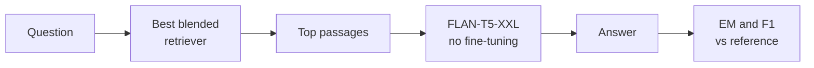
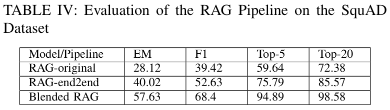
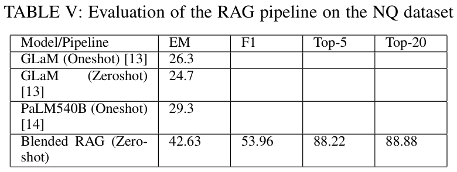

# 06. RAG Experimentation (Paper Section V, Tables IV and V)

In this note:

- The setup: best retriever plus FLAN-T5-XXL
- EM and F1 explained
- V.A SQuAD and Table IV
- V.B NQ and Table V
- Checking the headline percentages
- What the comparisons do and do not show
- What this means for our project

## The Setup

"From the retriever evaluation experiments, we know the best retriever, i.e., the best combination of indices + query." That retriever feeds a generator. "To avoid the effect of LLM size or type, we perform all experiments using FLAN-T5-XXL" (an instruction-tuned T5 model with about 11 billion parameters).

Blended RAG is **zero-shot**: neither the retriever nor the generator is trained on the evaluation dataset.

## EM and F1

<table width="100%">
<thead><tr><th>Metric</th><th>Definition</th><th>Example: reference "December 2018 Wikipedia dump"</th></tr></thead>
<tbody>
<tr><td>EM (Exact Match)</td><td>1 if the normalised answer equals the reference, else 0</td><td>"a 2018 Wikipedia dump" scores 0</td></tr>
<tr><td>F1</td><td>Harmonic mean of word precision and word recall against the reference</td><td>"a 2018 Wikipedia dump" (articles removed: 3 words) matches 3 of the 4 reference words: precision 1.0, recall 0.75, F1 0.86</td></tr>
</tbody>
</table>

Both reward wording close to the reference, not correctness in general; the paper itself calls them poor proxies (note 07).

## V.A SQuAD and Table IV

<table width="100%">
<thead><tr><th>Pipeline</th><th>Trained on</th><th>EM</th><th>F1</th><th>Top-5</th><th>Top-20</th></tr></thead>
<tbody>
<tr><td>RAG-original</td><td>NQ (no SQuAD adaptation)</td><td>28.12</td><td>39.42</td><td>59.64</td><td>72.38</td></tr>
<tr><td>RAG-end2end</td><td>Fine-tuned for SQuAD</td><td>40.02</td><td>52.63</td><td>75.79</td><td>85.57</td></tr>
<tr><td>Blended RAG</td><td>Nothing (zero-shot)</td><td><strong>57.63</strong></td><td><strong>68.4</strong></td><td><strong>94.89</strong></td><td><strong>98.58</strong></td></tr>
</tbody>
</table>

RAG-original and RAG-end2end come from Siriwardhana et al. (2023), a study of domain adaptation for RAG. The paper: Blended RAG "showcases enhanced performance for Generative Q&A with F1 scores higher by 50%, even without dataset-specific fine-tuning."

## V.B NQ and Table V

<table width="100%">
<thead><tr><th>System</th><th>EM</th><th>F1</th><th>Top-5</th><th>Top-20</th></tr></thead>
<tbody>
<tr><td>GLaM (one-shot)</td><td>26.3</td><td>-</td><td>-</td><td>-</td></tr>
<tr><td>GLaM (zero-shot)</td><td>24.7</td><td>-</td><td>-</td><td>-</td></tr>
<tr><td>PaLM 540B (one-shot)</td><td>29.3</td><td>-</td><td>-</td><td>-</td></tr>
<tr><td>Blended RAG (zero-shot)</td><td><strong>42.63</strong></td><td>53.96</td><td>88.22</td><td>88.88</td></tr>
</tbody>
</table>

The paper: Blended RAG "demonstrated superior performance with an EM of 42.63, improving the prior benchmark by 35%."

## Checking the Headline Percentages

<table width="100%">
<thead><tr><th>Claim</th><th>Computed from the tables</th><th>Matches?</th></tr></thead>
<tbody>
<tr><td>SQuAD F1 "higher by 50%"</td><td>68.4 vs 52.63 (RAG-end2end): +30% relative, +15.8 points; 68.4 vs 39.42 (RAG-original): +74% relative, +29 points</td><td>Neither comparison gives 50%</td></tr>
<tr><td>NQ EM "improving the prior benchmark by 35%"</td><td>42.63 vs 29.3 (PaLM, best prior): +45% relative, +13.3 points</td><td>Not 35%</td></tr>
</tbody>
</table>

The direction of both claims holds (Blended RAG is clearly higher); the exact percentages cannot be reproduced from the tables.

## What the Comparisons Do and Do Not Show

<table width="100%">
<thead><tr><th>Comparison</th><th>What differs besides the retriever</th></tr></thead>
<tbody>
<tr><td>Blended RAG vs RAG-original and RAG-end2end (SQuAD)</td><td>The generator (FLAN-T5-XXL vs BART in RAG), the retriever model (DPR in RAG), and the passages indexed. The table compares whole systems, not retrievers</td></tr>
<tr><td>Blended RAG vs GLaM and PaLM (NQ)</td><td>GLaM and PaLM answer from memory without retrieval (closed-book), so this compares RAG with no RAG, not a better retriever with a worse one</td></tr>
<tr><td>Retrieval accuracy columns (Top-5, Top-20)</td><td>On SQuAD, Blended RAG retrieves the right passage far more often (94.89 vs 75.79 top-5). This is the clearest evidence that the retriever drives the gain</td></tr>
</tbody>
</table>

One more detail: on NQ, top-5 (88.22) and top-20 (88.88) are almost equal. Either the right passage is found in the first five, or it is not found at all; more candidates barely help. That pattern fits a corpus where the question's words appear in the passage title or text when the passage is right.

## What This Means for Our Project

- The paper's strongest RAG evidence is the retrieval column: better retrieval (94.89 vs 75.79 top-5 on SQuAD) goes with better answers. That is the same reasoning behind moving our evaluation to chunk-level hit rate.
- Whole-system comparisons hide which part helped. Our presets (basic concepts note 13) change only retrieval and keep the same rewriter, reranker and generator, so a difference can be attributed.
- Always recompute headline percentages from the tables before quoting them.

## Key Points

- Blended RAG = best blended retriever + FLAN-T5-XXL, zero-shot.
- SQuAD: EM 57.63, F1 68.4, top-5 94.89, against fine-tuned RAG-end2end at 40.02, 52.63 and 75.79.
- NQ: EM 42.63 against PaLM 540B one-shot 29.3 (closed-book).
- The stated "50%" and "35%" gains do not match the tables (computed: +30% or +74% F1; +45% EM); the comparisons are system against system, not retriever against retriever.

## Navigation

Previous: [05. Retriever Benchmarking](05.%20Retriever%20Benchmarking.md) | [Paper index](README.md) | Next: [07. Discussion and Conclusion](07.%20Discussion%20and%20Conclusion.md)
