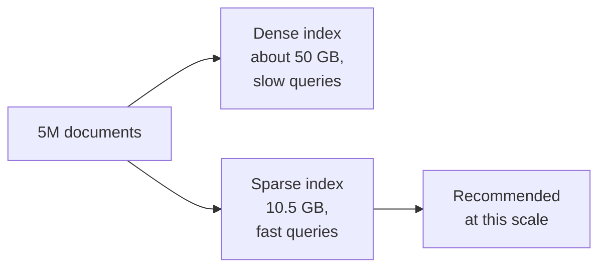
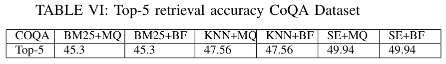

# 07. Discussion and Conclusion (Paper Sections VI and VII, Table VI)

In this note:

- The gap between retrieval research and RAG research
- VI.A Sparse vs dense index: size and speed
- VI.B Blended retrievers without metadata, and Table VI
- The note on metrics
- VII Conclusion, checked
- What we take from the paper, and what we leave

## Two Research Worlds

The authors found "no standard datasets on which both R (Retriever) and RAG benchmarks are available". Retrieval is studied in information retrieval with metrics like NDCG; RAG is studied in the LLM world with EM and F1. The paper tries to connect them by measuring both on the same datasets.

## VI.A Sparse vs Dense Index

For HotPotQA (5M documents):

<table width="100%">
<thead><tr><th></th><th>Dense vector index</th><th>Sparse encoder index</th></tr></thead>
<tbody>
<tr><td>Index size</td><td>About 50 GB</td><td>10.5 GB</td></tr>
<tr><td>Indexing</td><td>Fast</td><td>Slower</td></tr>
<tr><td>Querying</td><td>"relatively sluggish"</td><td>"expeditious" (fast)</td></tr>
</tbody>
</table>

A dense index stores a full vector (hundreds of numbers) for every passage; a sparse index stores only the non-zero weighted words in an inverted index. The authors recommend sparse encoder indexes at this scale, and "multi-tenancy with federated search queries" (splitting the data into several indexes searched together) for large enterprises.

For comparison, our measured indexes for 410 chunks (basic concepts note 14): FAISS 2.5 MB, BM25 about 398 KB. Dense indexes are larger per document in our case too, by about six times.

## VI.B Blended Retrievers Without Metadata

"When datasets are enriched with metadata or other relevant informational facets, they improve the efficacy of blended retrievers." CoQA, a conversational dataset, has no such metadata:

<table width="100%">
<thead><tr><th>Retriever</th><th>CoQA top-5</th></tr></thead>
<tbody>
<tr><td>BM25 + match / + best fields</td><td>45.3 / 45.3</td></tr>
<tr><td>KNN + match / + best fields</td><td>47.56 / 47.56</td></tr>
<tr><td>Sparse encoder + match / + best fields</td><td>49.94 / 49.94</td></tr>
</tbody>
</table>

- Match and best fields give **identical** numbers for every index: with only one useful field, a multi-field query has nothing extra to work with.
- The sparse encoder is still best (+4.6 points over BM25).
- Figure 8 (note 05) shows CoQA top-5 values of 38.95 to 42.94 for the same six retrievers, lower than Table VI. The paper does not explain the difference.

This is the paper's most useful limitation: **the "hybrid query" gains come from metadata fields.** Without them, the choice of index is all that is left.

## The Note on Metrics

> "while NDCG@10 scores for Retriever and F1,EM scores for RAG are commonly used metrics, we found them to be poor proxies of Generative Q&A systems for human alignment."

EM and F1 compare words, so a correct answer in different words scores low. This is why our project uses an LLM judge for correctness and faithfulness (Naive RAG and Advanced RAG evaluations), with known reference answers.

## VII Conclusion, Checked

<table width="100%">
<thead><tr><th>Conclusion</th><th>Where it comes from</th><th>Comment</th></tr></thead>
<tbody>
<tr><td>Sparse encoder + best fields is "the superior construct across all"</td><td>Notes 04 and 05</td><td>Best on NQ, TREC-COVID, HotPotQA; not on SQuAD, where KNN wins; tied with BM25 + best fields on TREC-COVID NDCG@10</td></tr>
<tr><td>"a new benchmark of 87% for Retriever Accuracy on TREC-COVID"</td><td>Figure 7, Table II</td><td>The 87 is an NDCG@10 of 0.87, not an accuracy; the top-10 accuracy of the same retriever was 98% (score 2)</td></tr>
<tr><td>"68% F1 Score on SQUAD and 42% EM Score on NQ dataset; for non-tuned Q&A systems"</td><td>Tables IV and V</td><td>Matches the tables (68.4 and 42.63)</td></tr>
<tr><td>Better results "with relatively smaller LLM"</td><td>FLAN-T5-XXL against PaLM 540B</td><td>True, but PaLM ran without retrieval</td></tr>
<tr><td>No prompt exemplars needed</td><td>Zero-shot setup</td><td>Holds: no few-shot examples were used</td></tr>
</tbody>
</table>

## What We Take and What We Leave

<table width="100%">
<thead><tr><th>From the paper</th><th>Decision for our Hybrid Search RAG</th></tr></thead>
<tbody>
<tr><td>Keyword, dense and learned sparse retrieval each win on some datasets</td><td>Take: keep both BM25 and dense; learned sparse stays a later option (stack rules)</td></tr>
<tr><td>Query construction and metadata fields matter</td><td>Take: same text analysis for chunks and queries; consider adding the file name as a BM25 field</td></tr>
<tr><td>Measure retrieval and RAG on the same questions</td><td>Take: chunk-level hit rate plus correctness on our test set</td></tr>
<tr><td>Elasticsearch, ELSER, multi-match queries</td><td>Leave: outside our stack (FastAPI, FAISS, plain Python BM25)</td></tr>
<tr><td>How to combine the two lists</td><td>Not covered by this paper: RRF and weighted fusion come from papers 2 and 3</td></tr>
</tbody>
</table>

## Key Points

- Sparse indexes can be much smaller and faster to query than dense ones at scale (10.5 GB against about 50 GB for 5M documents).
- Multi-field "hybrid queries" need metadata; on CoQA they add nothing, and the sparse encoder is still best.
- The authors call NDCG, EM and F1 poor proxies for answer quality.
- Conclusions mostly match the data, with two corrections: TREC-COVID "87% accuracy" is an NDCG@10, and BM25 + best fields ties the winner there.

## Navigation

Previous: [06. RAG Experimentation](06.%20RAG%20Experimentation.md) | [Paper index](README.md) | Next paper: [An Analysis of Fusion Functions for Hybrid Retrieval](../README.md)
