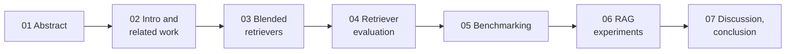

# Blended RAG

These notes go through the paper one section at a time, with one note per section of the paper.

## Paper Card

<table width="100%">
<thead><tr><th>Field</th><th>Value</th></tr></thead>
<tbody>
<tr><td>Title</td><td>Blended RAG: Improving RAG (Retriever-Augmented Generation) Accuracy with Semantic Search and Hybrid Query-Based Retrievers</td></tr>
<tr><td>Authors</td><td>Kunal Sawarkar, Abhilasha Mangal, Shivam Raj Solanki</td></tr>
<tr><td>Organization</td><td>IBM</td></tr>
<tr><td>Year and venue</td><td>2024, arXiv (version 2, August 2024)</td></tr>
<tr><td>arXiv</td><td><a href="https://arxiv.org/abs/2404.07220">2404.07220</a></td></tr>
<tr><td>Local PDF</td><td><a href="../../../02.%20Papers/2404.07220_Blended-RAG.pdf">2404.07220_Blended-RAG.pdf</a></td></tr>
<tr><td>Core idea</td><td>Try three index types (BM25, dense vector KNN, ELSER sparse encoder) with several Elasticsearch query types, pick the best combinations by top-k retrieval accuracy, and feed the best retriever to an LLM for question answering</td></tr>
</tbody>
</table>

## Notes (one per paper section)

<table width="100%">
<thead><tr><th>#</th><th>Note</th><th>Paper section</th><th>Status</th></tr></thead>
<tbody>
<tr><td>01</td><td><a href="01.%20Abstract.md">Abstract</a></td><td>Abstract</td><td>Done</td></tr>
<tr><td>02</td><td><a href="02.%20Introduction%20and%20Related%20Work.md">Introduction and Related Work</a></td><td>I Introduction, II Related Work (Table I)</td><td>Done</td></tr>
<tr><td>03</td><td><a href="03.%20Blended%20Retrievers.md">Blended Retrievers</a></td><td>III Blended Retrievers (Figure 1)</td><td>Done</td></tr>
<tr><td>04</td><td><a href="04.%20Retriever%20Evaluation.md">Retriever Evaluation</a></td><td>IV Experimentation for Retriever Evaluation (Figures 2 to 5)</td><td>Done</td></tr>
<tr><td>05</td><td><a href="05.%20Retriever%20Benchmarking.md">Retriever Benchmarking</a></td><td>IV.A Retriever Benchmarking, IV.B Summary (Figures 6 to 8, Tables II and III)</td><td>Done</td></tr>
<tr><td>06</td><td>RAG Experimentation</td><td>V RAG Experimentation (Tables IV and V)</td><td>Planned</td></tr>
<tr><td>07</td><td>Discussion and Conclusion</td><td>VI Discussion, VII Conclusion (Table VI)</td><td>Planned</td></tr>
</tbody>
</table>

## How to Read These Notes

The paper is short (6 pages of content) and mostly experimental. The notes explain every figure and table, check the headline numbers against the tables, and point out where the paper leaves details out. Each note ends with what the section means for our Hybrid Search RAG.

## Navigation

[Research Paper Explained](../README.md) | Next paper: [An Analysis of Fusion Functions for Hybrid Retrieval](../README.md)
