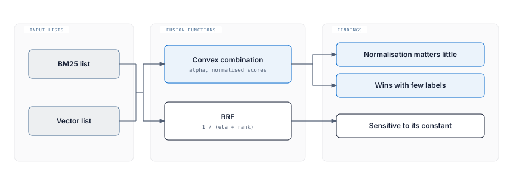
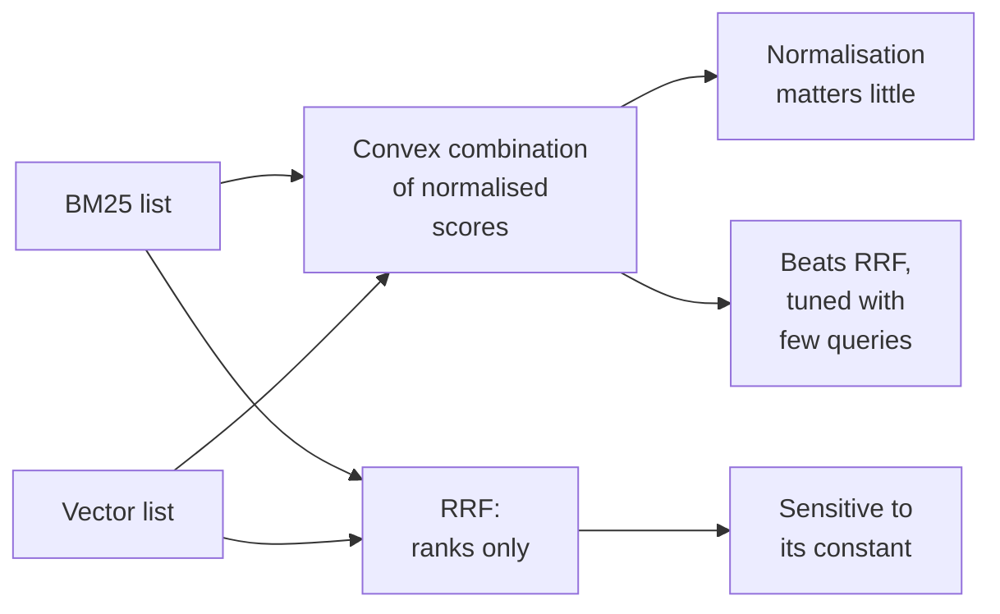

# 01. Abstract (Paper Section: Abstract)

In this note:

- The abstract split into its sentences
- Each sentence explained in simple words
- Words you need to know before reading further
- The paper in one picture

## The Abstract, Sentence by Sentence

<table width="100%">
<thead><tr><th>#</th><th>Sentence (from the paper)</th><th>In simple words</th></tr></thead>
<tbody>
<tr><td>1</td><td>"We study hybrid search in text retrieval where lexical and semantic search are fused together with the intuition that the two are complementary in how they model relevance."</td><td>Keyword search and vector search find different things, so merging them should help. The paper studies how to merge.</td></tr>
<tr><td>2</td><td>"In particular, we examine fusion by a convex combination (CC) of lexical and semantic scores, as well as the Reciprocal Rank Fusion (RRF) method, and identify their advantages and potential pitfalls."</td><td>Two methods are compared: a weighted sum of scores, and RRF, which uses only ranks.</td></tr>
<tr><td>3</td><td>"Contrary to existing studies, we find RRF to be sensitive to its parameters;"</td><td>RRF is often called "no tuning needed". Its constant (60) actually changes the results a lot.</td></tr>
<tr><td>4</td><td>"that the learning of a CC fusion is generally agnostic to the choice of score normalization;"</td><td>Min-max or z-score: once the weight is tuned, it hardly matters which one you use.</td></tr>
<tr><td>5</td><td>"that CC outperforms RRF in in-domain and out-of-domain settings;"</td><td>The weighted sum ranks better than RRF, both on data the vector model was trained on and on new data.</td></tr>
<tr><td>6</td><td>"and finally, that CC is sample efficient, requiring only a small set of training examples to tune its only parameter to a target domain."</td><td>A few labelled questions are enough to set the weight for a new collection.</td></tr>
</tbody>
</table>

## Words to Know

<table width="100%">
<thead><tr><th>Term</th><th>Meaning</th><th>Where in our notes</th></tr></thead>
<tbody>
<tr><td>Lexical search</td><td>Keyword search on a bag of words, here BM25</td><td>Basic concepts 03</td></tr>
<tr><td>Semantic search</td><td>Search by nearest embedding vectors</td><td>Basic concepts 05</td></tr>
<tr><td>Convex combination (CC)</td><td>alpha times one score plus (1 - alpha) times the other, with alpha between 0 and 1</td><td>Basic concepts 10</td></tr>
<tr><td>Normalisation</td><td>Rescaling scores before they are combined: min-max, theoretical min-max, z-score</td><td>Basic concepts 08</td></tr>
<tr><td>RRF</td><td>Sum of 1 / (eta + rank) over the lists; the paper calls the constant eta</td><td>Basic concepts 09</td></tr>
<tr><td>In-domain, out-of-domain</td><td>Datasets the vector model was trained on, and datasets it never saw (zero-shot)</td><td>Note 04</td></tr>
<tr><td>Sample efficient</td><td>Needs few labelled examples to tune</td><td>Note 09</td></tr>
</tbody>
</table>

## The Paper in One Picture

## Why This Paper Matters to Us

Our basic concepts note 10 chose RRF as the default because it needs no labelled data, and kept weighted fusion as a setting. This paper argues the opposite default: a convex combination with theoretical min-max normalisation (they call it TM2C2), tuned on a few labelled queries. The notes that follow check how strong that evidence is and what it means for a project with 10 test questions.

## Key Points

- The paper compares convex combination (weighted scores) and RRF (ranks) for fusing BM25 and vector search.
- Four findings: RRF is sensitive to its parameter; normalisation choice matters little for a tuned CC; CC beats RRF; CC is sample efficient.
- It challenges the common view, also in our note 10, that RRF is the safe default.

## Navigation

[Paper index](README.md) | Next: [02. Introduction](02.%20Introduction.md)
