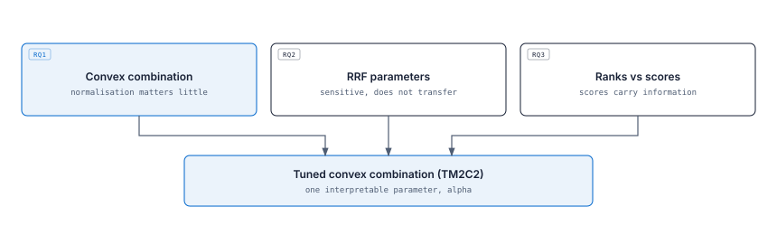
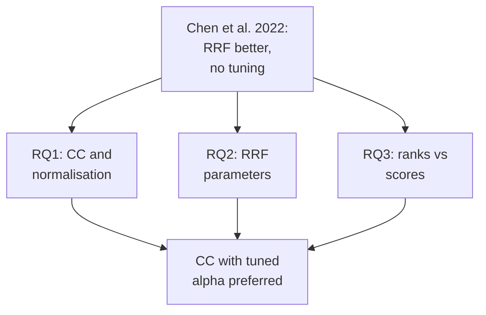

# 02. Introduction (Paper Section 1)

In this note:

- Retrieval as the first stage, and two kinds of relevance
- Hybrid search as the fusion of two ranked lists
- The study the paper responds to (Chen et al. 2022)
- The three research questions
- The headline claims

## Retrieval and Relevance

"Retrieval is the first stage in a multi-stage ranking system", whose job is to find the top-k documents for a query. Two questions are hidden in that job: how to **measure** relevance, and how to **find** the top-k efficiently. This paper is about the first.

<table width="100%">
<thead><tr><th></th><th>Lexical search</th><th>Semantic search</th></tr></thead>
<tbody>
<tr><td>Model</td><td>Bag of words, TF-IDF family, BM25</td><td>Vectors from a pre-trained language model such as BERT; top-k becomes k nearest neighbours</td></tr>
<tr><td>Strengths</td><td>"simple, efficient, (naturally) zero-shot, and generally effective"</td><td>Captures the meaning of queries and documents</td></tr>
<tr><td>Weakness</td><td>"susceptible to the vocabulary mismatch problem"; ignores semantic similarity</td><td>Often worse than BM25 on datasets it was not trained on</td></tr>
</tbody>
</table>

Hybrid search: given the lexical list R_Lex and the semantic list R_Sem for a query, build one fused list R_Fusion that is better than both. The paper notes it helps "especially when applied to out-of-domain datasets".

## The Study Being Re-examined

The usual fusion is a convex combination:

$$f_{\text{Convex}} = \alpha f_{\text{Sem}} + (1 - \alpha) f_{\text{Lex}}, \quad 0 \le \alpha \le 1$$

usually after min-max scaling, because BM25 and dot products are unbounded. Chen et al. (ECIR 2022, "Out-of-Domain Semantics to the Rescue!") argued that this is "sensitive to the score scales ... which needs careful score normalization", and showed that RRF works better and needs no tuning, even zero-shot. This paper was "inspired by" those claims and re-examines **why** the methods behave as they do.

## The Three Research Questions

<table width="100%">
<thead><tr><th>RQ</th><th>Question</th><th>Answer in the paper</th></tr></thead>
<tbody>
<tr><td>RQ1</td><td>Is convex combination a reasonable choice, and how sensitive is it to normalisation?</td><td>Normalisation is needed (to bound the scores), but which one matters little: for any weight with one linear normalisation, another weight gives the same ranking with another</td></tr>
<tr><td>RQ2</td><td>How sensitive is RRF to its parameters?</td><td>Very. RRF has one constant per list (two here), one more parameter than CC, and tuned values do not carry over to new domains</td></tr>
<tr><td>RQ3</td><td>Does ignoring the score distribution lose information?</td><td>Yes: a smoothed version of RRF that keeps some score information ranks better</td></tr>
</tbody>
</table>

The last claim: tuning alpha "is extremely sample-efficient, requiring just a handful of labeled queries", while RRF "converges to a relatively less effective retrieval system". The authors conclude that CC is "theoretically sound, empirically effective, sample-efficient, and robust to domain shift", and that alpha is interpretable, so it "can be adjusted to incorporate domain knowledge" when no labels exist.

## What This Means for Our Project

- RQ2 matches our own measurement in basic concepts note 09: changing k from 60 to 1 moved the chunk both lists agreed on from rank 1 to rank 3.
- RQ3 matches the weakness we listed for RRF: "a clear BM25 winner and a narrow one get the same credit".
- The paper's view that alpha can be set from domain knowledge fits our note 10 table ("lean towards keywords for codes and names").

## Key Points

- Lexical and semantic search fail in different ways; hybrid search fuses their lists.
- The paper re-examines Chen et al.'s claim that RRF beats a convex combination.
- Three questions: normalisation in CC, parameters of RRF, and the cost of ignoring scores.
- Claimed answers: normalisation choice matters little, RRF is sensitive, ignoring scores loses information, CC tunes with few queries.

## Navigation

Previous: [01. Abstract](01.%20Abstract.md) | [Paper index](README.md) | Next: [03. Related Work](03.%20Related%20Work.md)
