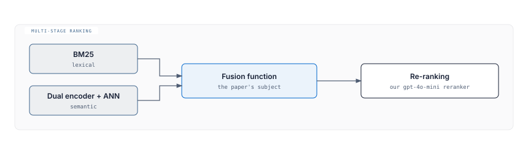
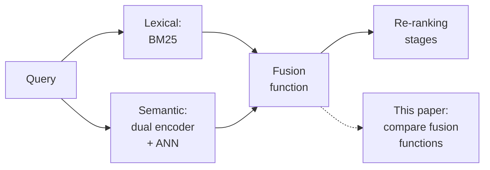

# 03. Related Work (Paper Section 2)

In this note:

- Multi-stage ranking: recall first, precision later
- BM25 and the vocabulary mismatch problem
- From BERT re-rankers to dual encoders
- Hybrid search in earlier work
- Where our project sits

## Multi-Stage Ranking

A ranking system usually has a **retrieval stage** and then "several subsequent re-ranking stages" with more expensive models (learning-to-rank). The traditional view: retrieval should maximise **recall** and leave precision to the re-rankers. A recent study (Zamani et al.) argues retrieval should optimise precision too, so this paper reports both recall and NDCG, mostly NDCG.

## BM25 and Its Limits

The paper describes BM25 as an additive statistic: for each query term, its in-document importance (term frequency normalised by length) times its "propensity" (inverse document frequency), summed over query terms. Because it needs exact term matches, "even a slight typo can throw the function off". This **vocabulary mismatch** problem has been attacked with pseudo-relevance feedback and query or document expansion, but lexical methods still cannot capture semantic similarity.

## From BERT to Dual Encoders

<table width="100%">
<thead><tr><th>Design</th><th>How it works</th><th>Used for</th></tr></thead>
<tbody>
<tr><td>BERT re-ranker (cross-encoder)</td><td>Reads query and document together</td><td>Re-ranking: too slow for a whole collection</td></tr>
<tr><td>Dual encoder (bi-encoder)</td><td>Encodes documents once, offline; only the query is encoded at search time</td><td>First-stage semantic retrieval</td></tr>
<tr><td>Nearest neighbour search</td><td>FAISS, HNSW graphs or a managed service find the k closest vectors</td><td>Making dual encoders fast</td></tr>
</tbody>
</table>

This is the same split as in our Advanced RAG notes: a cross-encoder style reranker (our gpt-4o-mini reranker plays that role) after a bi-encoder retriever (text-embedding-3-small with FAISS).

## Hybrid Search So Far

Semantic search has its own limit: "when applied to out-of-domain datasets, their performance is often worse than BM25." Since the two are complementary, many studies fuse them. The paper's critique: most focus on in-domain data (only Chen et al. also test zero-shot), and "most of these works only use one of the many existing fusion functions in experiments, but none compares the main ideas comprehensively." Filling that gap is the paper's goal.

## Where Our Project Sits

<table width="100%">
<thead><tr><th>Stage</th><th>This paper</th><th>Our Hybrid Search RAG</th></tr></thead>
<tbody>
<tr><td>Lexical</td><td>BM25 (PISA)</td><td>BM25 in plain Python</td></tr>
<tr><td>Semantic</td><td>all-MiniLM-L6-v2 dual encoder, FAISS</td><td>text-embedding-3-small, FAISS</td></tr>
<tr><td>Fusion</td><td>The subject of the paper</td><td>RRF by default, weighted fusion as a setting</td></tr>
<tr><td>Re-ranking</td><td>Out of scope</td><td>gpt-4o-mini reranker and threshold</td></tr>
</tbody>
</table>

One difference matters: the paper evaluates the fused list **directly** (NDCG@1000), while our fused top 10 goes through a reranker. Basic concepts note 11 explains why fusion differences shrink behind a reranker: the reranker only needs the answer chunk to be among the candidates.

## Key Points

- Retrieval feeds re-rankers; the paper reports recall and, mainly, NDCG.
- BM25 suffers from vocabulary mismatch; dual encoders bring semantics to first-stage retrieval but can fail out of domain.
- Earlier hybrid work usually tested one fusion function; this paper compares them directly.
- Our pipeline has the same parts plus a reranker after fusion.

## Navigation

Previous: [02. Introduction](02.%20Introduction.md) | [Paper index](README.md) | Next: [04. Setup](04.%20Setup.md)
