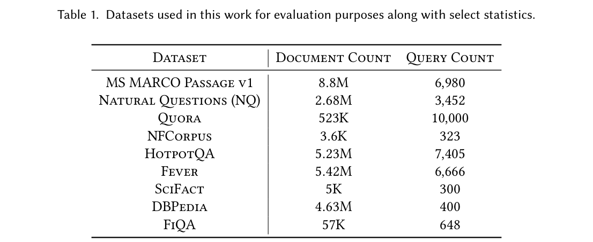
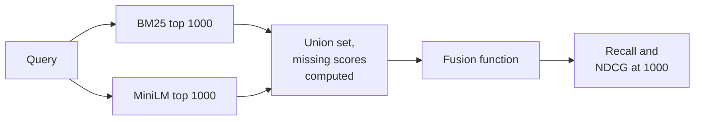

# 04. Setup (Paper Sections 3.1 and 3.2, Table 1)

In this note:

- 3.1 Notation: scores, ranks, the union set and missing scores
- 3.2 Datasets and Table 1
- The two retrievers and their settings
- Supplementary model pairs
- Evaluation: Recall and NDCG at 1000
- What this means for our project

## 3.1 Notation

<table width="100%">
<thead><tr><th>Symbol (plain text)</th><th>Meaning</th><th>Our equivalent</th></tr></thead>
<tbody>
<tr><td>f_o(q, d)</td><td>Score of document d for query q by retrieval system o</td><td>BM25 score or cosine similarity of a chunk</td></tr>
<tr><td>Lex, Sem</td><td>The lexical system (BM25) and the semantic system (cosine or inner product)</td><td>BM25 and FAISS</td></tr>
<tr><td>R_o^k(q)</td><td>Top-k documents of system o</td><td>Top 10 of each list</td></tr>
<tr><td>pi_o(q, d)</td><td>Rank of d in system o</td><td>BM25 rank, vector rank</td></tr>
<tr><td>U^k(q)</td><td>The union set: all documents in either top-k list</td><td>The candidate union of basic concepts note 10</td></tr>
<tr><td>f_Fusion</td><td>The fusion function applied to the union set</td><td>RRF or weighted fusion</td></tr>
</tbody>
</table>

The rank is written as a count (Equation 1):

$$\pi_o(q, d_i) = 1 + \sum_{d_j \in R_o^k(q)} \mathbb{1}\left[f_o(q, d_j) > f_o(q, d_i)\right]$$

In words: a document's rank is one plus the number of documents with a higher score. This form matters later (note 08), when the authors replace the hard 0-or-1 indicator with a smooth curve.

**Missing scores.** When a document is in the union set but not in one system's top-k, "we compute its missing score ... prior to fusion". This is the "compute the missing score" option from our basic concepts note 08, and what our measurement script did in note 10.

## 3.2 Datasets

<table width="100%">
<thead><tr><th>Dataset</th><th>Task</th><th>Documents</th><th>Test queries</th><th>Setting</th></tr></thead>
<tbody>
<tr><td>MS MARCO Passage v1</td><td>Web search (Bing)</td><td>8.8M</td><td>6,980 (dev small)</td><td>In-domain</td></tr>
<tr><td>Natural Questions</td><td>Question answering</td><td>2.68M</td><td>3,452</td><td>In-domain</td></tr>
<tr><td>Quora</td><td>Duplicate question detection</td><td>523K</td><td>10,000</td><td>In-domain</td></tr>
<tr><td>NFCorpus</td><td>Medical</td><td>3.6K</td><td>323</td><td>Out-of-domain</td></tr>
<tr><td>HotpotQA</td><td>Multi-hop question answering</td><td>5.23M</td><td>7,405</td><td>Out-of-domain</td></tr>
<tr><td>FEVER</td><td>Fact extraction</td><td>5.42M</td><td>6,666</td><td>Out-of-domain</td></tr>
<tr><td>SciFact</td><td>Scientific claim verification</td><td>5K</td><td>300</td><td>Out-of-domain</td></tr>
<tr><td>DBPedia</td><td>Entity search</td><td>4.63M</td><td>400</td><td>Out-of-domain</td></tr>
<tr><td>FiQA</td><td>Financial</td><td>57K</td><td>648</td><td>Out-of-domain</td></tr>
</tbody>
</table>

The eight datasets after MS MARCO come from the BEIR benchmark. "In-domain" means the semantic model was fine-tuned on that dataset (see below).

## The Two Retrievers

<table width="100%">
<thead><tr><th></th><th>Lexical</th><th>Semantic</th></tr></thead>
<tbody>
<tr><td>System</td><td>PISA search engine, BM25</td><td>all-MiniLM-L6-v2 (384 dimensions), FAISS IndexFlatIP, cosine</td></tr>
<tr><td>Text processing</td><td>Split on spaces, PISA's stemming; no stop word removal, lemmatisation or expansion</td><td>The model's own tokeniser</td></tr>
<tr><td>Parameters</td><td>k1 = 0.9, b = 0.4 (as in Chen et al.)</td><td>Fine-tuned on over 1 billion text pairs, including MS MARCO, NQ and Quora</td></tr>
<tr><td>Candidates</td><td>Top 1,000</td><td>Top 1,000 (exact search)</td></tr>
</tbody>
</table>

Because the semantic model saw MS MARCO, NQ and Quora in training, those three are **in-domain**; the other six are **out-of-domain** (zero-shot).

**Supplementary pairs (Appendices A to D):** Splade + BM25, Tas-B + BM25, Tas-B + Splade, Tas-B + all-MiniLM-L6-v2. Splade and Tas-B were fine-tuned on MS MARCO only, so for them only MS MARCO is in-domain. The point: the normalisation and fusion analysis applies to any pair of scoring functions, not just keyword plus vector.

## Evaluation

For every query: form the union set, compute missing scores, apply the fusion function, re-order, and measure **Recall@1000** and **NDCG@1000** (at 100 for the small SciFact and NFCorpus, which have 5K and 3.6K documents; at 1,000, recall would approach 1 for every method). Deep cut-offs are chosen to see the whole ranking, not just the top.

## What This Means for Our Project

<table width="100%">
<thead><tr><th>Choice</th><th>Paper</th><th>Ours</th><th>Consequence</th></tr></thead>
<tbody>
<tr><td>BM25 parameters</td><td>k1 0.9, b 0.4</td><td>k1 1.2, b 0.75</td><td>Score ranges differ; normalisation handles it</td></tr>
<tr><td>Text processing</td><td>Stemming, no stop words</td><td>Stop words incl. "et", "al", no stemming</td><td>Our basic concepts note 04 measured why</td></tr>
<tr><td>List depth</td><td>1,000</td><td>10</td><td>Our union is 14 to 19 chunks; their union can be up to 2,000</td></tr>
<tr><td>Metric depth</td><td>NDCG@1000</td><td>Answer chunk in the fused top 10, then reranker</td><td>Their gains at depth 1000 may not show at depth 10</td></tr>
<tr><td>Domain</td><td>In-domain and zero-shot</td><td>Zero-shot: text-embedding-3-small never saw our files</td><td>Their out-of-domain results are the relevant ones for us</td></tr>
</tbody>
</table>

## Key Points

- Notation: scores f, ranks pi, union set U; missing scores are computed, not set to zero.
- Nine datasets: three in-domain for the semantic model, six zero-shot.
- BM25 (PISA, k1 0.9, b 0.4) and all-MiniLM-L6-v2 with exact FAISS search, top 1,000 each.
- Metrics: Recall and NDCG at 1000 (100 for the two small datasets).
- Our setting is zero-shot with much shorter lists, so out-of-domain results matter most for us.

## Navigation

Previous: [03. Related Work](03.%20Related%20Work.md) | [Paper index](README.md) | Next: [05. Suitability of Convex Combination](05.%20Suitability%20of%20Convex%20Combination.md)
