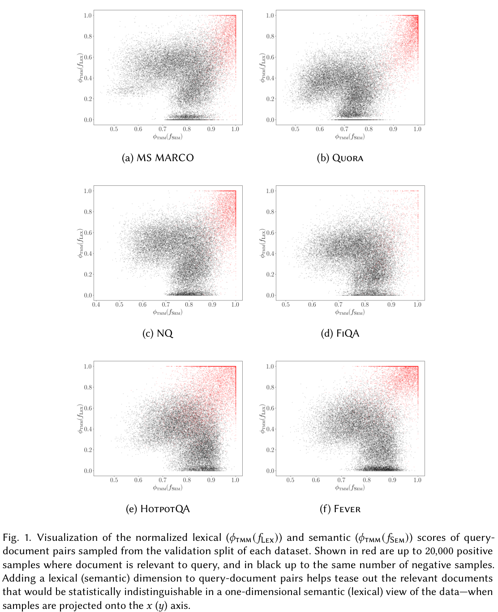
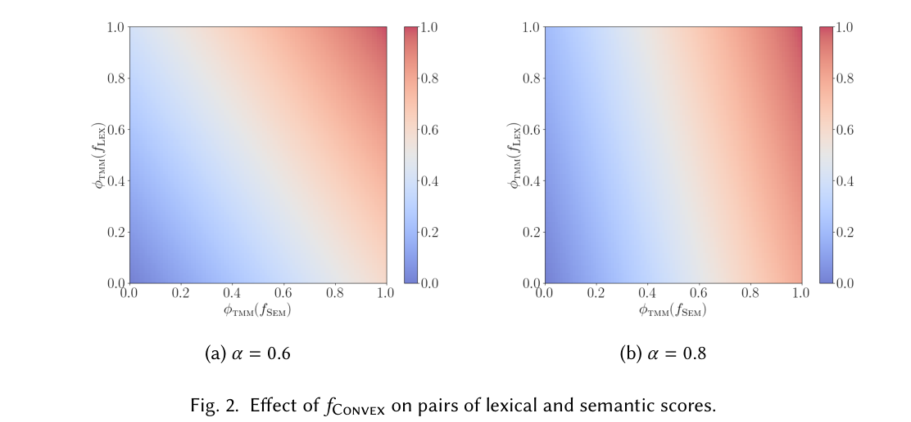
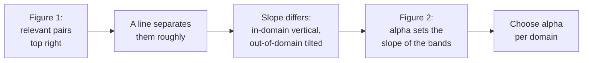

# 05. Suitability of Convex Combination (Paper Sections 4 and 4.1)

In this note:

- The convex combination and why it needs normalisation
- The three normalisations, as the paper defines them
- Figure 1: relevant and non-relevant pairs on a lexical-semantic plane
- Figure 2: what alpha does to that plane
- What this means for our project

## The Convex Combination

$$f_{\text{Convex}}(q, d) = \alpha f_{\text{Sem}}(q, d) + (1 - \alpha) f_{\text{Lex}}(q, d), \quad 0 \le \alpha \le 1$$

With alpha = 1 it is pure semantic search; with alpha = 0, pure lexical search. Its strength: "it takes into account the distribution of scores", so the distance between two documents' scores matters. Its weakness: the two score ranges differ, and BM25's range depends on the query ("BM25 is a function of the number of query terms"), so "any constant alpha is likely to yield inconsistently-scaled hybrid scores". The fix is normalisation (Equation 3):

$$f_{\text{Convex}}(q, d) = \alpha \phi_{\text{Sem}}(f_{\text{Sem}}(q, d)) + (1 - \alpha) \phi_{\text{Lex}}(f_{\text{Lex}}(q, d))$$

where phi can be any **monotone** function (it never changes the order within one list).

## Three Normalisations

<table width="100%">
<thead><tr><th>Name</th><th>Formula (plain text)</th><th>Notes</th></tr></thead>
<tbody>
<tr><td>Min-max, phi_mm (Eq. 2)</td><td>(f - m_q) / (M_q - m_q), with m_q and M_q the minimum and maximum over the union set</td><td>"the de facto method in the literature"</td></tr>
<tr><td>Theoretical min-max, phi_tmm (Eq. 4)</td><td>(f - inf f) / (M_q - inf f), with inf f the lowest value the function can ever give</td><td>inf = 0 for BM25, -1 for cosine similarity</td></tr>
<tr><td>Z-score, phi_z (Eq. 5)</td><td>(f - mu) / sigma over the query's scores</td><td>Unbounded</td></tr>
</tbody>
</table>

These are exactly the three we computed on real numbers in basic concepts note 08, where theoretical min-max kept the small cosine gaps small (1.000 to 0.982) while min-max stretched them (1.00 to 0.00).

The paper adds one practical remark: if all lexical (or semantic) scores in the union set are equal (variance 0), that side cannot change the ranking and fusion can be skipped; variance close to 0 "creates challenges for certain normalization functions", but they observed reasonably large variance on all datasets. Our note 08 found a tiny standard deviation for cosine scores (0.011) on one question, the case the paper sets aside.

## Figure 1: Is a Line a Good Separator?

The authors sample up to 20,000 relevant (positive) and 20,000 non-relevant (negative) query-document pairs per dataset and plot each pair by its two normalised scores: semantic on the x axis, lexical on the y axis.

How to read it:

- **Red** points (relevant) gather in the **top right**: high on both scores.
- **Black** points (non-relevant) spread over the middle and pile up along the **bottom** where the lexical score is 0: "there is a higher concentration of negative samples where lexical scores vanish." A document sharing no words with the query is rarely relevant.
- The two clusters are "with some error, separable by a linear function". The **slope** of the best separating line differs:
  - **In-domain** (MS MARCO, Quora, NQ): almost vertical. The semantic score alone separates them well.
  - **Out-of-domain** (HotpotQA, FEVER, and partly FiQA): the line tilts, so both scores are needed.

The key sentence: "adding a lexical (semantic) dimension to query-document pairs helps tease out the relevant documents that would be statistically indistinguishable in a one-dimensional semantic (lexical) view of the data." This is the visual proof that the two signals are complementary.

## Figure 2: What Alpha Does

Ranking is not classification; the fused list only needs the right **order**. Figure 2 colours the same plane by the fused score for two weights.

- The colour bands are lines of equal fused score. With **alpha = 0.6** they are tilted: lexical and semantic both move the score. With **alpha = 0.8** they are almost vertical: the semantic score dominates.
- In-domain data (where the separating line in Figure 1 is almost vertical) fits alpha = 0.8 better than 0.6.

## What This Means for Our Project

- A convex combination is a **line** in this plane, and alpha is its slope. That is the most intuitive way to explain alpha.
- Our setting is zero-shot (text-embedding-3-small never saw our papers), so the paper's out-of-domain pattern, a tilted line, suggests a lower alpha than 0.8. Our note 10 sweep agreed: the rag-corpus answer chunk stayed in the top 10 only for alpha 0.5 or less.
- "Negatives pile up where lexical scores vanish" supports giving BM25 a real weight: a chunk with no shared words is rarely the answer.

## Key Points

- Convex combination needs normalisation because BM25's scale changes per query; any monotone normaliser keeps each list's order.
- Min-max, theoretical min-max (inf 0 for BM25, -1 for cosine) and z-score are defined here.
- Figure 1: relevant pairs sit high on both scores; a line roughly separates them, vertical in-domain, tilted out-of-domain.
- Figure 2: alpha sets the slope; in-domain data fits alpha 0.8 better than 0.6.

## Navigation

Previous: [04. Setup](04.%20Setup.md) | [Paper index](README.md) | Next: [06. Role of Normalization](06.%20Role%20of%20Normalization.md)
