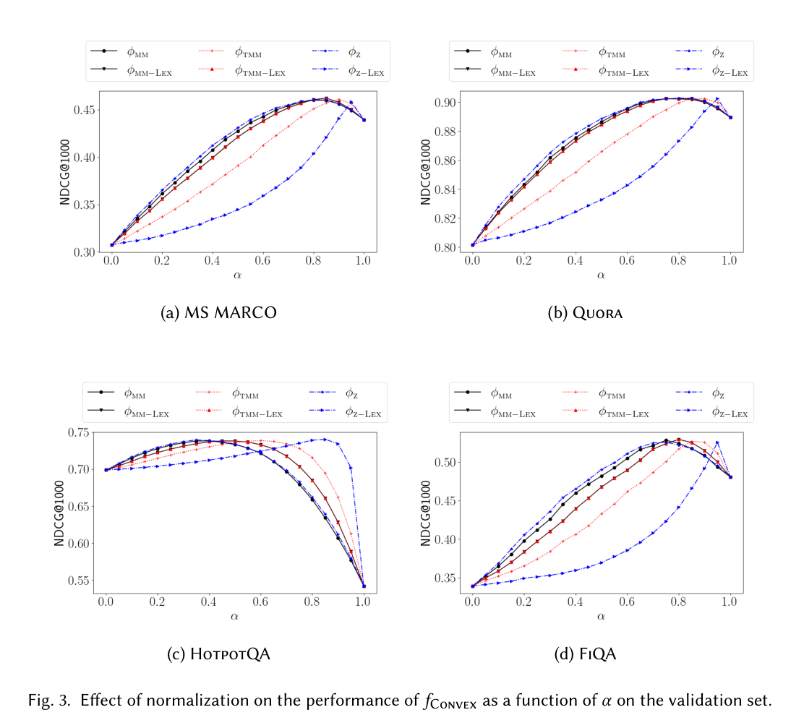
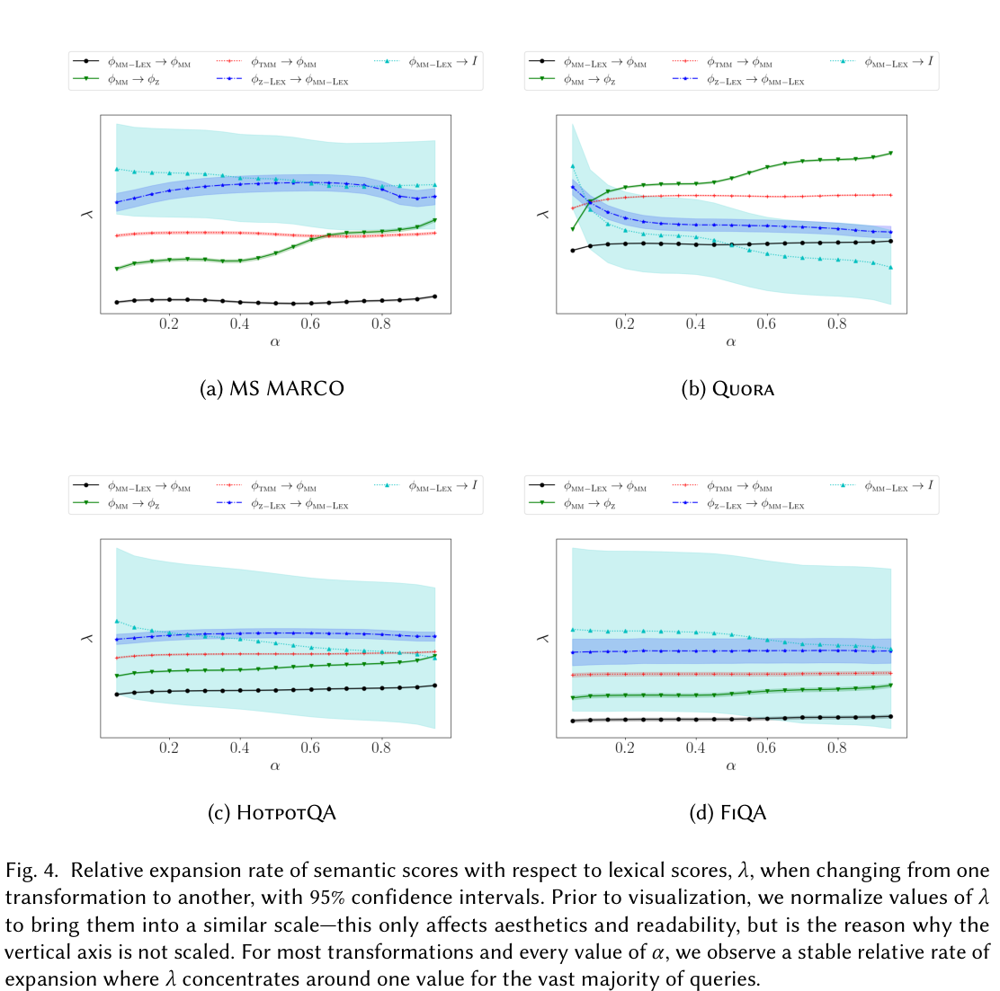
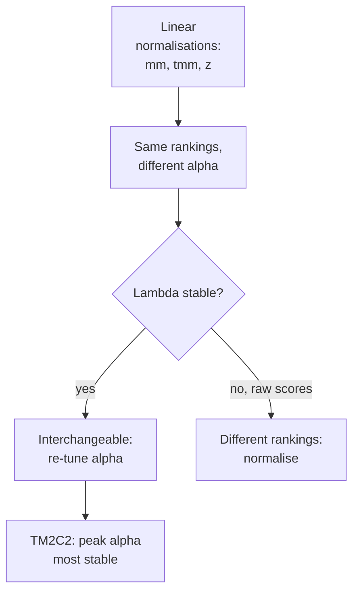

# 06. Role of Normalization (Paper Section 4.2)

In this note:

- The seven transformations tested
- Rank-equivalence, and why a linear normalisation only rescales alpha
- Lemma 4.2: min-max and z-score, per query, in plain words
- Theorem 4.5: when it holds for a whole set of queries
- Figure 3: the alpha curves shift instead of changing
- Figure 4: the relative expansion rate, measured
- Why theoretical min-max wins (TM2C2)
- What this means for our project

## The Question

Chen et al. said a convex combination "needs careful score normalization". Does the choice really matter? The authors test seven transformations:

<table width="100%">
<thead><tr><th>Name</th><th>Lexical scores</th><th>Semantic scores</th></tr></thead>
<tbody>
<tr><td>phi_mm</td><td>Min-max</td><td>Min-max</td></tr>
<tr><td>phi_tmm</td><td>Theoretical min-max</td><td>Theoretical min-max</td></tr>
<tr><td>phi_z</td><td>Z-score</td><td>Z-score</td></tr>
<tr><td>phi_mm-Lex</td><td>Min-max</td><td>Raw</td></tr>
<tr><td>phi_tmm-Lex</td><td>Theoretical min-max</td><td>Raw</td></tr>
<tr><td>phi_z-Lex</td><td>Z-score</td><td>Raw</td></tr>
<tr><td>I (identity)</td><td>Raw</td><td>Raw</td></tr>
</tbody>
</table>

## Rank-Equivalence

**Definition 4.1:** two functions are rank-equivalent on a set if they order its documents the same way. Only the order matters for retrieval, not the score values.

The key observation: all three normalisations are **linear** in the score (multiply by a positive number, then add a number). Adding a constant to every document's score, or multiplying all scores by the same positive number, never changes the order. So a convex combination of linearly normalised scores reduces to

$$f_{\text{Convex}} \overset{\pi}{=} (a\alpha) f_{\text{Sem}} + c(1 - \alpha) f_{\text{Lex}}$$

which is again a convex combination of the **raw** scores with a different weight, alpha' = a alpha / (a alpha + c (1 - alpha)). (The paper prints this weight with c in both places of the numerator term; the version with a follows from the line above it.) In words: **switching between linear normalisations only changes which alpha gives a particular ranking.**

## Lemma 4.2: Min-Max and Z-Score, One Query

> "For every query, given an arbitrary alpha, there exists a alpha' such that the convex combination of min-max normalized scores with parameter alpha is rank-equivalent to a convex combination of z-score normalized scores with alpha', and vice versa."

The proof in four steps:

1. Write the min-max combination: alpha (f_Sem - m_Sem) / R_Sem + (1 - alpha) (f_Lex - m_Lex) / R_Lex, where R is max minus min.
2. Drop the constants m: order unchanged.
3. Multiply by 1 / (sigma_Sem sigma_Lex) and subtract a constant built from the means mu: order unchanged.
4. Regroup: the result is a weighted sum of the two z-scores. Rescale its two weights to add up to 1 and you have alpha'.

Every step adds a constant or multiplies by a positive constant, so the order never changes. The catch: R, mu and sigma are **per query**, so alpha' is different for every query. The lemma alone does not say one alpha' works for a whole dataset.

## Theorem 4.5: A Whole Set of Queries

For a single alpha' to reproduce the ranking for **every** query, the authors need a condition on how the two normalisations stretch scores relative to each other.

<table width="100%">
<thead><tr><th>Concept</th><th>Plain meaning</th></tr></thead>
<tbody>
<tr><td>delta-expansion (Def. 4.3)</td><td>f stretches distances at least delta times as much as g. Example: min-max stretches more than theoretical min-max, because it divides by a smaller range</td></tr>
<tr><td>Relative expansion rate lambda (Def. 4.4)</td><td>How much more the new normalisation stretches semantic gaps than lexical gaps, compared with the old normalisation</td></tr>
<tr><td>Uniform</td><td>lambda is the same for every pair of documents</td></tr>
</tbody>
</table>

**Theorem 4.5:** if the switch from (phi, omega) to (phi', omega') changes semantic gaps relative to lexical gaps at a uniform rate lambda, then for every alpha there is a constant alpha' that gives the same ranking for all queries.

Proof idea: for two documents d_i above d_j, the order is kept exactly when alpha is above (or below) a threshold built from the ratio of their semantic gap to their lexical gap (Equation 6). A uniform lambda shifts every such threshold in the same direction, so the set of valid alphas is shifted but stays non-empty. A valid alpha exists for the old normalisation, so a valid alpha' exists for the new one.

The practical reading: "switching from min-max scaling to z-score normalization or any other linear transformation that is bounded and does not severely distort the distribution of scores ... results in a rank-equivalent function. At most, ... we should observe a shift of the weight in the convex combination to the right or left."

## Figure 3: The Curves Shift

- Each curve is NDCG against alpha for one normalisation. All curves start at the same point (alpha = 0, pure BM25) and end at the same point (alpha = 1, pure semantic).
- In between, they reach **roughly the same peak**, at **different alphas**. On MS MARCO the peaks are all near 0.46; z-score peaks furthest right (near alpha 0.95), theoretical min-max around 0.8 to 0.85.
- On HotpotQA (out-of-domain) most peaks lie further left (best alpha around 0.3 to 0.6), with z-score again furthest right, and pure semantic search (alpha = 1) is far worse than pure BM25.

## Figure 4: Is Lambda Stable?

The theorem needs lambda to be uniform. The authors measure it: fix alpha with one transformation, then compute lambda over all ordered document pairs for another transformation.

- **Narrow bands** (stable lambda): for example theoretical min-max to min-max (red), and min-max-lexical to min-max. The theorem's condition roughly holds, so these normalisations are interchangeable after re-tuning alpha.
- **Wide band**: min-max-lexical to identity (cyan, raw scores). Removing normalisation "dramatically distorts the expansion rates": some rankings possible with normalisation cannot be produced without it.
- Lambda only needs to be "concentrated around one value", not exactly constant, for the effect to appear in practice.

The answer to RQ1: convex combination is an appropriate fusion, and its quality "is not sensitive to the choice of normalization so long as the transformation has reasonable properties", which means **bounded** and not distorting.

## Why Theoretical Min-Max: TM2C2

Across datasets, the peak of theoretical min-max "remains within a small neighborhood". The reason given: it has "one fewer data-dependent statistic", because the minimum of the candidate set is replaced by a fixed lower bound. From here on, the paper calls a convex combination with theoretical min-max **TM2C2**; when no theoretical minimum exists (Tas-B, an unnormalised dot product), it uses min-max and calls it **M2C2**.

## What This Means for Our Project

- Our note 10 sweep showed the same thing on our data: theoretical min-max and min-max reached rank 5 to 6 for the answer chunk, but at different alphas (0.5 or less, against 0.2 or less). The normalisation choice moves the best alpha, as Theorem 4.5 predicts.
- If alpha is **not** tuned (our situation until the evaluation has chunk-level labels), the choice matters: theoretical min-max is the safer default, because its best alpha moves least across datasets.
- Never fuse raw scores: Figure 4's identity band is the formal version of our note 08 point that BM25 would decide everything.

## Key Points

- Linear normalisations (min-max, theoretical min-max, z-score) only change which alpha gives a ranking; per query this is exact (Lemma 4.2).
- For a whole query set it holds when the relative expansion rate lambda is stable (Theorem 4.5); measurements show it roughly is, except when one side is left raw.
- NDCG-against-alpha curves for different normalisations peak at similar heights but different alphas (Figure 3).
- Theoretical min-max has the most stable best alpha; the paper names CC with it TM2C2.

## Navigation

Previous: [05. Suitability of Convex Combination](05.%20Suitability%20of%20Convex%20Combination.md) | [Paper index](README.md) | Next: [07. RRF and the Effect of Its Parameters](07.%20RRF%20and%20the%20Effect%20of%20Its%20Parameters.md)
