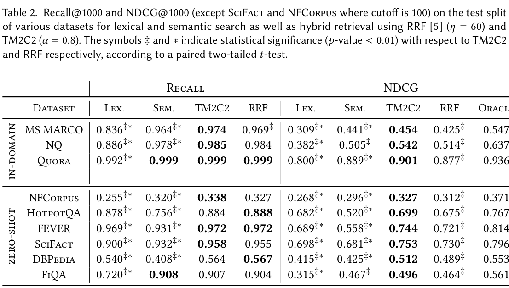
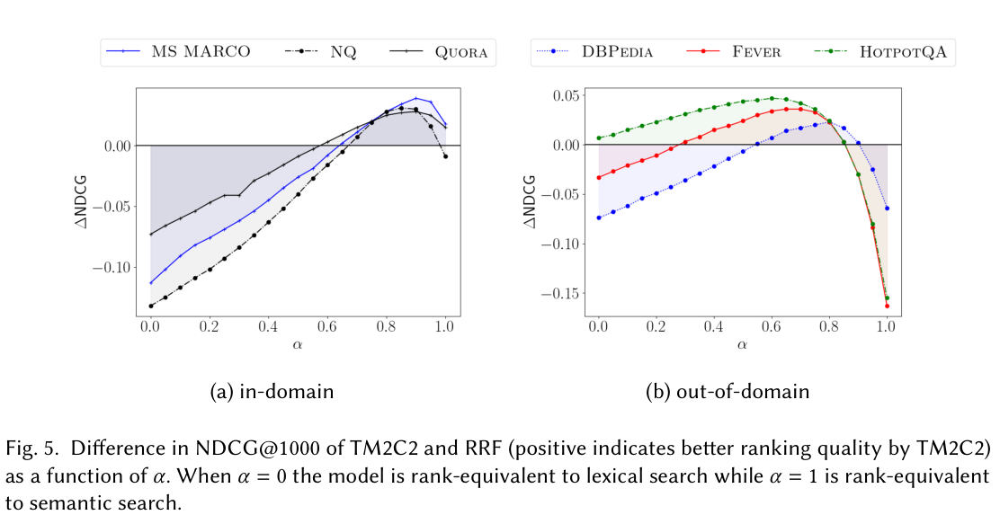
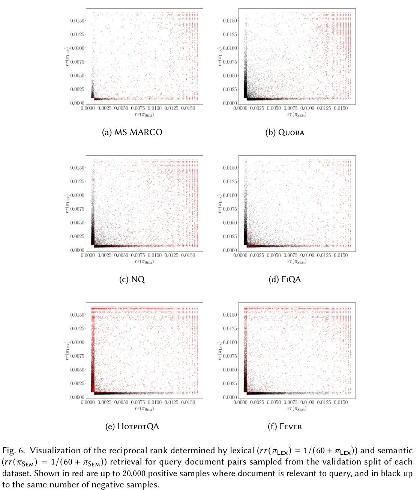
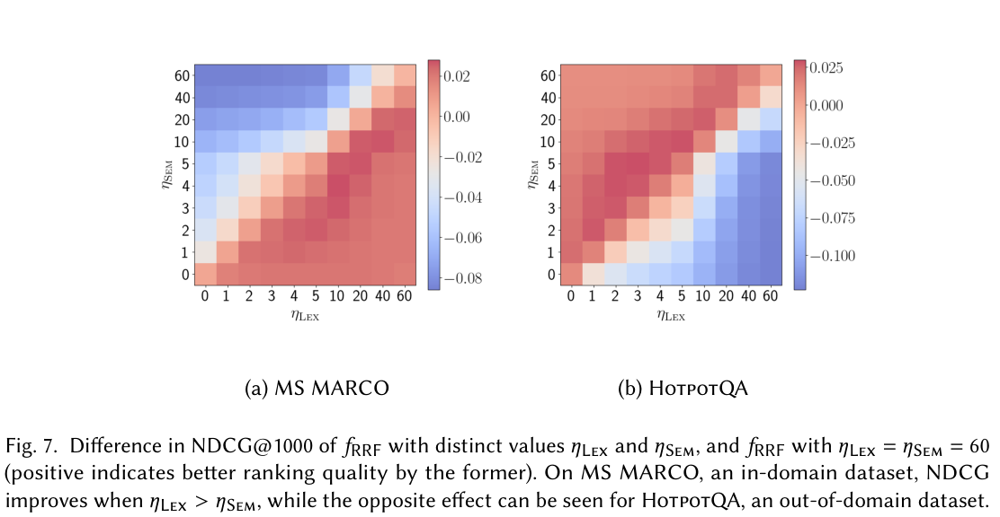
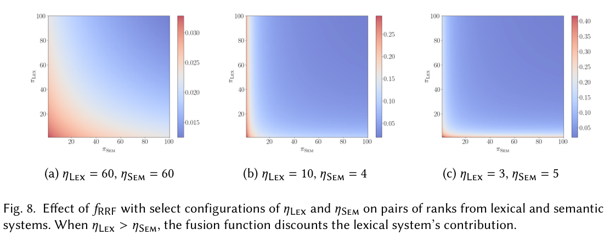
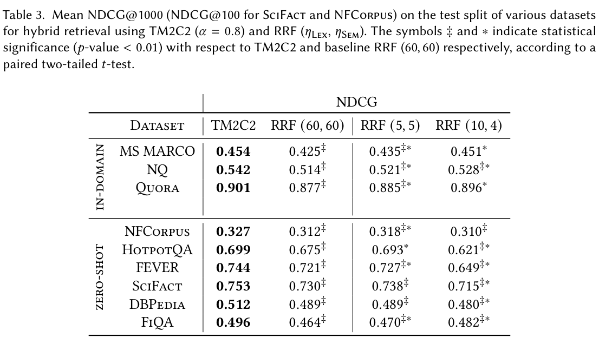
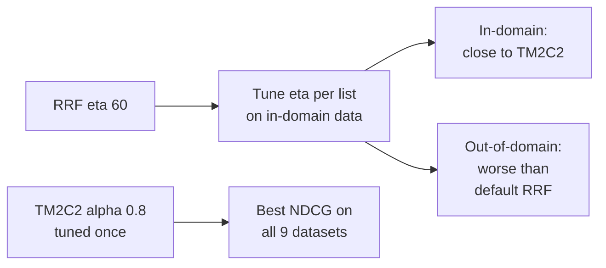

# 07. RRF and the Effect of Its Parameters (Paper Sections 5 and 5.1)

In this note:

- RRF as the paper writes it
- Table 2: lexical, semantic, TM2C2, RRF and the oracle
- Figure 5: TM2C2 minus RRF across alpha
- Two problems with RRF: approximate ranks and lost score information
- Figure 6: reciprocal ranks on the plane
- RRF has two parameters, not zero (Equation 8)
- Figures 7 and 8, and Table 3: tuning RRF and whether it transfers
- What this means for our project

## RRF in This Paper

$$f_{\text{RRF}}(q, d) = \frac{1}{\eta + \pi_{\text{Lex}}(q, d)} + \frac{1}{\eta + \pi_{\text{Sem}}(q, d)}$$

The constant is called eta here (k in the 2009 paper and in our note 09). Chen et al. treat RRF as non-parametric with eta = 60. This paper also takes a **parametric** view.

## Table 2: The Main Comparison

Settings: RRF with eta = 60; TM2C2 with alpha = 0.8, tuned on the validation sets of the in-domain datasets and then fixed for all. The oracle picks the best alpha **per query**, an upper bound no real system can reach.

NDCG only (Recall in the image):

<table width="100%">
<thead><tr><th>Dataset</th><th>BM25</th><th>Semantic</th><th>TM2C2</th><th>RRF</th><th>TM2C2 minus RRF</th><th>Oracle</th></tr></thead>
<tbody>
<tr><td>MS MARCO (in)</td><td>0.309</td><td>0.441</td><td><strong>0.454</strong></td><td>0.425</td><td>+0.029</td><td>0.547</td></tr>
<tr><td>NQ (in)</td><td>0.382</td><td>0.505</td><td><strong>0.542</strong></td><td>0.514</td><td>+0.028</td><td>0.637</td></tr>
<tr><td>Quora (in)</td><td>0.800</td><td>0.889</td><td><strong>0.901</strong></td><td>0.877</td><td>+0.024</td><td>0.936</td></tr>
<tr><td>NFCorpus</td><td>0.268</td><td>0.296</td><td><strong>0.327</strong></td><td>0.312</td><td>+0.015</td><td>0.371</td></tr>
<tr><td>HotpotQA</td><td>0.682</td><td>0.520</td><td><strong>0.699</strong></td><td>0.675</td><td>+0.024</td><td>0.767</td></tr>
<tr><td>FEVER</td><td>0.689</td><td>0.558</td><td><strong>0.744</strong></td><td>0.721</td><td>+0.023</td><td>0.814</td></tr>
<tr><td>SciFact</td><td>0.698</td><td>0.681</td><td><strong>0.753</strong></td><td>0.730</td><td>+0.023</td><td>0.796</td></tr>
<tr><td>DBPedia</td><td>0.415</td><td>0.425</td><td><strong>0.512</strong></td><td>0.489</td><td>+0.023</td><td>0.553</td></tr>
<tr><td>FiQA</td><td>0.315</td><td>0.467</td><td><strong>0.496</strong></td><td>0.464</td><td>+0.032</td><td>0.561</td></tr>
</tbody>
</table>

What the table shows:

- **Hybrid helps.** RRF beats both single retrievers on most datasets, "particularly effective on out-of-domain datasets", confirming Chen et al. Exceptions: RRF is below the semantic model on MS MARCO, Quora and FiQA, and below BM25 on HotpotQA.
- **TM2C2 beats RRF in NDCG on all nine datasets**, by 0.015 to 0.032, each marked statistically significant (p below 0.01, paired t-test). This contradicts Chen et al.
- **Recall is close.** TM2C2 and RRF are within 0.011 on every dataset; RRF is slightly higher on HotpotQA (0.888 against 0.884) and DBPedia (0.567 against 0.564). The gain of TM2C2 is mostly in **order**, not in what is found.
- **Out-of-domain, BM25 can beat semantic search by a lot** (HotpotQA 0.682 against 0.520, FEVER 0.689 against 0.558). The fused result still beats BM25.
- **The oracle is far ahead** (for example 0.637 against 0.542 on NQ): a per-query alpha would help a lot, if it could be predicted.

## Figure 5: TM2C2 Minus RRF Across Alpha

- **In-domain:** TM2C2 beats RRF only for alpha above about 0.6 to 0.75 (depending on the dataset), peaking near 0.85 to 0.9.
- **Out-of-domain:** TM2C2 beats RRF from alpha 0 on HotpotQA and from about 0.3 on FEVER, up to about 0.8, peaking around 0.6 to 0.7; on DBPedia only from about 0.7 to 0.9. Near alpha 1 (pure semantic) TM2C2 loses badly.
- "There always exists an interval of alpha for which" TM2C2 is better, but a bad alpha makes it worse than RRF.

## Two Problems With RRF

1. **Ranks are approximate.** A document in the union set but outside one system's top-k has no true rank there; the authors rank within the union set. (Our note 09 instead gave a missing document no contribution.)
2. **Scores are thrown away.** "Whether or not a document has a low or high semantic score does not matter so long as its rank ... stays the same." In a metric space where distance matters, the authors suspect this loses information (tested in note 08).

## Figure 6: Reciprocal Ranks on the Plane

The same plot as Figure 1 (note 05), but each axis is now 1 / (60 + rank).

- Points are pulled to two poles: (0, 0), where most negatives sit, and (1/61, 1/61), where positives gather.
- Where positives sit varies: near the top-right corner on HotpotQA and FEVER, but along the vertical line rr(Sem) = 1/61 on FiQA and the in-domain sets, "indicating that lexical ranks matter less".
- Conclusion: "a simple addition of reciprocal ranks does not behave consistently across domains."

## RRF Has Two Parameters

Equation 8 gives each list its own constant:

$$f_{\text{RRF}}(q, d) = \frac{1}{\eta_{\text{Lex}} + \pi_{\text{Lex}}(q, d)} + \frac{1}{\eta_{\text{Sem}} + \pi_{\text{Sem}}(q, d)}$$

A larger eta for one list **discounts** that list. With two lists, RRF has two parameters, one more than a convex combination (alpha).

## Figure 7: Tuning the Two Constants

- Each cell: NDCG with (eta_Lex, eta_Sem) minus NDCG with (60, 60). Red is better.
- "NDCG swings wildly as a function of RRF parameters", and the best cells are **off the diagonal** (different values for the two lists).
- **MS MARCO** improves when eta_Lex is larger than eta_Sem (discount BM25: the semantic model is strong in-domain). **HotpotQA** shows the opposite.

## Figure 8: What the Constants Do

With (60, 60) the fused score falls off slowly and symmetrically. With (10, 4) or (3, 5) only the very top ranks get a high score, and the falloff is lopsided: one list is discounted.

## Table 3: Does Tuned RRF Transfer?

RRF tuned on in-domain validation data, then tested everywhere:

<table width="100%">
<thead><tr><th>Dataset</th><th>TM2C2</th><th>RRF (60, 60)</th><th>RRF (5, 5)</th><th>RRF (10, 4)</th></tr></thead>
<tbody>
<tr><td>MS MARCO (in)</td><td>0.454</td><td>0.425</td><td>0.435</td><td>0.451</td></tr>
<tr><td>Quora (in)</td><td>0.901</td><td>0.877</td><td>0.885</td><td>0.896</td></tr>
<tr><td>HotpotQA</td><td>0.699</td><td>0.675</td><td>0.693</td><td>0.621</td></tr>
<tr><td>FEVER</td><td>0.744</td><td>0.721</td><td>0.727</td><td>0.649</td></tr>
<tr><td>FiQA</td><td>0.496</td><td>0.464</td><td>0.470</td><td>0.482</td></tr>
</tbody>
</table>

RRF (10, 4), tuned for in-domain data, almost matches TM2C2 there (0.451 against 0.454) but **collapses out of domain** (HotpotQA 0.621, FEVER 0.649, worse than the default (60, 60)). The reversed pattern of Figure 7 explains it. This answers RQ2: RRF is sensitive to its parameters and tuned values do not generalise.

## What This Means for Our Project

- RRF with k = 60 is a sound default **without labels**: it beat both single retrievers on most datasets. With labels, a tuned convex combination is better, but only inside a good alpha range.
- Do not tune RRF's constant on one kind of question and expect it to carry over; our note 09 already showed k changes the order.
- The large gap between recall (close) and NDCG (TM2C2 ahead) suggests that behind our reranker, which reorders anyway, the difference between RRF and weighted fusion will be small. Our evaluation presets C and D (basic concepts note 13) measure exactly that.

## Key Points

- TM2C2 (alpha 0.8) beats RRF (eta 60) in NDCG on all nine datasets by 0.015 to 0.032; recall is nearly equal.
- RRF still beats the single retrievers on most datasets, especially out of domain.
- RRF has one constant per list; tuned constants help in-domain and hurt out of domain (RRF (10, 4): HotpotQA 0.621 against 0.675 for (60, 60)).
- TM2C2 only wins inside an alpha interval; a bad alpha loses to RRF.

## Navigation

Previous: [06. Role of Normalization](06.%20Role%20of%20Normalization.md) | [Paper index](README.md) | Next: [08. Effect of Lipschitz Continuity](08.%20Effect%20of%20Lipschitz%20Continuity.md)
