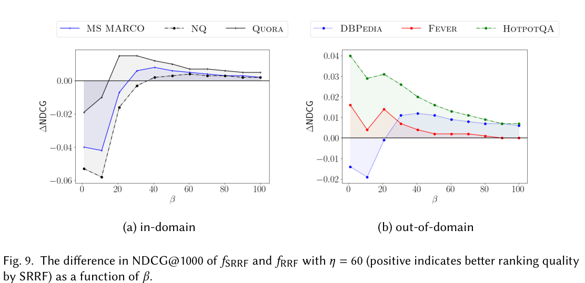
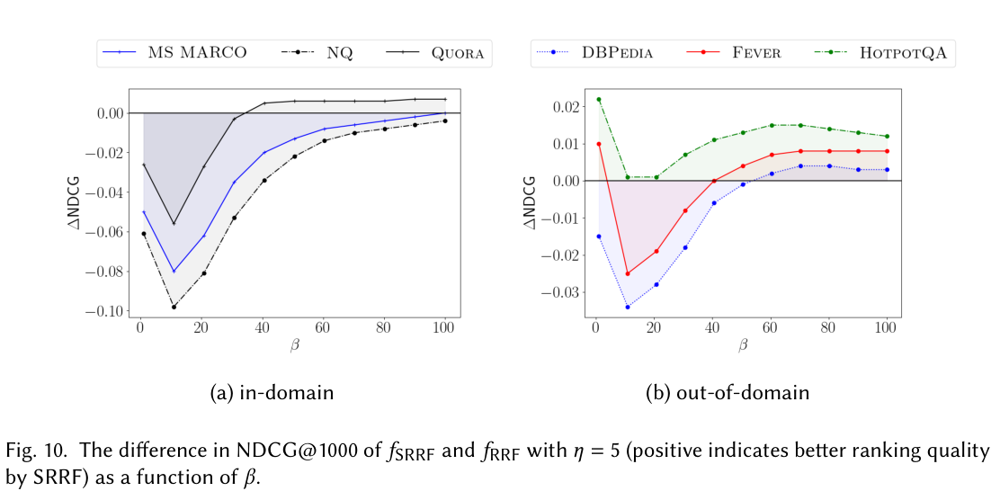
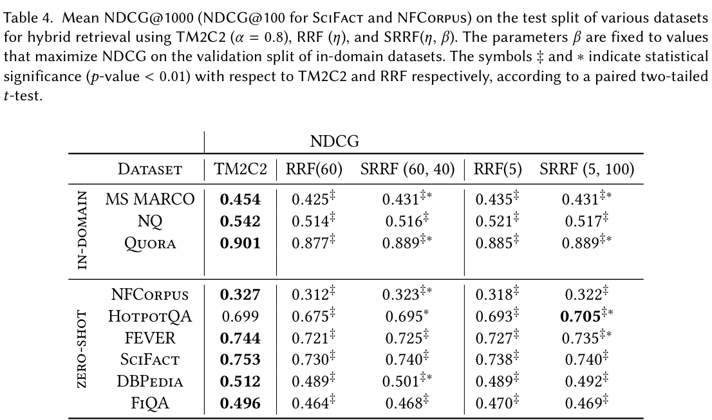
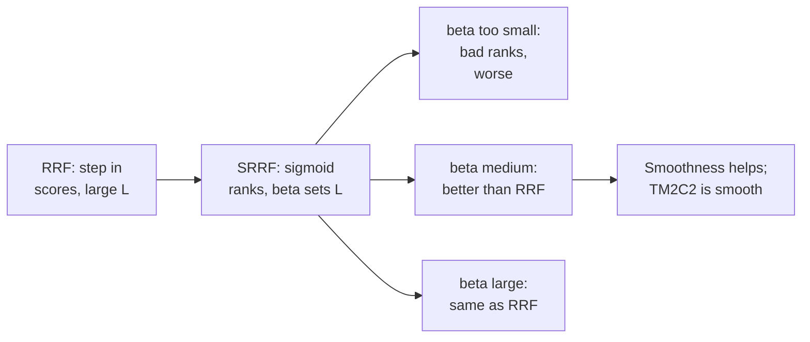

# 08. Effect of Lipschitz Continuity (Paper Section 5.2)

In this note:

- Lipschitz continuity in plain words
- Why RRF is not smooth in the scores
- SRRF: a smooth approximation of RRF
- Figures 9 and 10: smoother is better, up to a point
- Table 4: SRRF against RRF and TM2C2
- How strong the evidence is
- What this means for our project

## Lipschitz Continuity

A function is **Lipschitz continuous** with constant L if a change in the input of size x changes the output by at most L times x (footnote 9: ||f(y) - f(x)|| <= L ||y - x||). A small L means the function never jumps: small changes in, small changes out.

For fusion: with a small Lipschitz constant, "a small change to the individual scores does not lead to a sudden and exaggerated effect on the fused score". The authors call this, informally, "preserving information".

- **TM2C2** is a weighted sum of scores: smooth, small L.
- **RRF** is not smooth in the scores: "the moment one lexical (or semantic) score becomes larger than another the function makes a hard transition to a new value." Two documents with cosine 0.5371 and 0.5370 get ranks 1 and 2 and different RRF scores; documents with 0.54 and 0.30 at ranks 1 and 2 get the same two RRF scores.

RQ3 becomes: does this smoothness matter for ranking quality?

## SRRF: Smoothing the Rank

The rank is a sum of 0-or-1 indicators (Equation 1, note 04). Replace each indicator with a sigmoid:

$$\sigma_\beta(x) = \frac{1}{1 + e^{-\beta x}}$$

$$\tilde{\pi}_o(q, d_i) = 0.5 + \sum_{d_j \in R_o^k(q)} \sigma_\beta\big(f_o(q, d_j) - f_o(q, d_i)\big)$$

$$f_{\text{SRRF}}(q, d) = \frac{1}{\eta + \tilde{\pi}_{\text{Lex}}(q, d)} + \frac{1}{\eta + \tilde{\pi}_{\text{Sem}}(q, d)}$$

<table width="100%">
<thead><tr><th>Symbol (plain text)</th><th>Meaning</th></tr></thead>
<tbody>
<tr><td>sigma_beta</td><td>A sigmoid with steepness beta; its Lipschitz constant is beta</td></tr>
<tr><td>beta large</td><td>The sigmoid is almost a step: approximate rank close to the true rank, large Lipschitz constant (like RRF)</td></tr>
<tr><td>beta small</td><td>A gentle S curve: a document slightly below another counts as "half above"; score gaps now matter</td></tr>
<tr><td>pi tilde</td><td>The smooth approximate rank; the 0.5 term accounts for the document compared with itself (sigma of 0 is 0.5)</td></tr>
</tbody>
</table>

beta is the lever: lower beta means a smoother fusion that keeps more of the score distribution.

## Figures 9 and 10: The Effect of Beta

- **Very small beta** (around 10 or below): the approximation breaks down and in-domain quality falls (down to about -0.06 for eta = 60, about -0.10 for eta = 5).
- **Large beta**: SRRF approaches RRF; the difference goes to 0.
- **In between** (beta around 20 to 40 for eta = 60): SRRF **beats** RRF. The gain is clearer for eta = 60 and out of domain (HotpotQA up to about +0.04 at small beta).

The authors expected the approximation to hurt; that it helps, and that "the only other difference between SRRF and RRF is their Lipschitz constant", is their evidence that smoothness matters.

## Table 4: SRRF, RRF and TM2C2

beta fixed by in-domain validation (40 for eta = 60, 100 for eta = 5):

<table width="100%">
<thead><tr><th>Dataset</th><th>TM2C2</th><th>RRF (60)</th><th>SRRF (60, 40)</th><th>RRF (5)</th><th>SRRF (5, 100)</th></tr></thead>
<tbody>
<tr><td>MS MARCO (in)</td><td><strong>0.454</strong></td><td>0.425</td><td>0.431</td><td>0.435</td><td>0.431</td></tr>
<tr><td>Quora (in)</td><td><strong>0.901</strong></td><td>0.877</td><td>0.889</td><td>0.885</td><td>0.889</td></tr>
<tr><td>NFCorpus</td><td><strong>0.327</strong></td><td>0.312</td><td>0.323</td><td>0.318</td><td>0.322</td></tr>
<tr><td>HotpotQA</td><td>0.699</td><td>0.675</td><td>0.695</td><td>0.693</td><td><strong>0.705</strong></td></tr>
<tr><td>FEVER</td><td><strong>0.744</strong></td><td>0.721</td><td>0.725</td><td>0.727</td><td>0.735</td></tr>
<tr><td>DBPedia</td><td><strong>0.512</strong></td><td>0.489</td><td>0.501</td><td>0.489</td><td>0.492</td></tr>
</tbody>
</table>

- SRRF (60, 40) is at or above RRF (60) on every dataset in the full table, by 0.002 to 0.020.
- TM2C2 stays best everywhere except HotpotQA, where SRRF (5, 100) reaches 0.705.

## How Strong Is the Evidence?

- The direction is consistent: SRRF beats RRF at the chosen beta on all nine datasets, and the appendices repeat the pattern for other model pairs.
- The gains are small (often 0.002 to 0.012), and several are not marked significant against RRF.
- "Only the Lipschitz constant differs" is an interpretation: a sigmoid rank also lets **score gaps** enter the fusion, which is the information RRF throws away. Both readings point the same way: using scores, smoothly, helps.

## What This Means for Our Project

- Our note 09 weakness list said RRF "throws away how much better rank 1 is than rank 2". This section is the experimental case for that weakness.
- SRRF is not worth implementing for us: it adds beta, needs all scores, and still loses to TM2C2 on most datasets. If we want score information, weighted fusion with theoretical min-max is the simpler route, and it is already planned as a setting.
- A practical reading of "smoothness": tiny score differences should not cause big changes in the fused list. Our cosine scores are tightly packed (note 08), so with RRF a 0.001 difference decides a whole rank position.

## Key Points

- Lipschitz continuity: small input changes give small output changes; convex combination has it, RRF does not.
- SRRF replaces the hard rank with a sigmoid of score differences; beta controls smoothness.
- Medium beta beats RRF; too small breaks ranking; large beta equals RRF.
- SRRF (60, 40) is at or above RRF on all datasets but still mostly below TM2C2; the authors read this as evidence that preserving score information matters.

## Navigation

Previous: [07. RRF and the Effect of Its Parameters](07.%20RRF%20and%20the%20Effect%20of%20Its%20Parameters.md) | [Paper index](README.md) | Next: [09. Discussion](09.%20Discussion.md)
