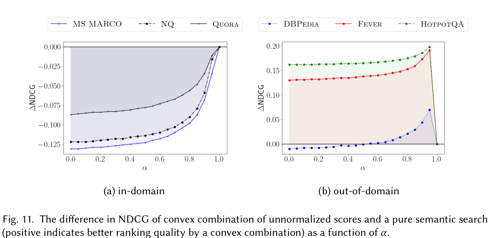
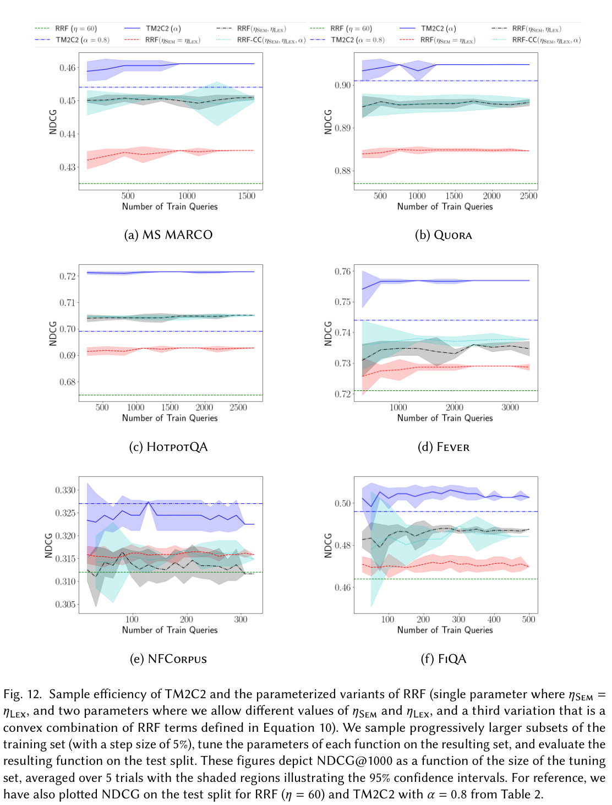
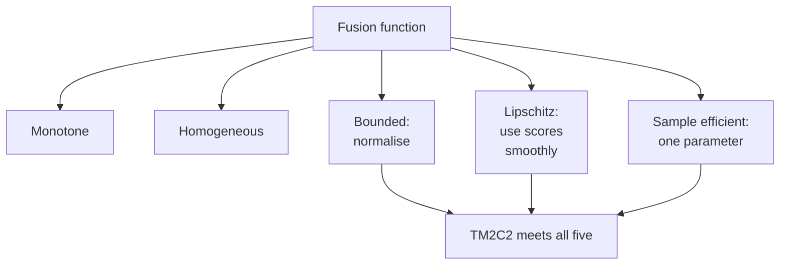

# 09. Discussion (Paper Section 6)

In this note:

- Five properties of a well-behaved fusion function
- Figure 11: what happens without boundedness
- Figure 12: how many labelled queries tuning needs
- RRF-CC: adding a weight to RRF
- A checklist for our fusion step

## Five Properties

The authors turn their analysis into "desiderata" for any fusion function:

<table width="100%">
<thead><tr><th>Property</th><th>Meaning</th><th>Convex combination (TM2C2)</th><th>RRF</th></tr></thead>
<tbody>
<tr><td>Monotonicity</td><td>A higher input score never lowers the fused score</td><td>Yes</td><td>Yes</td></tr>
<tr><td>Homogeneity</td><td>Rescaling query or document vectors by a positive number does not change the order, so no system can "inflate its contribution"</td><td>Yes, with normalisation</td><td>Yes (ranks ignore scale)</td></tr>
<tr><td>Boundedness</td><td>The fused score stays within fixed limits</td><td>Yes, with normalisation</td><td>Yes</td></tr>
<tr><td>Lipschitz continuity</td><td>Small score changes give small fused changes (note 08)</td><td>Yes</td><td>No</td></tr>
<tr><td>Interpretability and sample efficiency</td><td>Few parameters, tunable with few labels or set from domain knowledge</td><td>One parameter, alpha</td><td>One constant per list; tuned values do not transfer</td></tr>
</tbody>
</table>

## Figure 11: Without Boundedness

A convex combination of **raw** scores, compared with pure semantic search:

- **In-domain:** adding raw BM25 scores makes things worse for almost every alpha below 1 (down to about -0.13 NDCG). The strong, fine-tuned semantic ranking is swamped by BM25's large numbers.
- **Out-of-domain:** adding raw BM25 often **helps** a lot (about +0.13 to +0.19 on FEVER and HotpotQA), because the semantic model is weak there and its small bounded scores "do not significantly distort the rankings produced by the lexical retriever". In effect this is BM25 with a semantic tie-breaker.

Both results come from the same cause: unbounded BM25 dominates. Whether that helps depends on which retriever happens to be better. Hence the requirement |f_Hybrid| <= M, met by normalising.

## Figure 12: Sample Efficiency

Tuning with progressively larger random subsets of each training set (steps of 5%), five trials each, measured on the test split:

<table width="100%">
<thead><tr><th>Line</th><th>Meaning</th></tr></thead>
<tbody>
<tr><td>Blue solid: TM2C2 (alpha tuned)</td><td>Highest on all six panels, flat from the smallest training set</td></tr>
<tr><td>Blue dash-dot: TM2C2 (alpha = 0.8)</td><td>The untuned setting of Table 2, for reference</td></tr>
<tr><td>Red: RRF, one shared constant</td><td>Lowest of the tuned lines</td></tr>
<tr><td>Black and cyan: RRF with two constants, and RRF-CC</td><td>Between the two; noisy for small sets</td></tr>
<tr><td>Green dashed: RRF (eta = 60)</td><td>The untuned default</td></tr>
</tbody>
</table>

- "with less than 5% of the training data, which is often a small set of queries, TM2C2's alpha converges, regardless of the magnitude of domain shift." On NFCorpus and FiQA the x axis starts at a few dozen queries, and tuned TM2C2 is already on top there.
- Tuned TM2C2 on HotpotQA reaches about 0.72 and on FEVER about 0.757, above the fixed alpha = 0.8 (0.699 and 0.744): the in-domain alpha is not the best one out of domain, and a small tuning set finds a better one.
- RRF's tuned parameters "do not settle", but its performance roughly converges, still below TM2C2.

## RRF-CC

Equation 10 adds a weight to RRF:

$$f = (1 - \alpha) \frac{1}{\eta_{\text{Lex}} + \pi_{\text{Lex}}} + \alpha \frac{1}{\eta_{\text{Sem}} + \pi_{\text{Sem}}}$$

This is the "weighted RRF" of our note 09. In Figure 12 it does not do better than RRF with two constants, which the authors take as more evidence that the gap to TM2C2 comes from ignoring scores, not from a missing weight.

## A Checklist for Our Fusion Step

<table width="100%">
<thead><tr><th>Property</th><th>Our RRF default</th><th>Our weighted fusion setting</th></tr></thead>
<tbody>
<tr><td>Bounded</td><td>Yes</td><td>Yes: theoretical min-max (0 for BM25, -1 for cosine)</td></tr>
<tr><td>Uses scores smoothly</td><td>No</td><td>Yes</td></tr>
<tr><td>Parameters</td><td>k = 60, not tuned</td><td>alpha, default 0.5</td></tr>
<tr><td>Tunable with few labels</td><td>Tuning k does not transfer</td><td>Yes, per the paper; our test set has 10 answerable questions, fewer than the paper's smallest tuning sets</td></tr>
</tbody>
</table>

## Key Points

- Five desiderata: monotone, homogeneous, bounded, Lipschitz continuous, interpretable and sample efficient.
- Raw-score fusion is unbounded: it hurts in-domain and helps out-of-domain only because BM25 dominates (Figure 11).
- Tuned TM2C2 converges with a small fraction of the training queries and beats all tuned RRF variants on six datasets (Figure 12).
- Adding a weight to RRF (RRF-CC) does not close the gap.

## Navigation

Previous: [08. Effect of Lipschitz Continuity](08.%20Effect%20of%20Lipschitz%20Continuity.md) | [Paper index](README.md) | Next: [10. Conclusion and Appendices](10.%20Conclusion%20and%20Appendices.md)
