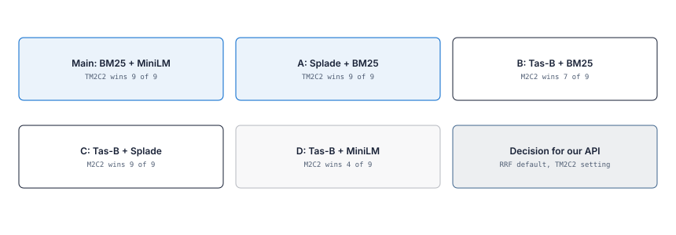
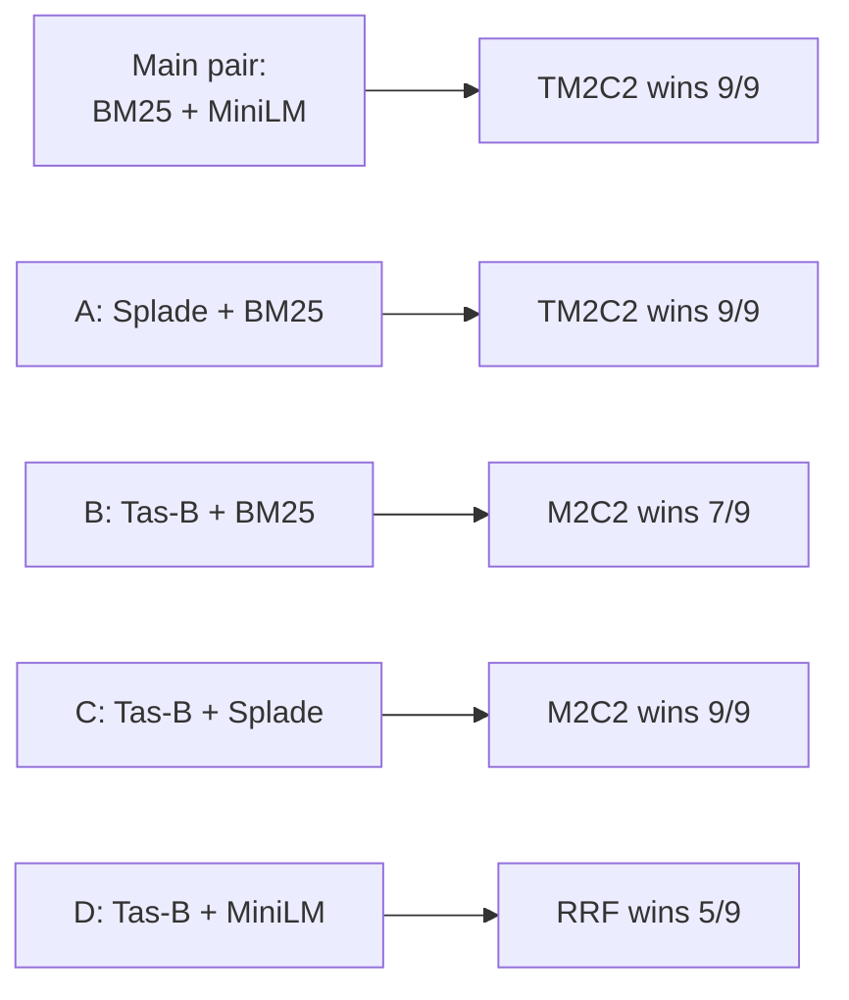

# 10. Conclusion and Appendices (Paper Section 7, Appendices A to D)

In this note:

- The conclusion, claim by claim
- Open questions the authors name
- Appendices A to D: other model pairs, and where RRF wins
- What we take from the paper for the Hybrid Search RAG API

## The Conclusion

<table width="100%">
<thead><tr><th>Claim</th><th>Evidence</th><th>Note</th></tr></thead>
<tbody>
<tr><td>"the choice of normalization is not as consequential as once thought for a convex combination-based fusion function"</td><td>Lemma 4.2, Theorem 4.5, Figures 3 and 4</td><td>06</td></tr>
<tr><td>"RRF is sensitive to its parameters"</td><td>Figure 7, Table 3</td><td>07</td></tr>
<tr><td>Convex combination "outperforms RRF on in-domain and out-of-domain datasets", "in disagreement with" Chen et al.</td><td>Table 2, Figure 5</td><td>07</td></tr>
<tr><td>TM2C2 has the right properties, and alpha can be tuned with few samples or set from domain knowledge</td><td>Section 6, Figure 12</td><td>09</td></tr>
<tr><td>"we found the range alpha in [0.6, 0.8] to consistently lead to improvements"</td><td>Figures 3 and 5</td><td>Below</td></tr>
</tbody>
</table>

On the alpha range: 0.6 to 0.8 is the vector weight for **all-MiniLM-L6-v2 with BM25** on these datasets. Figure 5 (note 07) shows the useful range depends on the domain (on DBPedia TM2C2 only beat RRF from about 0.7), and the appendices use other values (alpha = 0.2 for Tas-B with Splade). The range is a starting point, not a constant.

## Open Questions

- **Per-query alpha.** A line fits the whole collection, but "that may change if our analysis was conducted on a per-query basis". The oracle in Table 2 (for example NQ 0.637 against 0.542) shows how much a good per-query weight could add.
- **Non-linear fusion or normalisation**: unknown whether it would predict a per-query alpha better.
- **Three or more retrievers**: the analysis extends in principle, but whether normalisation matters more, and how CC compares with RRF, is untested.

## Appendices A to D: Other Model Pairs

Each appendix repeats the normalisation study (alpha curves and expansion rates) and the TM2C2 or M2C2 against RRF comparison for another pair. NDCG, from Tables 5 to 8:

<table width="100%">
<thead><tr><th>Appendix and pair</th><th>Fusion vs RRF (eta = 60)</th><th>Datasets where RRF is higher</th></tr></thead>
<tbody>
<tr><td>A. Splade + BM25, TM2C2 alpha 0.8</td><td>TM2C2 higher on all 9</td><td>None (MS MARCO 0.507 against 0.444)</td></tr>
<tr><td>B. Tas-B + BM25, M2C2 alpha 0.8</td><td>M2C2 higher on 7 of 9</td><td>HotpotQA (0.711 against 0.702), SciFact (0.719 against 0.715)</td></tr>
<tr><td>C. Tas-B + Splade, M2C2 alpha 0.2</td><td>M2C2 higher on all 9</td><td>None</td></tr>
<tr><td>D. Tas-B + all-MiniLM-L6-v2, M2C2 alpha 0.8</td><td>M2C2 higher on 4 of 9</td><td>NQ, Quora, NFCorpus, SciFact, FiQA (largest gap: FiQA, 0.467 against 0.438)</td></tr>
</tbody>
</table>

So for two **semantic** models fused together (Appendix D), RRF wins on five of nine datasets. The body's "CC beats RRF everywhere" holds for the main pair and for Splade + BM25 (with theoretical min-max); with plain min-max (M2C2) and some pairs, RRF is often as good or better. The appendices do not discuss this, but it fits the paper's own point that theoretical min-max is the more robust normalisation.

The appendix SRRF plots (Figures 14, 16, 18, 20) repeat the pattern of note 08: a medium beta improves on RRF.

## What We Take for the Hybrid Search RAG API

<table width="100%">
<thead><tr><th>Finding</th><th>Decision</th></tr></thead>
<tbody>
<tr><td>Never fuse raw scores</td><td>Weighted fusion always normalises; RRF needs none</td></tr>
<tr><td>Theoretical min-max has the most stable best alpha</td><td>Weighted fusion uses theoretical min-max (BM25 bound 0, cosine bound -1), as planned in basic concepts note 12</td></tr>
<tr><td>Missing scores are computed</td><td>For weighted fusion, compute the cosine of BM25-only hits and the BM25 score of vector-only hits</td></tr>
<tr><td>Tuned CC beats RRF, with few labels</td><td>Keep RRF as the default until the evaluation has chunk-level labels; then sweep alpha and switch the default if weighted fusion wins</td></tr>
<tr><td>Best alpha depends on domain; 0.6 to 0.8 for their in-domain model</td><td>Our model is zero-shot on our files and our sweep favoured alpha 0.5 or less; start at 0.5, let the evaluation decide</td></tr>
<tr><td>RRF's constant matters and tuned values do not transfer</td><td>Keep k = 60; do not tune it on our 10 questions</td></tr>
<tr><td>Gains are mainly NDCG (order), recall is close</td><td>Behind our reranker the difference may be small; presets C and D (basic concepts note 13) measure it</td></tr>
</tbody>
</table>

## Key Points

- Conclusions: normalisation choice matters little once alpha is tuned; RRF is sensitive; TM2C2 beats RRF; alpha tunes with few labels; 0.6 to 0.8 worked for their main pair.
- Open: per-query alpha (large oracle gap), non-linear fusion, three or more retrievers.
- The appendices mostly confirm, but RRF beats min-max CC on 5 of 9 datasets when fusing two semantic models, and on 2 of 9 for Tas-B + BM25.
- For our API: RRF default for now, weighted fusion with theoretical min-max as a setting, decided by the chunk-level evaluation.

## Navigation

Previous: [09. Discussion](09.%20Discussion.md) | [Paper index](README.md) | Next paper: [Reciprocal Rank Fusion](../README.md)
