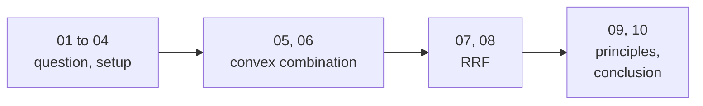

# An Analysis of Fusion Functions for Hybrid Retrieval

These notes go through the paper one section at a time, with one note per section of the paper.

## Paper Card

<table width="100%">
<thead><tr><th>Field</th><th>Value</th></tr></thead>
<tbody>
<tr><td>Title</td><td>An Analysis of Fusion Functions for Hybrid Retrieval</td></tr>
<tr><td>Authors</td><td>Sebastian Bruch, Siyu Gai, Amir Ingber</td></tr>
<tr><td>Organizations</td><td>Pinecone, University of California Berkeley</td></tr>
<tr><td>Year and venue</td><td>2022, arXiv (version 2, May 2023); published in ACM Transactions on Information Systems</td></tr>
<tr><td>arXiv</td><td><a href="https://arxiv.org/abs/2210.11934">2210.11934</a></td></tr>
<tr><td>Local PDF</td><td><a href="../../../02.%20Papers/2210.11934_Fusion-Functions-Hybrid-Retrieval.pdf">2210.11934_Fusion-Functions-Hybrid-Retrieval.pdf</a></td></tr>
<tr><td>Core idea</td><td>Compare the two common ways to fuse lexical (BM25) and semantic (vector) search: a convex combination of normalised scores and Reciprocal Rank Fusion. Show that the choice of normalisation matters little, that RRF is sensitive to its parameters, and that a tuned convex combination beats RRF and needs few labelled queries</td></tr>
</tbody>
</table>

## Notes (one per paper section)

<table width="100%">
<thead><tr><th>#</th><th>Note</th><th>Paper section</th><th>Status</th></tr></thead>
<tbody>
<tr><td>01</td><td><a href="01.%20Abstract.md">Abstract</a></td><td>Abstract</td><td>Done</td></tr>
<tr><td>02</td><td><a href="02.%20Introduction.md">Introduction</a></td><td>1 Introduction</td><td>Done</td></tr>
<tr><td>03</td><td><a href="03.%20Related%20Work.md">Related Work</a></td><td>2 Related Work</td><td>Done</td></tr>
<tr><td>04</td><td><a href="04.%20Setup.md">Setup</a></td><td>3.1 Notation, 3.2 Empirical Setup (Table 1)</td><td>Done</td></tr>
<tr><td>05</td><td>Suitability of Convex Combination</td><td>4, 4.1 (Figures 1 and 2)</td><td>Planned</td></tr>
<tr><td>06</td><td>Role of Normalization</td><td>4.2 (Lemma 4.2, Theorem 4.5, Figures 3 and 4)</td><td>Planned</td></tr>
<tr><td>07</td><td>RRF and the Effect of Its Parameters</td><td>5, 5.1 (Table 2, Figures 5 to 8, Table 3)</td><td>Planned</td></tr>
<tr><td>08</td><td>Effect of Lipschitz Continuity</td><td>5.2 (Figures 9 and 10, Table 4)</td><td>Planned</td></tr>
<tr><td>09</td><td>Discussion</td><td>6 Discussion (Figures 11 and 12)</td><td>Planned</td></tr>
<tr><td>10</td><td>Conclusion and Appendices</td><td>7 Conclusion, Appendices A to D</td><td>Planned</td></tr>
</tbody>
</table>

## How to Read These Notes

The paper mixes experiments with short proofs. The notes explain each proof in plain words first, then the steps. Our basic concepts notes 08 to 10 already introduced min-max, z-score, theoretical min-max, RRF and weighted fusion; these notes show where those ideas come from and what the evidence is.

## Navigation

Previous paper: [Blended RAG](../01.%20Blended%20RAG/) | [Research Paper Explained](../README.md) | Next paper: [Reciprocal Rank Fusion](../README.md)
