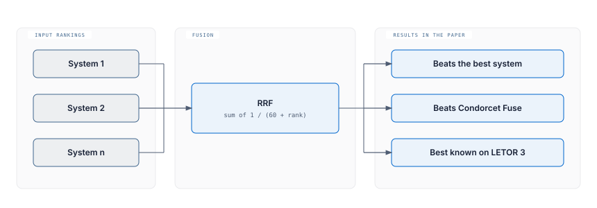
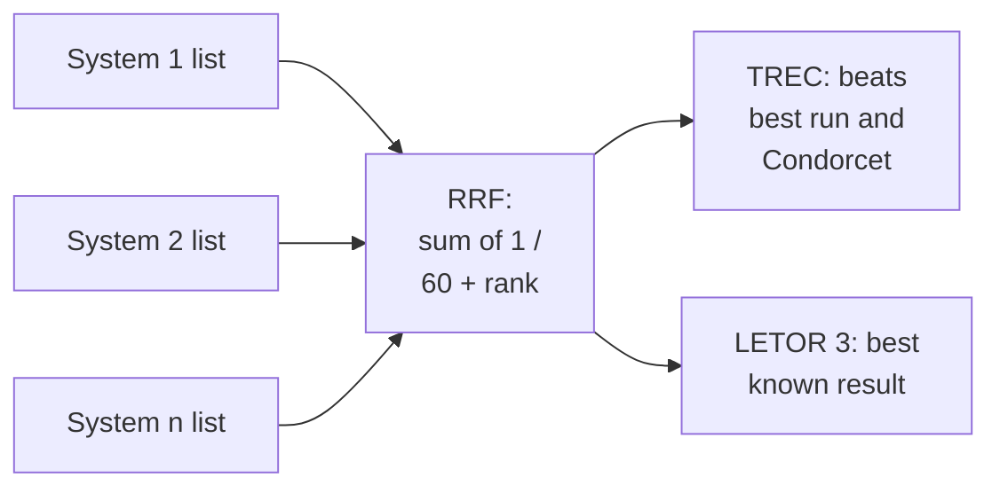

# 01. Abstract (Paper Section: Abstract)

In this note:

- The abstract split into its sentences
- Each sentence explained in simple words
- Words you need to know before reading further
- What the abstract claims, and how far the tables support it

## The Abstract, Sentence by Sentence

<table width="100%">
<thead><tr><th>#</th><th>Sentence (from the paper)</th><th>In simple words</th></tr></thead>
<tbody>
<tr><td>1</td><td>"Reciprocal Rank Fusion (RRF), a simple method for combining the document rankings from multiple IR systems, consistently yields better results than any individual system, and better results than the standard method Condorcet Fuse."</td><td>RRF merges several ranked lists into one. The merged list is better than each input list, and better than Condorcet Fuse, the best known merging method of the time.</td></tr>
<tr><td>2</td><td>"This result is demonstrated by using RRF to combine the results of several TREC experiments, and to build a meta-learner that ranks the LETOR 3 dataset better than any previously reported method."</td><td>Two kinds of evidence: merging runs submitted to TREC, and merging the outputs of learning-to-rank models on LETOR 3. The second gives a new best result on LETOR 3.</td></tr>
</tbody>
</table>

The keywords are "fusion, aggregation, ranking". The whole paper is about one step: turning several ranked lists into one.

## Words to Know

<table width="100%">
<thead><tr><th>Term</th><th>Meaning</th><th>Where in our notes</th></tr></thead>
<tbody>
<tr><td>IR system</td><td>An information retrieval system: given a query, it returns documents in ranked order</td><td>Basic concepts 01</td></tr>
<tr><td>Rank fusion (metasearch)</td><td>Merging the ranked lists of several systems for the same query into one list</td><td>Basic concepts 09</td></tr>
<tr><td>RRF</td><td>Each document gets the sum of 1 / (k + rank) over all lists; sort by that sum</td><td>Note 02</td></tr>
<tr><td>Condorcet Fuse</td><td>Sort documents by majority vote: A goes above B if most lists rank A above B</td><td>Note 03</td></tr>
<tr><td>CombMNZ</td><td>Sum each document's scores from the lists that found it, times the number of those lists</td><td>Note 03</td></tr>
<tr><td>TREC</td><td>Text REtrieval Conference: yearly shared tasks where many teams submit ranked runs for the same topics</td><td>Note 05</td></tr>
<tr><td>LETOR 3</td><td>A benchmark for learning to rank, with feature vectors for query-document pairs and baseline model outputs</td><td>Note 06</td></tr>
<tr><td>Learning to rank</td><td>Training a model on labelled examples to order documents, for example RankSVM or ListNet</td><td>Note 06</td></tr>
<tr><td>Meta-learner</td><td>A method that combines the outputs of other learned models; here RRF over the LETOR baselines</td><td>Note 06</td></tr>
<tr><td>MAP</td><td>Mean Average Precision: for each query, average the precision at every rank where a relevant document appears, then average over queries. Higher is better, 1 is perfect</td><td>Note 04</td></tr>
</tbody>
</table>

## Claims Against the Evidence

The abstract is stronger than the tables in two places:

<table width="100%">
<thead><tr><th>Abstract says</th><th>Tables show</th><th>Note</th></tr></thead>
<tbody>
<tr><td>"consistently" better than "any individual system"</td><td>True in every pilot and TREC run except TREC 9, where a run with a human in the loop has MAP 0.3519 against 0.2830 for RRF. The paper says so in the text</td><td>05</td></tr>
<tr><td>Better than Condorcet Fuse</td><td>True in every experiment shown</td><td>04 to 06</td></tr>
<tr><td>"better than any previously reported method" on LETOR 3</td><td>True for single learners. In the same table CombMNZ, another fusion method, scores 0.6107 against 0.6051 for RRF; the gap is not significant</td><td>06</td></tr>
</tbody>
</table>

The abstract does not mention CombMNZ. The body does, and claims RRF "consistently equaled or bettered" it, which Tables 2 and 3 do not fully support (note 05).

## The Paper in One Picture

## Why This Paper Matters to Us

Every hybrid search system that uses RRF, including the default fusion in our Hybrid Search RAG API, uses this formula and this constant. The paper fused tens of lists from mature systems; we fuse two lists (BM25 and vector search) of 10 chunks each. The notes that follow check which of the paper's findings carry over to that small setting.

## Key Points

- RRF merges rankings by summing 1 / (k + rank); it needs no scores and no training.
- The paper claims RRF beats every single system and Condorcet Fuse on TREC runs, and sets a new best on LETOR 3.
- The tables support the Condorcet claim fully. They show one exception for "better than any system" (a manual TREC 9 run) and show CombMNZ level with RRF.

## Navigation

[Paper index](README.md) | Next: [02. The RRF Formula](02.%20The%20RRF%20Formula.md)
