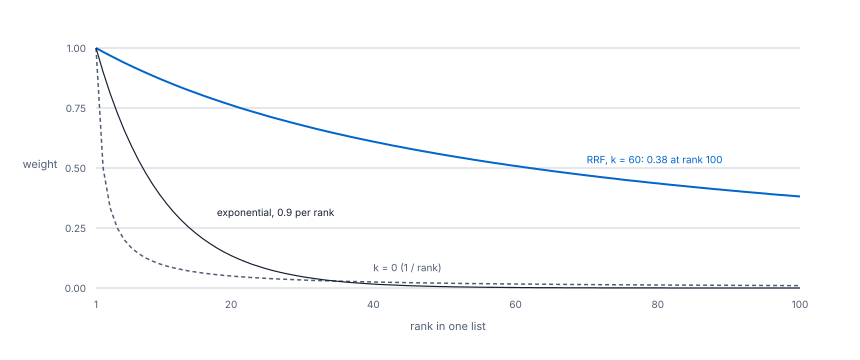
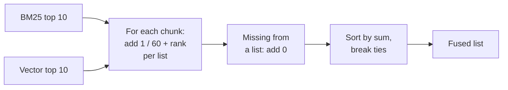

# 02. The RRF Formula (Paper Section 1, First Part)

In this note:

- Why the authors wanted an unsupervised method
- The formula, symbol by symbol
- Why k = 60, and what "outlier systems" means
- How much each rank is worth
- Three things the formula leaves open, and how our API handles them

## Why an Unsupervised Method

The paper opens with the context of 2009: "supervised learning-to-rank methods have garnered much attention of late", but "unsupervised methods are attractive because they require no training examples". The authors were looking for such a method and "came up with Reciprocal Rank Fusion (RRF) to serve as a baseline".

The baseline turned out to be the result. RRF "almost invariably improved on the best of the combined results", and "consistently equaled or bettered" the established methods Condorcet Fuse and CombMNZ (note 03 explains both; note 05 checks the "consistently").

## The Formula

"Given a set D of documents to be ranked and a set of rankings R, each a permutation on 1..|D|, we compute"

$$\text{RRFscore}(d \in D) = \sum_{r \in R} \frac{1}{k + r(d)}$$

"where k = 60 was fixed during a pilot investigation and not altered during subsequent validation." Documents are then sorted by this score, highest first.

<table width="100%">
<thead><tr><th>Symbol</th><th>Meaning</th><th>In our hybrid search</th></tr></thead>
<tbody>
<tr><td>D</td><td>The documents to rank</td><td>The chunks found by either retriever (union of two top 10 lists)</td></tr>
<tr><td>R</td><td>The set of rankings, one per system</td><td>Two rankings: BM25 and vector search</td></tr>
<tr><td>r(d)</td><td>The position of document d in ranking r, starting at 1</td><td>1 to 10, or missing</td></tr>
<tr><td>k</td><td>A constant added to every rank</td><td>60</td></tr>
<tr><td>Permutation on 1..|D|</td><td>Every ranking orders every document</td><td>Not true for us: each list holds only its top 10 (see below)</td></tr>
</tbody>
</table>

Only ranks enter the formula. The scores that produced the ranks (BM25 values, cosine similarities) are never used, so they need no normalisation. Basic concepts note 08 shows why that matters: BM25 and cosine scores live on different scales.

## Why This Shape, and Why k = 60

The authors give two reasons:

- "while highly-ranked documents are more important, the importance of lower-ranked documents does not vanish as it would were, say, an exponential function used."
- "The constant k mitigates the impact of high rankings by outlier systems."

<table width="100%">
<thead><tr><th>Rank</th><th>1 / (60 + rank)</th><th>Relative to rank 1</th><th>1 / rank (k = 0)</th><th>Relative to rank 1</th></tr></thead>
<tbody>
<tr><td>1</td><td>0.0164</td><td>1.00</td><td>1.000</td><td>1.00</td></tr>
<tr><td>2</td><td>0.0161</td><td>0.98</td><td>0.500</td><td>0.50</td></tr>
<tr><td>5</td><td>0.0154</td><td>0.94</td><td>0.200</td><td>0.20</td></tr>
<tr><td>10</td><td>0.0143</td><td>0.87</td><td>0.100</td><td>0.10</td></tr>
<tr><td>50</td><td>0.0091</td><td>0.55</td><td>0.020</td><td>0.02</td></tr>
<tr><td>100</td><td>0.0063</td><td>0.38</td><td>0.010</td><td>0.01</td></tr>
</tbody>
</table>

What the numbers say:

- **Lower ranks keep weight.** With k = 60, rank 100 still counts for 38 percent of rank 1. An exponential decay of 0.9 per rank leaves 0.6 percent at rank 50. So a document that many systems place in their top 100 can collect a large total.
- **One system cannot decide alone.** With k = 0, a single system that puts a document first gives it 1.0, ten times the credit of rank 10. With k = 60 the gap is 0.0164 against 0.0143. A system with an unusual opinion (an "outlier system") moves the document only a little; agreement between systems moves it a lot.
- **The cost is resolution at the top.** With k = 60, rank 1 and rank 2 differ by only 2 percent. RRF hardly distinguishes a clear winner from a close second. The fusion functions paper (its note 08) treats this as the main weakness of RRF.

On "fixed during a pilot investigation and not altered during subsequent validation": the authors chose k on one pilot experiment and then kept it for every later experiment. That is good practice: k was not tuned on the data used to report results. Note 04 shows the pilot data.

## Three Things the Formula Leaves Open

<table width="100%">
<thead><tr><th>Open point</th><th>Why it matters</th><th>What our API will do</th></tr></thead>
<tbody>
<tr><td>Documents missing from a list</td><td>The formula assumes every ranking orders all of D. Real systems return a top k, so most documents are missing from most lists</td><td>A chunk missing from a list gets 0 from that list, as if its rank were infinite</td></tr>
<tr><td>Ties</td><td>Rank 3 in BM25 only and rank 3 in vector only give exactly the same score. The paper gives no tie rule</td><td>Break ties by the better single rank, then by the vector score (basic concepts note 09)</td></tr>
<tr><td>Weights per system</td><td>Every system counts the same. The paper has no weights</td><td>No weights in the default; weighted fusion of scores is a separate setting (basic concepts note 10)</td></tr>
</tbody>
</table>

The missing-document rule is the one that changes results most for us. With two lists of 10, a chunk found by both retrievers gets two terms, a chunk found by one gets one term. Note 04 shows that this alone decides most of our fused ranking.

## Key Points

- RRF was meant as a baseline for learning-to-rank research and turned out to beat the methods it was compared with.
- RRFscore(d) = sum over rankings of 1 / (k + r(d)), with k = 60 chosen once in a pilot and never changed.
- k = 60 keeps weight on lower ranks and stops one system from deciding alone, at the cost of hardly separating rank 1 from rank 2.
- The paper assumes full rankings with no ties; real use needs a rule for missing documents (0) and for ties.

## Navigation

Previous: [01. Abstract](01.%20Abstract.md) | [Paper index](README.md) | Next: [03. Condorcet Fuse and CombMNZ](03.%20Condorcet%20Fuse%20and%20CombMNZ.md)
