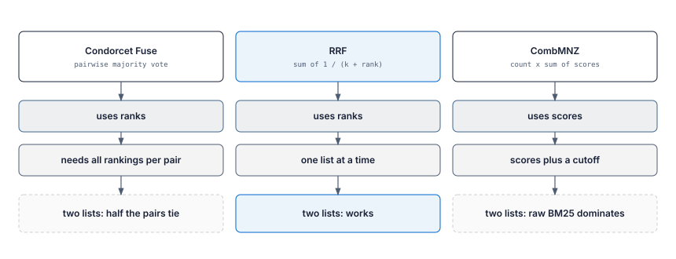
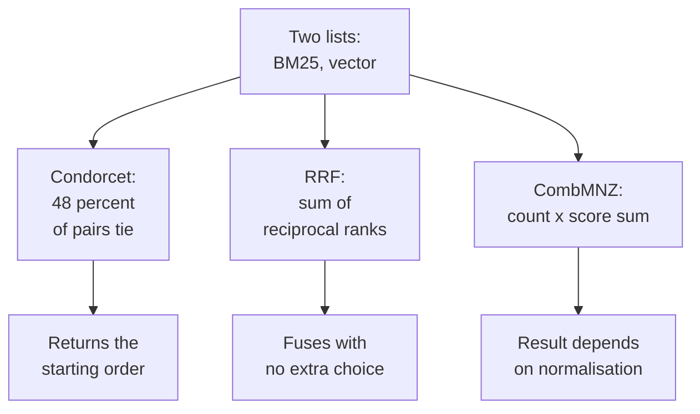

# 03. Condorcet Fuse and CombMNZ (Paper Section 1, the Baselines)

In this note:

- Condorcet Fuse: ranking by majority vote
- CombMNZ: ranking by summed scores times the number of lists
- How the three methods differ
- All three on our data, with only two lists

## Condorcet Fuse

"Condorcet Fuse combines rankings by sorting the documents according to the pairwise relation r(d1) < r(d2), which is determined for each (d1, d2) by majority vote among the input rankings."

In simple words: treat every system as a voter. For two documents A and B, each system votes for the one it ranks higher. If most systems prefer A, A goes above B. Sort all documents with that rule. The method comes from Montague and Aslam (CIKM 2002, reference [4] of the paper), who took the idea from voting theory, where a Condorcet winner is the candidate who beats every other candidate head to head.

Properties:

- Uses only ranks, like RRF. Scores never matter.
- Counts votes, not margins. A system that ranks A first and B 500th casts the same single vote as a system that ranks A 11th and B 12th.
- Needs all rankings at once to decide each pair.

## CombMNZ

"CombMNZ requires for each r a corresponding scoring function s_r : D -> R and a cutoff rank c which all contribute to the CombMNZ score:"

$$\text{CMNZscore}(d \in D) = \big|\{r \in R \mid r(d) \le c\}\big| \cdot \sum_{\{r \mid r(d) \le c\}} s_r(d)$$

<table width="100%">
<thead><tr><th>Part</th><th>Meaning</th></tr></thead>
<tbody>
<tr><td>s_r(d)</td><td>The score system r gave document d (for example a BM25 value or a cosine similarity)</td></tr>
<tr><td>c</td><td>Cutoff rank: only lists that have d in their top c count</td></tr>
<tr><td>First factor</td><td>How many lists found d in their top c (the "MNZ" part: multiply by the number of non-zero scores)</td></tr>
<tr><td>Second factor</td><td>The sum of d's scores in those lists</td></tr>
</tbody>
</table>

So CombMNZ rewards both high scores and agreement. Unlike the other two methods it uses **scores**, which come from different systems on different scales. The discussion section (note 07) blames this for CombMNZ's unstable results: the scores are "uncalibrated".

## The Three Methods Side by Side

<table width="100%">
<thead><tr><th>Question</th><th>Condorcet Fuse</th><th>RRF</th><th>CombMNZ</th></tr></thead>
<tbody>
<tr><td>What it uses</td><td>Ranks</td><td>Ranks</td><td>Scores and ranks (cutoff)</td></tr>
<tr><td>How strength of preference counts</td><td>Not at all (one vote per pair)</td><td>Through 1 / (k + rank)</td><td>Through score size</td></tr>
<tr><td>Needs normalisation</td><td>No</td><td>No</td><td>Yes, in practice</td></tr>
<tr><td>Parameters</td><td>None</td><td>k</td><td>c, plus the normalisation</td></tr>
<tr><td>Can process one list at a time</td><td>No (pairs need all votes)</td><td>Yes</td><td>Yes</td></tr>
</tbody>
</table>

## All Three on Our Data

The paper fused 30 or more rankings. Hybrid search fuses two. We ran each method on the Advanced RAG index with BM25 and vector top 10 lists, over our 10 test questions (file-level MRR) and the rewritten rag-corpus query (rank of the answer chunk). Measurement script and setup as in basic concepts note 10.

<table width="100%">
<thead><tr><th>Method</th><th>File MRR (10 questions)</th><th>Answer chunk rank</th></tr></thead>
<tbody>
<tr><td>BM25 alone</td><td>0.875</td><td>4</td></tr>
<tr><td>Vector alone</td><td>0.803</td><td>Not in top 10</td></tr>
<tr><td>RRF, k = 60</td><td>0.833</td><td>8</td></tr>
<tr><td>Condorcet, starting from the BM25 order</td><td>0.875</td><td>4</td></tr>
<tr><td>Condorcet, starting from the vector order</td><td>0.803</td><td>14</td></tr>
<tr><td>CombMNZ, raw scores</td><td>0.833</td><td>5</td></tr>
<tr><td>CombMNZ, min-max scores per list</td><td>0.783</td><td>8</td></tr>
</tbody>
</table>

What this shows:

- **Condorcet breaks down with two voters.** Two voters either agree (2 to 0) or tie (1 to 1); there is no majority to break a disagreement. Across the 11 queries, 796 of 1,647 document pairs (48 percent) were ties. The sort then keeps whatever order it started from, so Condorcet returned the BM25 results when started from BM25 and the vector results when started from vector search. It did not fuse anything.
- **CombMNZ depends on the score scale.** In the top 10 lists, BM25 scores range from 4.6 to 45, cosine scores from 0.12 to 0.78. With raw scores, BM25 decides the order and agreement adds a bonus, so the answer chunk stays near its BM25 rank (5). With min-max per list, the result changes (answer at 8, MRR down to 0.783). Same method, different normalisation, different answer: the "uncalibrated scores" problem in practice.
- **RRF is the only one of the three that fuses two lists without extra choices.** It does not beat BM25 alone on file MRR here; on our files BM25 is the stronger single retriever (basic concepts notes 10 and 13). What RRF does is put the answer chunk, which vector search misses, into the fused top 10.

These are 10 questions and file-level labels, so small MRR differences mean little. The two structural points (Condorcet ties with two voters, CombMNZ depends on normalisation) do not depend on sample size.

## Key Points

- Condorcet Fuse sorts by pairwise majority vote; it uses ranks but ignores how strong each preference is.
- CombMNZ multiplies the number of lists that found a document by the sum of its scores; it needs comparable scores.
- With two lists, Condorcet ties on about half the pairs and does not fuse; CombMNZ changes with the normalisation; RRF works as is.
- This is why hybrid search systems use RRF or weighted score fusion, not Condorcet or CombMNZ.

## Navigation

Previous: [02. The RRF Formula](02.%20The%20RRF%20Formula.md) | [Paper index](README.md) | Next: [04. Pilot Experiments and the Choice of k](04.%20Pilot%20Experiments%20and%20the%20Choice%20of%20k.md)
