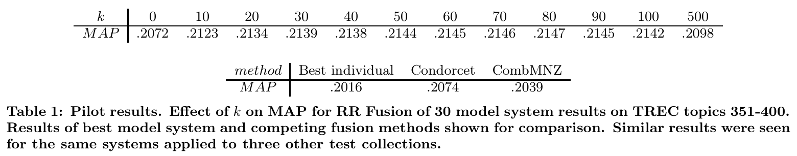
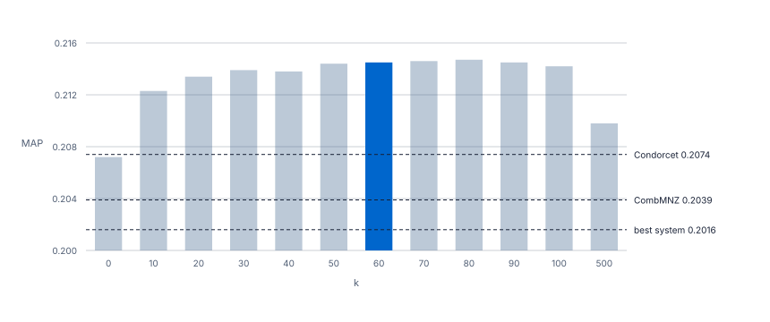
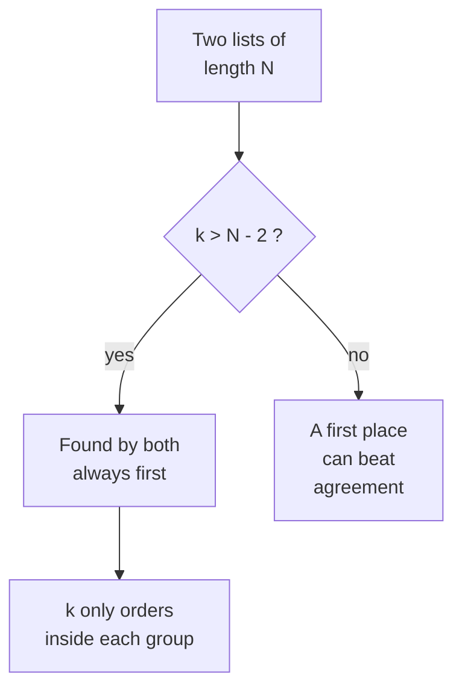

# 04. Pilot Experiments and the Choice of k (Paper Section 1, Table 1)

In this note:

- The four pilot experiments
- Table 1: the effect of k on MAP
- How this fits with the fusion functions paper, which found RRF sensitive to k
- The same sweep on our data, and a simple rule for when k matters

## The Pilot Experiments

"We conducted four pilot experiments, each combining the results of 30 configurations of Wumpus Search applied to four different TREC collections."

- **Wumpus** is the search engine Stefan Buettcher built at Waterloo. The paper does not list the 30 configurations; they are settings of the same engine, so the 30 rankings are related but not identical.
- Each pilot fuses all 30 rankings for every topic and measures MAP.
- Table 1 shows the first pilot, on TREC topics 351 to 400 (the TREC 7 ad hoc topics). The other three are only summarised: "Similar results were seen for the same systems applied to three other test collections."

## Table 1

The authors' reading: "k = 60 was near-optimal, but the choice was not critical." Checking that against the numbers:

<table width="100%">
<thead><tr><th>Observation</th><th>Numbers</th></tr></thead>
<tbody>
<tr><td>k from 10 to 100 is flat</td><td>MAP between 0.2123 and 0.2147, a spread of 0.0024</td></tr>
<tr><td>k = 60 is near the top, not at it</td><td>0.2145; the best is k = 80 with 0.2147</td></tr>
<tr><td>Extremes are worse</td><td>k = 0 gives 0.2072, k = 500 gives 0.2098</td></tr>
<tr><td>Every k beats the best single system and CombMNZ</td><td>Lowest RRF value 0.2072 against 0.2016 and 0.2039</td></tr>
<tr><td>Condorcet is beaten for every k except 0</td><td>0.2074 against 0.2072 at k = 0</td></tr>
<tr><td>Gain of RRF (k = 60) over Condorcet</td><td>0.2145 against 0.2074, about 3.4 percent</td></tr>
</tbody>
</table>

So the claim holds for this pilot: anywhere from 10 to 100 gives almost the same result. It is one collection, one engine and 50 topics; the other three pilots are described but not shown.

Two more points from the text:

- The results "showed, somewhat unexpectedly, that RRF bested competing approaches, as well as more sophisticated learning methods whose investigation was the original impetus for our work." The learning methods are not named or shown.
- Because k was chosen on this pilot, the significance test later leaves it out ("Discounting the first pilot run", note 05). That keeps the choice of k separate from the evidence.

## How This Fits with the Fusion Functions Paper

The fusion functions paper (Bruch et al., its note 07) says RRF is sensitive to its constant. That looks like a contradiction, but the settings differ:

<table width="100%">
<thead><tr><th>Setting</th><th>This paper (2009)</th><th>Fusion functions paper (2022)</th></tr></thead>
<tbody>
<tr><td>Number of lists</td><td>30 (or tens of TREC runs)</td><td>2 (BM25 and a vector model)</td></tr>
<tr><td>How similar the lists are</td><td>Variants of one engine, or runs from similar systems</td><td>Two very different retrievers</td></tr>
<tr><td>Constants</td><td>One k for all lists</td><td>One constant per list, tuned separately</td></tr>
<tr><td>Values that hurt</td><td>k = 0 and k = 500</td><td>Small tuned values (for example 10 and 4) that fail out of domain</td></tr>
</tbody>
</table>

Both papers agree that very small constants hurt and that 60 is a reasonable default. The 2022 paper's point is that a constant tuned on one dataset does not transfer; the 2009 paper never tuned k beyond the pilot, so it never met that problem.

## The Same Sweep on Our Data

We swept k on our two lists (BM25 and vector top 10) for the 10 test questions and the rewritten rag-corpus query:

<table width="100%">
<thead><tr><th>k</th><th>File MRR</th><th>Answer chunk rank</th><th>Queries whose fused top 10 equals k = 60</th></tr></thead>
<tbody>
<tr><td>0</td><td>0.825</td><td>8</td><td>2 of 11</td></tr>
<tr><td>1</td><td>0.825</td><td>8</td><td>4 of 11</td></tr>
<tr><td>5</td><td>0.833</td><td>8</td><td>11 of 11</td></tr>
<tr><td>10 to 500</td><td>0.833</td><td>8</td><td>11 of 11</td></tr>
<tr><td>10,000</td><td>0.833</td><td>8</td><td>11 of 11</td></tr>
</tbody>
</table>

From k = 5 to k = 10,000 the fused top 10 is **exactly the same** for every query. Only k = 0 and k = 1 change anything.

### Why: agreement wins once k > N - 2

Take two lists of length N. A chunk found by both lists, at ranks a and b (both at most N), scores at least 2 / (k + N). A chunk found by one list scores at most 1 / (k + 1). Agreement always wins when

$$\frac{2}{k + N} > \frac{1}{k + 1} \iff 2k + 2 > k + N \iff k > N - 2$$

With our lists of N = 10, any k above 8 puts **every chunk found by both retrievers above every chunk found by only one**. After that, k can only change the order inside each group:

- Chunks found by one list are ordered by their single rank, whatever k is. Rank 3 in BM25 only and rank 3 in vector only tie (note 02).
- Chunks found by both can swap in principle. For example ranks (1, 10) against (5, 5): with k below 35 the pair with a first place wins, above 35 the even pair wins. In our 11 queries no such swap reached the top 10.

<table width="100%">
<thead><tr><th>List length N</th><th>Agreement always wins when</th><th>With k = 60</th></tr></thead>
<tbody>
<tr><td>10 (our API)</td><td>k > 8</td><td>Yes</td></tr>
<tr><td>50</td><td>k > 48</td><td>Yes</td></tr>
<tr><td>100</td><td>k > 98</td><td>No: a first place in one list can beat a pair of low ranks</td></tr>
</tbody>
</table>

So for our setup, "is k = 60 right?" is mostly the question "should chunks found by both retrievers always come first?". With k = 60 and top 10 lists, the answer built into the system is yes.

## Key Points

- The pilot fused 30 Wumpus configurations on four TREC collections; k = 60 was chosen on the first and never changed.
- Table 1: MAP is flat for k from 10 to 100 (0.2123 to 0.2147); k = 60 is near-best, k = 80 is best; only k = 0 and k = 500 drop.
- The fusion functions paper's "RRF is sensitive" applies to two different retrievers with tuned, small constants; both papers agree small constants hurt.
- On our data, k from 5 to 10,000 gives identical fused top 10 lists. For two lists of length N, any k > N - 2 ranks every chunk found by both lists above every chunk found by one.

## Navigation

Previous: [03. Condorcet Fuse and CombMNZ](03.%20Condorcet%20Fuse%20and%20CombMNZ.md) | [Paper index](README.md) | Next: [05. TREC Experiments and Significance](05.%20TREC%20Experiments%20and%20Significance.md)
