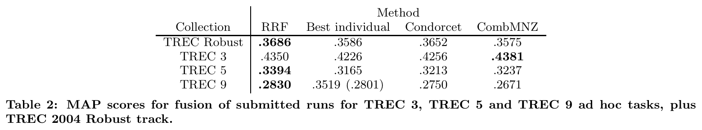
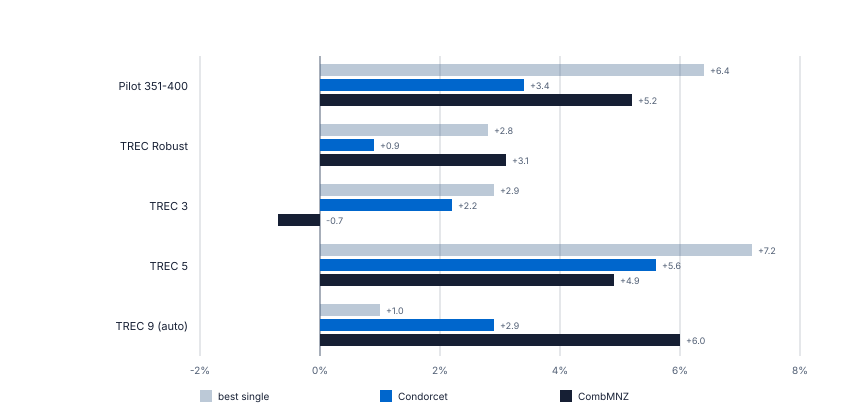
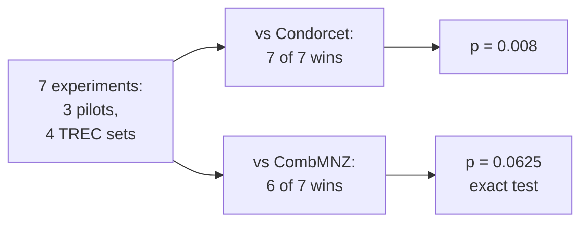

# 05. TREC Experiments and Significance (Paper Section 1, Table 2)

In this note:

- Fusing real TREC submissions
- Table 2, row by row
- Checking "4% to 5% on average"
- The sign test, and one p-value we could not reproduce
- What carries over to two lists

## Fusing Real TREC Submissions

"We repeated our experiment with four sets of submissions to TREC tasks; the particular sets were selected because they have been used in previous metaranking evaluation."

- The four sets: the TREC 3, TREC 5 and TREC 9 ad hoc tasks and the TREC 2004 Robust track. Earlier metaranking studies used the same sets, so the results can be compared with theirs.
- The difference from the pilots matters: "while our pilot runs used exactly the same set of Wumpus configurations ... the individual rankings in these experiments were exactly those submitted by TREC participants." These are rankings from many different teams and systems, not variants of one engine.
- k stays at 60 from the pilot.

## Table 2

<table width="100%">
<thead><tr><th>Collection</th><th>RRF</th><th>Best single run</th><th>Condorcet</th><th>CombMNZ</th><th>Highest</th></tr></thead>
<tbody>
<tr><td>TREC Robust (2004)</td><td><strong>0.3686</strong></td><td>0.3586</td><td>0.3652</td><td>0.3575</td><td>RRF</td></tr>
<tr><td>TREC 3</td><td>0.4350</td><td>0.4226</td><td>0.4256</td><td><strong>0.4381</strong></td><td>CombMNZ</td></tr>
<tr><td>TREC 5</td><td><strong>0.3394</strong></td><td>0.3165</td><td>0.3213</td><td>0.3237</td><td>RRF</td></tr>
<tr><td>TREC 9</td><td>0.2830</td><td><strong>0.3519</strong> (best automatic 0.2801)</td><td>0.2750</td><td>0.2671</td><td>Manual run</td></tr>
</tbody>
</table>

The paper's statements, checked:

- "The MAP score for RRF exceeds that of Condorcet Fuse in all cases": yes, 4 of 4.
- "and CombMNZ in all but one": yes, CombMNZ is higher on TREC 3 (0.4381 against 0.4350).
- "RRF also outperforms the best ranking in each experiment, with the exception of TREC 9, where the best ranking was derived using a human-in-the-loop. RRF outperforms the next-best ranking, which was automated": yes, 0.2830 against 0.2801. The manual run is 24 percent above RRF; fusing automatic runs does not match a human searcher here.

## Checking "4% to 5% on Average"

"The pilot and TREC experiments indicate that RRF outperforms Condorcet, CombMNZ and the best system by 4% to 5% on average." We computed the relative gain, RRF / other - 1, for every row the paper shows:

<table width="100%">
<thead><tr><th>Rows used</th><th>Against best single run</th><th>Against Condorcet</th><th>Against CombMNZ</th></tr></thead>
<tbody>
<tr><td>Four TREC sets (TREC 9 against the best automatic run)</td><td>+3.5%</td><td>+2.9%</td><td>+3.3%</td></tr>
<tr><td>Four TREC sets plus pilot 1</td><td>+4.1%</td><td>+3.0%</td><td>+3.7%</td></tr>
</tbody>
</table>

The rows we can see average about 3 to 4 percent. The paper's "4% to 5%" also includes the three pilots that are not shown, so we cannot check it. The direction is clear; the size is a little smaller in the published rows than in the summary sentence.

## The Sign Test

"We use a simple sign test to establish significance." A sign test ignores how big each difference is and only counts wins and losses. If RRF and a competitor were equally good, each experiment would be a coin flip; the p-value is the chance of seeing at least that many wins by luck.

The paper leaves out the first pilot, where k was chosen, which leaves 7 experiments (3 pilots and 4 TREC sets):

<table width="100%">
<thead><tr><th>Comparison</th><th>RRF wins</th><th>Paper's p</th><th>Exact one-sided sign test</th></tr></thead>
<tbody>
<tr><td>RRF against Condorcet</td><td>7 of 7</td><td>about 0.008</td><td>1 / 128 = 0.0078</td></tr>
<tr><td>RRF against CombMNZ</td><td>6 of 7</td><td>about 0.04</td><td>8 / 128 = 0.0625</td></tr>
<tr><td>RRF against the best single run</td><td>7 of 7 (manual run excluded) or 6 of 7</td><td>between 0.008 and 0.04</td><td>0.0078 or 0.0625</td></tr>
</tbody>
</table>

For 7 of 7 our number matches. For 6 of 7 we could not reproduce 0.04: the exact test gives (7 + 1) / 128 = 0.0625, one-sided, and twice that two-sided. The paper does not say which test variant it used. With the exact test, "all measured differences are significant" holds at the 0.05 level only for Condorcet (and for the best automatic run); the CombMNZ result is suggestive, not significant.

## What Carries Over to Two Lists

The TREC results show RRF reliably matching or beating the best input when it fuses many runs from different teams. Two conditions help there:

- **Many inputs.** A document's fused score is a sum over tens of lists, so one odd list changes little.
- **Inputs of similar quality that make different mistakes.** Fusion helps most when no input is far better than the rest and each errs on different documents. Tens of runs from different teams fit that description.

Our hybrid search has two inputs of unequal quality on our files: BM25 has file MRR 0.875, vector search 0.803, RRF 0.833 (note 03). With two lists, fusion lands between them on this measure. What RRF buys us is coverage: chunks that one retriever misses, such as the rag-corpus answer chunk that vector search does not find, still reach the reranker. The "beats the best system" claim should not be expected to hold for every metric when only two lists are fused.

## Key Points

- Table 2 fuses real TREC submissions from many teams for four collections, with k = 60 unchanged.
- RRF beats Condorcet on all four, CombMNZ on three of four (not TREC 3), and the best automatic run on all four; a manual TREC 9 run is far better.
- The published rows give average gains of about 3 to 4 percent; "4% to 5%" also counts unshown pilots.
- Sign test: 7 of 7 against Condorcet gives p = 0.008; 6 of 7 gives 0.0625 with an exact test, not the paper's 0.04.
- Many similar-quality inputs favour RRF; with two unequal lists it adds coverage more than ranking quality.

## Navigation

Previous: [04. Pilot Experiments and the Choice of k](04.%20Pilot%20Experiments%20and%20the%20Choice%20of%20k.md) | [Paper index](README.md) | Next: [06. LETOR 3 Meta-Learner](06.%20LETOR%203%20Meta-Learner.md)
