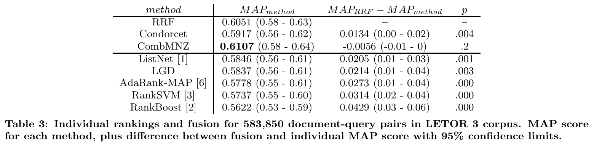
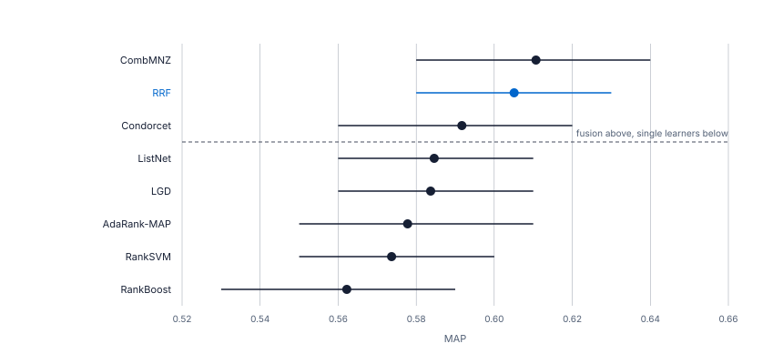
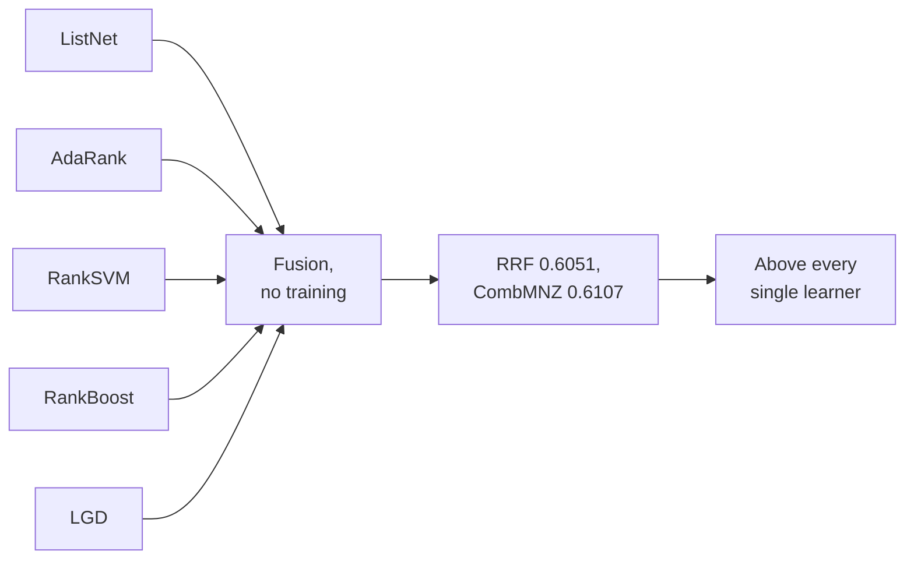

# 06. LETOR 3 Meta-Learner (Paper Section 1, Table 3)

In this note:

- What LETOR 3 is and what was fused
- Table 3, row by row
- Why overlapping intervals can still give significant differences
- CombMNZ comes out on top here
- What a "meta-learner" means for our pipeline

## The Setup

"Our final experiment used the sample learning results supplied with the LETOR 3 dataset, as well as a logistic gradient descent method (LGD) which we are developing."

- **LETOR 3** is a Microsoft Research benchmark for learning to rank. It gives feature vectors for query-document pairs and relevance labels, split into seven query sets (one from OHSUMED medical abstracts and six from the .gov web collection). It also ships the outputs of standard learning-to-rank baselines, so anyone can compare against them.
- **The inputs to fusion** are five learned rankers: ListNet, AdaRank-MAP, RankSVM, RankBoost (the LETOR baselines) and the authors' own LGD.
- **Fusion methods**: RRF (k = 60), Condorcet Fuse and CombMNZ applied to those five rankings.
- **Pooling**: "we combined the seven sets of document-query pairs into one and computed an overall MAP score", over 583,850 document-query pairs. Pooling gives larger query sets more weight than smaller ones.
- **Statistics**: for each method, the MAP difference from RRF with a 95 percent confidence interval, and a p-value for "the difference is 0".

RRF fused over learned rankers is what the paper calls a **meta-learner**: a combination of learned models that needs no training of its own.

## Table 3

<table width="100%">
<thead><tr><th>Method</th><th>Kind</th><th>MAP (95% interval)</th><th>RRF minus method</th><th>p</th></tr></thead>
<tbody>
<tr><td>CombMNZ</td><td>Fusion</td><td><strong>0.6107</strong> (0.58 to 0.64)</td><td>-0.0056</td><td>0.2</td></tr>
<tr><td>RRF</td><td>Fusion</td><td>0.6051 (0.58 to 0.63)</td><td>-</td><td>-</td></tr>
<tr><td>Condorcet</td><td>Fusion</td><td>0.5917 (0.56 to 0.62)</td><td>0.0134</td><td>0.004</td></tr>
<tr><td>ListNet</td><td>Single learner</td><td>0.5846 (0.56 to 0.61)</td><td>0.0205</td><td>0.001</td></tr>
<tr><td>LGD</td><td>Single learner</td><td>0.5837 (0.56 to 0.61)</td><td>0.0214</td><td>0.003</td></tr>
<tr><td>AdaRank-MAP</td><td>Single learner</td><td>0.5778 (0.55 to 0.61)</td><td>0.0273</td><td>below 0.001</td></tr>
<tr><td>RankSVM</td><td>Single learner</td><td>0.5737 (0.55 to 0.60)</td><td>0.0314</td><td>below 0.001</td></tr>
<tr><td>RankBoost</td><td>Single learner</td><td>0.5622 (0.53 to 0.59)</td><td>0.0429</td><td>below 0.001</td></tr>
</tbody>
</table>

The paper's statements, checked:

- "RRF betters all individual rankings (p < .003), the best by a margin of 0.02 (4%)": yes. Against ListNet the margin is 0.0205, which is 3.5 percent, rounded to 4.
- "Condorcet is inferior to RRF (p about .004) while apparently bettering the individual rankings (p about .2)": Condorcet is above every single learner, but not significantly.
- "CombMNZ edges RRF by a small margin (p about .2)": CombMNZ has the highest MAP in the table; the gap is not significant.
- "None of the measured differences among the baseline systems is significant": the five learners cannot be told apart.

## Overlapping Intervals, Significant Differences

Every interval in the plot overlaps every other, yet RRF is significantly better than all five learners. Both are true because the test is **paired**:

- The interval around each MAP says how much that MAP would move with a different sample of queries. It is wide (about plus or minus 0.03) because queries differ a lot in difficulty.
- The difference column compares two methods **on the same queries**. Hard queries are hard for both, easy ones easy for both, so that variation cancels. The interval on the difference is narrow, for example 0.01 to 0.03 against ListNet, and it excludes 0.

So overlapping per-method intervals do not mean "no difference". The same applies to our own evaluation: compare retrieval settings on the same questions, and look at per-question differences, not only at averages.

One rounding detail: the Condorcet difference interval is printed as "0.00 - 0.02" with p = 0.004. The lower limit is above 0 but rounds to 0.00 at two decimals.

## CombMNZ on Top

In Table 2 (note 05) CombMNZ was the most variable method: it won on TREC 3 and came last on TREC 9. Here it wins again. The discussion (note 07) explains the variance by the scores: "some scores are more amenable than others." The LETOR baselines are learned models trained on similar features, so their scores may be easier to add up than scores from unrelated TREC systems. That is a plausible reading; the paper does not test it.

The abstract's claim that the RRF meta-learner ranks LETOR 3 "better than any previously reported method" is true against the single learners. In the paper's own table, CombMNZ fusion is slightly higher, not significantly so. The fair summary: rank fusion of the LETOR baselines, by RRF or CombMNZ, beats every single learner.

## What This Means for Our Pipeline

- **Fusion is a free ensemble.** Five trained rankers, each around 0.56 to 0.58 MAP, become 0.61 with no extra training. In our pipeline the inputs are two retrievers, and fusion gives the reranker a candidate set that neither retriever would give alone.
- **Order of stages.** The paper fuses after learned rankers. We fuse before a learned ranker (the gpt-4o-mini reranker, basic concepts note 11). The reranker then fixes the fine order inside the fused candidates, which is where RRF is weakest (rank 1 and rank 2 are almost equal, note 02).
- **Paired comparisons.** Our evaluation presets compare settings on the same 10 questions; per-question differences tell more than the averages.

## Key Points

- LETOR 3 experiment: fuse five learned rankers (four LETOR baselines and the authors' LGD) over 583,850 pooled query-document pairs.
- RRF (0.6051) beats every single learner significantly (best: ListNet 0.5846, about 3.5 percent) and beats Condorcet (p = 0.004).
- CombMNZ is highest (0.6107) but not significantly above RRF; "better than any previously reported method" is fair for single learners.
- Overlapping intervals per method do not rule out significant paired differences.
- For us: fusion is a training-free ensemble that feeds the reranker, which repairs RRF's weak fine ordering.

## Navigation

Previous: [05. TREC Experiments and Significance](05.%20TREC%20Experiments%20and%20Significance.md) | [Paper index](README.md) | Next: [07. Discussion and Conclusion](07.%20Discussion%20and%20Conclusion.md)
