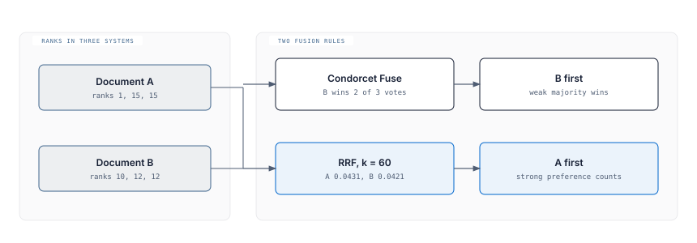
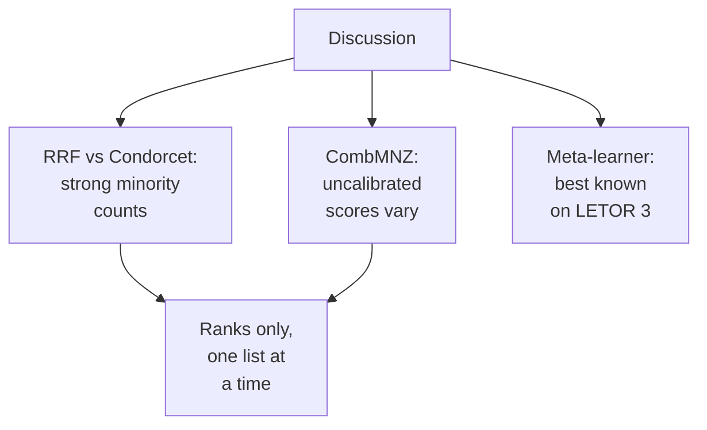

# 07. Discussion and Conclusion (Paper Section 2)

In this note:

- Why only MAP is reported
- Why RRF beats Condorcet: a strong minority against a weak majority
- Why CombMNZ varies so much
- The meta-learner and the limit of what can be learned
- What the paper does not cover
- What the three papers together decide for our API

## Only MAP

"For brevity, we report MAP as the measure of system performance. P@k, R-precision, and NDCG yield comparable results." The other measures are not shown, so this is a statement we have to take on trust. For a two-page paper that is a fair trade.

## RRF Against Condorcet

"RRF is simpler and more effective than Condorcet Fuse, while sharing the valuable property that it combines ranks without regard to the arbitrary scores returned by particular ranking methods."

Two practical advantages:

- "RRF requires no special voting algorithm or global information; ranks may be computed and summed one system at a time, avoiding the necessity of keeping all rankings in memory." Condorcet must compare every pair of documents across all rankings. RRF is a running sum.
- In code, adding a list to RRF is one more loop over its ranks. That is why our API can later add a third list (for example a second query or learned sparse retrieval, basic concepts note 07) without changing the fusion step.

The authors' explanation of why RRF ranks better is labelled a conjecture: "RRF ... is better able to harness diversity within individual rankings. One or two systems that rank a document highly can substantially improve its rank relative to the more popular documents. With Condorcet, a simple majority of weak preferences may overrule substantially stronger ones."

<table width="100%">
<thead><tr><th>Document</th><th>System 1</th><th>System 2</th><th>System 3</th><th>Condorcet</th><th>RRF, k = 60</th></tr></thead>
<tbody>
<tr><td>A</td><td>1</td><td>15</td><td>15</td><td>Loses 1 to 2</td><td>1/61 + 2/75 = 0.0431</td></tr>
<tr><td>B</td><td>10</td><td>12</td><td>12</td><td>Wins 2 to 1</td><td>1/70 + 2/72 = 0.0421</td></tr>
</tbody>
</table>

Two systems prefer B, but only by 3 places. One system prefers A by 9 places. Condorcet counts the votes and picks B. RRF weighs how far apart the ranks are and picks A.

This sits next to a sentence from section 1 (note 02): "The constant k mitigates the impact of high rankings by outlier systems." Both are true at once. With k = 60 one system cannot lift a document to the top on its own, but a strong preference still counts for more than a single vote. RRF sits between "count votes" (Condorcet) and "trust the top rank" (small k).

## Why CombMNZ Varies

"CombMNZ multiplies the sum of the uncalibrated scores of individual system by the sum of a binary quantization of each rank." (The "binary quantization of each rank" is 1 if the document is in that list's top c, else 0; summed, it is the number of lists that found it.) "It is perhaps not surprising that its results have higher variance, ranging from insubstantially better than RRF to substantially worse than Condorcet. We conjecture that this effect is due to the fact that, by happenstance, some scores are more amenable than others."

The tables bear this out: CombMNZ is first on TREC 3 and LETOR 3, last on TREC 9 and the TREC Robust track (note 05). Our own test in note 03 showed the same effect in miniature: on the same two lists, CombMNZ gave a different result with raw scores than with min-max scores. The fusion functions paper later made the same point properly: score-based fusion needs bounded, normalised scores and a tuned weight.

## The Meta-Learner and the Limit of Learning

"To our knowledge, no reported result matches or exceeds the performance of the meta-learner formed by applying fusion to the LETOR baseline rank learning methods." So the authors call it "the best known method", which "raises the lower bound of what is known to be learnable from the dataset".

The last sentence gives context: MAP on LETOR 3 approaches "the 65% considered achievable with human-adjudicated relevance". Relevance labels themselves are not perfect; different human assessors disagree. A system scoring near that level is close to how well people agree with each other, so there is limited room left.

## What the Paper Does Not Cover

<table width="100%">
<thead><tr><th>Not covered</th><th>Why it matters for hybrid search</th><th>Where we handle it</th></tr></thead>
<tbody>
<tr><td>Fusing only two lists</td><td>Condorcet degenerates; the agreement rule k > N - 2 decides most of the order</td><td>Notes 03 and 04</td></tr>
<tr><td>Truncated lists and missing documents</td><td>The formula assumes every list ranks every document</td><td>Missing counts as 0 (note 02)</td></tr>
<tr><td>Ties</td><td>Single-list documents at the same rank tie exactly</td><td>Tie rule: better single rank, then vector score</td></tr>
<tr><td>Normalised score fusion</td><td>Only uncalibrated CombMNZ was tested, not a tuned weighted sum of normalised scores</td><td>Fusion functions paper; weighted fusion setting</td></tr>
<tr><td>Dense (vector) retrieval</td><td>It did not exist in its current form in 2009</td><td>Blended RAG and fusion functions papers</td></tr>
</tbody>
</table>

## What the Three Papers Decide for Our API

<table width="100%">
<thead><tr><th>Question</th><th>Evidence</th><th>Decision</th></tr></thead>
<tbody>
<tr><td>Fuse at all?</td><td>Blended RAG: hybrid beats single retrievers. Our data: RRF brings the rag-corpus answer chunk into the candidates</td><td>Yes: BM25 and vector search, fused</td></tr>
<tr><td>Default fusion</td><td>RRF needs no scores, no training and no normalisation (this paper); with two lists Condorcet and CombMNZ fail (note 03)</td><td>RRF</td></tr>
<tr><td>Value of k</td><td>Flat from 10 to 100 (Table 1); identical results from 5 to 10,000 on our data; tuned values do not transfer (fusion functions paper)</td><td>k = 60, not tuned</td></tr>
<tr><td>Alternative fusion</td><td>Tuned weighted fusion of theoretical min-max scores beats RRF in NDCG (fusion functions paper)</td><td>Weighted fusion as a setting, alpha 0.5, decided by chunk-level evaluation</td></tr>
<tr><td>Fine order at the top</td><td>RRF hardly separates rank 1 from rank 2 (note 02)</td><td>Leave it to the reranker</td></tr>
<tr><td>Missing documents and ties</td><td>Not in the paper</td><td>Missing counts 0; ties by better single rank, then vector score</td></tr>
</tbody>
</table>

## Key Points

- Only MAP is shown; other measures are said to agree.
- RRF beats Condorcet, the authors suggest, because a strong preference from a few systems can outweigh a weak majority; RRF is also a simple running sum.
- CombMNZ varies because it adds uncalibrated scores; our two-list test shows the same.
- Fusing the LETOR baselines gave the best known LETOR 3 result, near the level of human agreement.
- For our API: RRF with k = 60 as the default, weighted fusion as a setting, the reranker for the fine order, and explicit rules for missing documents and ties.

## Navigation

Previous: [06. LETOR 3 Meta-Learner](06.%20LETOR%203%20Meta-Learner.md) | [Paper index](README.md) | Next: [03. Interview Preparation](../../03.%20Interview%20Preparation/)
