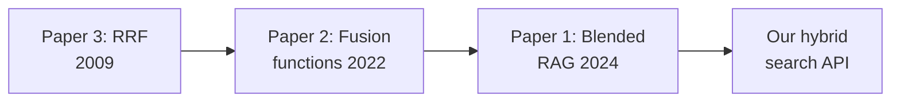

# 02. Research Paper Explained

The three papers behind Hybrid Search RAG, explained section by section: every important sentence in simple words, every figure, table and equation, and what each part means for this project. The PDFs are in [02. Papers](../../02.%20Papers/).

## The papers

<table width="100%">
<thead><tr><th>#</th><th>Paper</th><th>Role in hybrid search</th><th>Core idea</th><th>Status</th></tr></thead>
<tbody>
<tr><td>1</td><td><a href="01.%20Blended%20RAG/">Blended RAG: Improving RAG Accuracy with Semantic Search and Hybrid Query-Based Retrievers (Sawarkar, Mangal, Solanki, IBM 2024)</a></td><td>Hybrid retrieval for RAG</td><td>Combine keyword (BM25), dense vector and sparse encoder indexes with different query types, and measure the effect on retrieval and RAG accuracy</td><td>Done</td></tr>
<tr><td>2</td><td>An Analysis of Fusion Functions for Hybrid Retrieval (Bruch, Gai, Ingber, 2022)</td><td>How to fuse</td><td>Compare convex combination of normalised scores with Reciprocal Rank Fusion, in and out of domain, and how sensitive each is to its parameters</td><td>Planned</td></tr>
<tr><td>3</td><td>Reciprocal Rank Fusion outperforms Condorcet and individual Rank Learning Methods (Cormack, Clarke, Buettcher, SIGIR 2009)</td><td>The fusion formula</td><td>Merge rankings with score = sum of 1 / (k + rank), k = 60; simple, and better than each input ranking</td><td>Planned</td></tr>
</tbody>
</table>

The note list for each paper is added when its notes start, one note per paper section, as for the Advanced RAG papers.

Reading order in time: RRF gives the fusion formula, the fusion analysis tests it against weighted fusion, Blended RAG applies hybrid retrieval to RAG.

## Navigation

Previous: [01. Basic Concepts](../01.%20Basic%20Concepts/) | [Notes](../README.md) | Next: [03. Interview Preparation](../03.%20Interview%20Preparation/)
