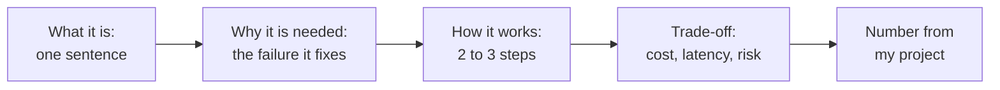
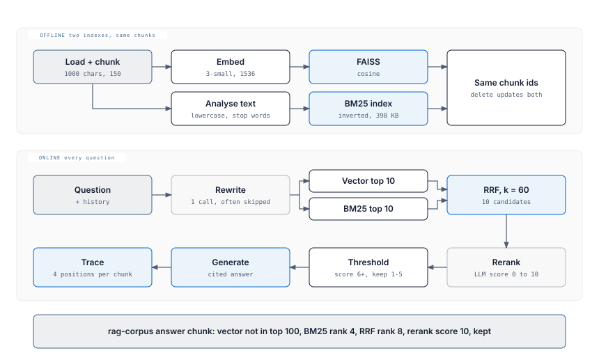

# 01. Explanations and the Whiteboard Diagram

In this doc:

- How to use these docs, and how to structure any answer
- The 30-second explanation
- The 2-minute explanation
- The diagram to draw
- What you can claim now, and what waits for the evaluation

Everything here is backed by the basic concept notes and the three paper notes in this folder. Numbers come from measurements on the Advanced RAG index (410 chunks, text-embedding-3-small, FAISS) with the 10 answerable test questions, made while writing the notes. Start with the [Advanced RAG Interview Preparation](../../../02.%20Advanced%20RAG/01.%20Notes/03.%20Interview%20Preparation/): Hybrid Search RAG builds on it, and interviewers will ask what changed.

## How to Use These Docs

- Read the two explanations until you can say them without notes.
- Practise drawing the diagram in under two minutes.
- For each question in docs 02 and 03, answer it yourself first, then compare.
- Learn the worked numbers in doc 04: a number from your own system is what makes an answer stand out.

### How to structure any answer

Example: "Reciprocal Rank Fusion merges ranked lists using only positions. It is needed because BM25 scores and cosine similarities are on different scales: in my data BM25 went up to 45 while cosine stayed between 0.1 and 0.8. Each chunk gets 1 / (60 + rank) from every list it appears in, and chunks are sorted by the sum. It cannot tell a clear winner from a close second, so the reranker sets the final order. In my data it brought an answer chunk that vector search could not find into the reranker's candidates at fused rank 8."

## The 30-Second Explanation

"Hybrid Search RAG searches every question two ways over the same chunks: keyword search with BM25 and vector search with embeddings. Keyword search is strong on exact and rare terms such as codes and names; vector search is strong on paraphrases. The two ranked lists are merged with Reciprocal Rank Fusion, and the merged candidates go through the same reranker, threshold and generator as Advanced RAG. BM25 runs locally in well under a millisecond, so there are no extra model calls and the cost per question stays the same."

## The 2-Minute Explanation

"My Advanced RAG raised context precision from 0.41 to 0.66, but correctness stayed at 0.84. Looking at the failures, the answer chunk was sometimes never retrieved. For one question, 'What collection does RAG retrieve from?', the chunk with the answer is about something else and mentions a Wikipedia dump in one sentence. Vector search, which embeds the whole chunk, did not have it in its top 100. BM25 with the rewritten query ranked it 4th, because it matches words, not overall meaning.

So Hybrid Search RAG adds a second retriever. At ingestion, the same chunks also go into a BM25 inverted index, after lowercasing and stop-word removal; adding 'et' and 'al' as stop words alone moved one paper from rank 30 to rank 2. At question time both retrievers return their top 10. On my test set they share only 2.4 chunks on average, so they really are complementary: BM25 put the right file first for 8 of 10 questions, vector search for 7.

The lists are fused with Reciprocal Rank Fusion: each chunk gets 1 / (60 + rank) from each list. I use RRF because it needs only ranks; BM25 scores and cosine scores cannot be added directly. Weighted fusion of normalised scores can rank better, as the 2022 fusion functions paper shows, but it needs labelled data to set its weight, so it is a setting, not the default. In my data RRF put the missing answer chunk at fused rank 8, and the reranker scored it 10 out of 10, so it reached the answer.

The rest is Advanced RAG: an LLM reranker scores the 10 fused candidates, a threshold keeps the good ones. Fusion is for recall, reranking for precision. The trade-offs: keyword candidates can push out vector candidates, two indexes must stay in sync, and file-level metrics are too coarse to show the gain, so the evaluation checks whether the answer chunk itself is retrieved."

## The Diagram to Draw

Draw it in this order:

1. The offline row: chunks go to both FAISS and the BM25 index, with the same chunk ids. Say "deleting a file updates both".
2. The online row: rewrite, then the two retrievers side by side, then RRF.
3. The second online row: rerank, threshold, generate. Say "unchanged from Advanced RAG".
4. The bottom line: the answer chunk's journey (vector misses it, BM25 rank 4, fused rank 8, rerank score 10). This is the story in one line.

## What You Can Claim Now, and What Waits

<table width="100%">
<thead><tr><th>Claim</th><th>Status</th><th>Evidence</th></tr></thead>
<tbody>
<tr><td>The two retrievers are complementary</td><td>Measured</td><td>Top 10 overlap 2.4 chunks on average; union 14 to 19 chunks</td></tr>
<tr><td>BM25 finds an answer chunk vector search misses</td><td>Measured</td><td>rag-corpus: vector not in top 100, BM25 rank 4</td></tr>
<tr><td>RRF brings it to the reranker, which keeps it</td><td>Measured</td><td>Fused rank 8, rerank score 10, kept</td></tr>
<tr><td>Keyword search and fusion add almost no time</td><td>Measured</td><td>BM25 0.06 ms, RRF 0.009 ms, against 300 to 1,000 ms for one embedding call</td></tr>
<tr><td>Hybrid raises correctness over Advanced RAG</td><td>Not yet measured</td><td>Needs the API and the chunk-level evaluation (doc 05)</td></tr>
<tr><td>Cost per question unchanged</td><td>Expected</td><td>Same model calls; confirmed only after the evaluation</td></tr>
</tbody>
</table>

In an interview, say which is which. "Measured on my index, before the full evaluation" is a strong answer; claiming a correctness gain you have not measured is a weak one.

## Key Points

- Structure every answer: what, why, how, trade-off, number.
- 30 seconds: two retrievers over the same chunks, RRF to merge, Advanced RAG stages after, no extra model calls.
- 2 minutes: the rag-corpus failure, the complementary retrievers (2.4 shared chunks), RRF and why not weighted fusion, fusion for recall and reranking for precision, the trade-offs.
- Draw the two indexes, the two lists, RRF, then the unchanged stages, then the answer chunk's journey.
- Keep measured, expected and not yet measured claims apart.

## Navigation

[Interview Preparation](README.md) | Next: [02. Concept Questions and Answers](02.%20Concept%20Questions%20and%20Answers.md)
