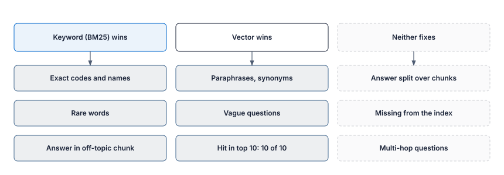
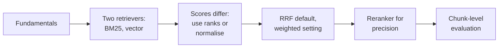

# 02. Concept Questions and Answers

In this doc:

- Questions and answers by topic, from fundamentals to cost
- Each answer backed by a basic concepts note and, where possible, a number measured on this project's data

Answer each question yourself first, then compare. The note number in the last column is where the full explanation is.

## 1. Fundamentals

<table width="100%">
<thead><tr><th>Question</th><th>Answer</th><th>Note</th></tr></thead>
<tbody>
<tr><td>What is Hybrid Search RAG?</td><td>RAG that retrieves with two methods over the same chunks, keyword search (BM25) and vector search, and fuses the two ranked lists before reranking and generation</td><td>01</td></tr>
<tr><td>Which Advanced RAG problem does it solve?</td><td>Answer chunks that never become candidates. Advanced RAG improved what is sent (precision 0.41 to 0.66) but correctness stayed at 0.84; some failures were retrieval misses that no reranker can fix</td><td>02</td></tr>
<tr><td>Why not just retrieve more vector results?</td><td>A chunk that vector search ranks below 100 does not appear at 20 or 50 either. The rag-corpus answer chunk was not in the vector top 100; BM25 ranked it 4th</td><td>02</td></tr>
<tr><td>What changes compared with Advanced RAG?</td><td>A BM25 index at ingestion, keyword retrieval and fusion at question time. Rewriting, reranker, threshold and generator are unchanged</td><td>12</td></tr>
<tr><td>Does it add model calls?</td><td>No. BM25 and fusion run locally; cost per question stays at the Advanced RAG level</td><td>14</td></tr>
<tr><td>What does it not fix?</td><td>Answers split across chunks, information missing from the index, multi-hop questions, and queries that share no words with the answer and are also paraphrased</td><td>06</td></tr>
</tbody>
</table>

## 2. Sparse retrieval and BM25

<table width="100%">
<thead><tr><th>Question</th><th>Answer</th><th>Note</th></tr></thead>
<tbody>
<tr><td>Sparse vs dense vectors?</td><td>Sparse: one dimension per vocabulary word, almost all zero, stored as an inverted index. Dense: a few hundred to a few thousand learned dimensions (1,536 here), all non-zero</td><td>03</td></tr>
<tr><td>What is an inverted index?</td><td>A map from each term to the chunks that contain it (its postings). Only chunks containing a query word are scored. Ours: 6,368 terms, 33,400 postings</td><td>03, 14</td></tr>
<tr><td>Explain the BM25 formula.</td><td>For each query word: IDF (rare words count more) times a term frequency part that saturates with k1 and is discounted for long chunks with b. Sum over query words</td><td>03</td></tr>
<tr><td>What do k1 and b do?</td><td>k1 (1.2) controls how fast repeated words stop adding score. b (0.75) controls how much long chunks are penalised; b = 0 means no length correction</td><td>03</td></tr>
<tr><td>Why is BM25 still used?</td><td>Free, fast (0.06 ms per query here), exact on codes and names, no training, explainable. A strong baseline on out-of-domain data</td><td>03, 14</td></tr>
<tr><td>Weaknesses?</td><td>Vocabulary mismatch: no synonyms or meaning. Scores have no fixed scale and never say "nothing relevant"</td><td>03, 06</td></tr>
</tbody>
</table>

## 3. Text analysis

<table width="100%">
<thead><tr><th>Question</th><th>Answer</th><th>Note</th></tr></thead>
<tbody>
<tr><td>What is text analysis?</td><td>Turning text into terms: normalise, tokenise, remove stop words, optionally stem. It decides what can match, and must be identical at index and query time</td><td>04</td></tr>
<tr><td>A stop word example from your data?</td><td>Adding "et" and "al" (from "et al.") as stop words moved the RAG paper from rank 30 to rank 2 for one question: citation noise was matching</td><td>04</td></tr>
<tr><td>Should you stem?</td><td>Measured trade-off: stemming moved the rag-corpus answer chunk from rank 4 to 38, and selfrag-when from 4 to 1. Off by default, a setting the evaluation can test</td><td>04</td></tr>
<tr><td>How do you handle codes like "E-4021"?</td><td>Index the whole token and its parts, so both "E-4021" and "4021" match</td><td>04</td></tr>
</tbody>
</table>

## 4. Dense retrieval blind spots

<table width="100%">
<thead><tr><th>Question</th><th>Answer</th><th>Note</th></tr></thead>
<tbody>
<tr><td>Where does vector search fail?</td><td>Exact codes and numbers, negation, and answers that are one sentence inside a chunk about something else</td><td>05</td></tr>
<tr><td>Show it with numbers.</td><td>A wrong error code scored 0.688 against 0.703 for the right one; a negated sentence 0.784 against 0.868 for the original; the rag-corpus answer sentence inside an off-topic chunk was not in the top 100</td><td>05</td></tr>
<tr><td>Why are similarities so close?</td><td>Embeddings of texts in one domain cluster together, so cosine values are compressed into a narrow band; small differences decide the ranking</td><td>05, 08</td></tr>
<tr><td>When does vector search win?</td><td>Paraphrases, synonyms, vague questions. It found the expected file in its top 10 for all 10 questions, BM25 for 9</td><td>06</td></tr>
<tr><td>How complementary are they on your data?</td><td>The two top 10 lists share 2.4 chunks on average (1 to 6); the union holds 14 to 19 chunks. BM25 ranked the right file first for 8 of 10 questions, vector for 7</td><td>06, 13</td></tr>
</tbody>
</table>

## 5. Learned sparse retrieval

<table width="100%">
<thead><tr><th>Question</th><th>Answer</th><th>Note</th></tr></thead>
<tbody>
<tr><td>What is SPLADE?</td><td>A sparse model where BERT sets the term weights and adds related terms (expansion). Weights are log(1 + ReLU) of masked-language-model scores, trained with a sparsity penalty. Still uses an inverted index</td><td>07</td></tr>
<tr><td>Why not use it here?</td><td>It needs a model (or a service such as Elastic ELSER) outside the stack: Azure OpenAI only, no local models. BM25 covers the main gap, exact terms</td><td>07</td></tr>
<tr><td>Where does it sit?</td><td>Between BM25 and dense: exact matching plus some synonyms, still explainable term by term</td><td>07</td></tr>
</tbody>
</table>

## 6. Score scales and normalisation

<table width="100%">
<thead><tr><th>Question</th><th>Answer</th><th>Note</th></tr></thead>
<tbody>
<tr><td>Why not add BM25 and cosine scores?</td><td>Different scales: BM25 up to about 45 here and changing per query, cosine between 0.1 and 0.8. Added raw, BM25 decides everything</td><td>08</td></tr>
<tr><td>Min-max vs z-score vs theoretical min-max?</td><td>Min-max uses the list's own min and max; z-score the mean and spread; theoretical min-max fixed lower bounds (0 for BM25, -1 for cosine) and the list maximum. The first two stretch tiny cosine gaps; theoretical min-max keeps real gaps</td><td>08</td></tr>
<tr><td>A chunk appears in only one list. What score does it get in the other?</td><td>Options: treat as the minimum, compute the missing score exactly, or use ranks (RRF), where a missing chunk simply adds nothing</td><td>08</td></tr>
</tbody>
</table>

## 7. Reciprocal Rank Fusion

<table width="100%">
<thead><tr><th>Question</th><th>Answer</th><th>Note</th></tr></thead>
<tbody>
<tr><td>The formula?</td><td>score(d) = sum over lists of 1 / (k + rank of d), k = 60; sort by score</td><td>09</td></tr>
<tr><td>Why k = 60?</td><td>Chosen once in a pilot by Cormack et al. (2009) and never changed; MAP was flat for k from 10 to 100. It keeps weight on lower ranks and stops one list from deciding alone</td><td>09, RRF notes 02 and 04</td></tr>
<tr><td>Does k matter for you?</td><td>Barely: from k = 5 to 10,000 the fused top 10 was identical for all 11 queries. With two lists of length N, any k > N - 2 puts every chunk found by both lists above every chunk found by one</td><td>RRF note 04</td></tr>
<tr><td>Strengths?</td><td>No scores, no normalisation, no training; a few lines of code; easy to add a third list</td><td>09</td></tr>
<tr><td>Weaknesses?</td><td>Ignores how much better rank 1 is than rank 2 (1/61 against 1/62); ties are common; with little overlap it interleaves the lists</td><td>09</td></tr>
<tr><td>Why not Condorcet or CombMNZ?</td><td>With two lists Condorcet ties on 48 percent of pairs and returns the starting order. CombMNZ adds raw scores and changed with the normalisation (answer chunk rank 5 vs 8)</td><td>RRF note 03</td></tr>
</tbody>
</table>

## 8. Weighted fusion

<table width="100%">
<thead><tr><th>Question</th><th>Answer</th><th>Note</th></tr></thead>
<tbody>
<tr><td>How does it work?</td><td>alpha x normalised vector score + (1 - alpha) x normalised BM25 score, over the union of both lists</td><td>10</td></tr>
<tr><td>What did your alpha sweep show?</td><td>With theoretical min-max the rag-corpus answer chunk stayed in the fused top 10 up to alpha 0.5; with plain min-max only up to 0.2. File-level hit rate was 10 of 10 for every alpha, too coarse to choose alpha</td><td>10</td></tr>
<tr><td>Why is RRF your default, not weighted fusion?</td><td>Weighted fusion needs labelled data to set alpha, and the best alpha differs per question. RRF needs none. Weighted fusion is a setting, to be switched on if the chunk-level evaluation shows it wins</td><td>10</td></tr>
</tbody>
</table>

## 9. Hybrid search plus reranking

<table width="100%">
<thead><tr><th>Question</th><th>Answer</th><th>Note</th></tr></thead>
<tbody>
<tr><td>Why both fusion and a reranker?</td><td>Fusion is for recall (get the answer chunk into the candidates); the reranker is for precision (put it on top and drop the rest)</td><td>11</td></tr>
<tr><td>Does the fused rank matter?</td><td>Little, as long as the chunk is among the candidates: the rag-corpus answer chunk entered at fused rank 8 and the reranker scored it 10</td><td>11</td></tr>
<tr><td>Any side effects?</td><td>Two questions kept fewer chunks: keyword candidates displaced useful vector candidates, and listwise rerank scores shifted with the other candidates (two chunks scored 7 and 6 with one candidate set, 2 and 1 with another)</td><td>11</td></tr>
<tr><td>How would you reduce displacement?</td><td>More candidates (15 instead of 10, preset E), at a higher rerank cost; or reserve slots for each retriever</td><td>11, 13</td></tr>
</tbody>
</table>

## 10. Architecture, evaluation and cost

<table width="100%">
<thead><tr><th>Question</th><th>Answer</th><th>Note</th></tr></thead>
<tbody>
<tr><td>What changes at ingestion?</td><td>The same chunks also go into a BM25 index with the same chunk ids. Delete and upload must update both indexes. BM25 statistics are global, so the index is rebuilt (16 ms here)</td><td>12, 14</td></tr>
<tr><td>What does the trace record?</td><td>For every candidate: vector rank and score, keyword rank and score, fused rank and score, rerank score and kept flag</td><td>12</td></tr>
<tr><td>How do you evaluate hybrid search?</td><td>At three levels: each retriever, the fused candidates, the final answer. File-level hit rate is saturated (10 of 10), so chunk-level labels (evidence phrases) check whether the answer chunk itself was retrieved</td><td>13</td></tr>
<tr><td>Your presets?</td><td>A vector (Advanced RAG), B keyword, C hybrid RRF, D hybrid weighted (theoretical min-max, alpha 0.5), E hybrid RRF with 15 candidates. Same reranker and generator, three runs each because model stages vary</td><td>13</td></tr>
<tr><td>What does keyword search cost in time?</td><td>BM25 0.06 ms, FAISS 0.04 ms, RRF 0.009 ms per query; one embedding call takes 300 to 1,000 ms. Retrieval time is the embedding call</td><td>14</td></tr>
<tr><td>Main limitations?</td><td>Needs the right query words, analysis tuned to the domain, fusion settings that depend on the data, fewer slots for vector results, two indexes to keep in sync</td><td>14</td></tr>
</tbody>
</table>

## Key Points

- Hybrid search fixes retrieval misses, not selection: the answer chunk must first be a candidate.
- BM25 and vector search fail in different places; on our data their top 10 lists share only 2.4 chunks.
- Scores cannot be added raw; RRF uses ranks, weighted fusion needs normalisation and a tuned alpha.
- Fusion is for recall, the reranker for precision; side effects are displacement and listwise score shifts.
- Evaluate at chunk level, at three levels, with repeated runs.

## Navigation

Previous: [01. Explanations and the Whiteboard Diagram](01.%20Explanations%20and%20the%20Whiteboard%20Diagram.md) | [Interview Preparation](README.md) | Next: [03. Research Paper Questions and Answers](03.%20Research%20Paper%20Questions%20and%20Answers.md)
