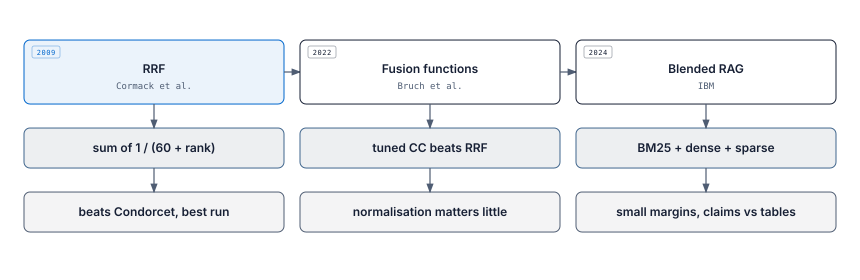

# 03. Research Paper Questions and Answers

In this doc:

- The three papers in one line each
- Questions and answers on RRF (2009), the fusion functions analysis (2022) and Blended RAG (2024)
- Questions that compare the papers
- How to talk about a paper's weak points without overclaiming

Each answer is backed by the paper notes in [02. Research Paper Explained](../02.%20Research%20Paper%20Explained/). Interviewers rarely expect paper details; quoting one exact number and one honest caveat is what stands out.

## 1. Reciprocal Rank Fusion (Cormack, Clarke, Buettcher, SIGIR 2009)

<table width="100%">
<thead><tr><th>Question</th><th>Answer</th><th>Note</th></tr></thead>
<tbody>
<tr><td>What does the paper propose?</td><td>Merge rankings by sum of 1 / (k + rank), k = 60. Built as an unsupervised baseline for learning-to-rank work; it beat the methods it was compared with</td><td>RRF 01, 02</td></tr>
<tr><td>What was it compared with?</td><td>Condorcet Fuse (pairwise majority vote), CombMNZ (number of lists times sum of scores), the best single run, and five learning-to-rank methods on LETOR 3</td><td>RRF 03</td></tr>
<tr><td>Key results?</td><td>Beat Condorcet in every experiment; beat the best automatic TREC run on all four sets; on LETOR 3, 0.6051 MAP against 0.5846 for the best learner (ListNet)</td><td>RRF 05, 06</td></tr>
<tr><td>How was k chosen?</td><td>On one pilot (30 Wumpus configurations, TREC topics 351 to 400), then frozen. MAP was 0.2123 to 0.2147 for k from 10 to 100; k = 80 was actually best</td><td>RRF 04</td></tr>
<tr><td>Why does RRF beat Condorcet, according to the authors?</td><td>A strong preference from one or two systems can outweigh a weak majority. Condorcet counts votes; RRF weighs how far apart the ranks are</td><td>RRF 07</td></tr>
<tr><td>A weak point?</td><td>CombMNZ beat RRF on TREC 3 and LETOR 3 (not significantly), so "consistently equaled or bettered" is too strong. The paper's p about 0.04 for 6 wins of 7 is 0.0625 with an exact sign test</td><td>RRF 05, 06</td></tr>
<tr><td>What did you take from it?</td><td>RRF as the default with k = 60, not tuned. Rules the paper leaves open: missing documents count 0, ties by better single rank then vector score</td><td>RRF 07</td></tr>
</tbody>
</table>

## 2. An Analysis of Fusion Functions for Hybrid Retrieval (Bruch, Gai, Ingber, 2022)

<table width="100%">
<thead><tr><th>Question</th><th>Answer</th><th>Note</th></tr></thead>
<tbody>
<tr><td>What question does it ask?</td><td>Is a convex combination (CC) of normalised scores or RRF the better way to fuse BM25 and vector search, and how sensitive is each to its parameters?</td><td>Fusion 01, 02</td></tr>
<tr><td>Setup?</td><td>BM25 and all-MiniLM-L6-v2, top 1,000 each; nine BEIR-style datasets, three in-domain for the vector model, six zero-shot; NDCG and recall</td><td>Fusion 04</td></tr>
<tr><td>Does the normalisation method matter?</td><td>Little: linear normalisations (min-max, z-score, theoretical min-max) only change which alpha gives a ranking (Lemma 4.2, Theorem 4.5). Theoretical min-max has the most stable best alpha (TM2C2)</td><td>Fusion 06</td></tr>
<tr><td>CC or RRF?</td><td>TM2C2 at alpha 0.8 beat RRF (eta 60) in NDCG on all nine datasets by 0.015 to 0.032; recall nearly equal</td><td>Fusion 07</td></tr>
<tr><td>Is RRF really parameter-free?</td><td>No: one constant per list. Tuned constants help in-domain and hurt elsewhere: RRF (10, 4) gave 0.621 on HotpotQA against 0.675 for (60, 60)</td><td>Fusion 07</td></tr>
<tr><td>Why do scores help?</td><td>A smoothed RRF (SRRF) that lets score gaps in was at or above RRF on every dataset; the authors read this as evidence that ignoring scores loses information</td><td>Fusion 08</td></tr>
<tr><td>How many labels to tune alpha?</td><td>Few: tuned TM2C2 led from the smallest training subsets (a few dozen queries on the small datasets)</td><td>Fusion 09</td></tr>
<tr><td>A weak point?</td><td>The appendices show RRF winning on 5 of 9 datasets for two vector models fused with plain min-max (Tas-B + MiniLM). "CC beats RRF everywhere" holds for their main pair with theoretical min-max</td><td>Fusion 10</td></tr>
<tr><td>Then why is RRF still your default?</td><td>We have 10 answerable test questions with file-level labels, fewer than the paper's smallest tuning sets, and our alpha sweep favoured 0.5 or less, not their 0.6 to 0.8. Weighted fusion is a setting until chunk-level labels exist</td><td>Fusion 10</td></tr>
</tbody>
</table>

## 3. Blended RAG (Sawarkar, Mangal, Solanki, IBM, 2024)

<table width="100%">
<thead><tr><th>Question</th><th>Answer</th><th>Note</th></tr></thead>
<tbody>
<tr><td>What does it propose?</td><td>Combine three Elasticsearch indexes (BM25, dense KNN with a sentence transformer, ELSER sparse encoder) with six query types into 18 "blended retrievers", pick the best, and use it for RAG with FLAN-T5-XXL</td><td>Blended 01, 03</td></tr>
<tr><td>What does "hybrid query" mean there?</td><td>A multi-field Elasticsearch query (match, or multi-match best fields, most fields, cross fields and so on), not fusion of two ranked lists. A common misreading</td><td>Blended 01, 03</td></tr>
<tr><td>Best retriever?</td><td>Sparse encoder with best fields: top-10 accuracy 88.77 on NQ, NDCG at 10 of 0.67 on NQ against 0.633 for monoT5-3B</td><td>Blended 04, 05</td></tr>
<tr><td>How big are the margins?</td><td>Small: 88.77 against 88.66 for KNN + best fields on NQ. TREC-COVID has 50 queries, so 2 points is one query. BM25 + best fields also reaches 0.87 NDCG there</td><td>Blended 04, 05</td></tr>
<tr><td>RAG results?</td><td>SQuAD EM 57.63, F1 68.4 zero-shot against fine-tuned RAG-end2end at 40.02 and 52.63. The stated "50 percent" F1 and "35 percent" EM gains do not match the tables (+30 or +74 percent F1, +45 percent EM)</td><td>Blended 06</td></tr>
<tr><td>Other weak points?</td><td>No query bodies, no score-combination rule, no embedding model name; "87 percent accuracy" on TREC-COVID is an NDCG of 0.87; Figure 8 and Table VI give different CoQA values</td><td>Blended 03, 07</td></tr>
<tr><td>What did you take from it?</td><td>Multiple retrievers help, and a keyword or sparse retriever is competitive. Not its method: no Elasticsearch or ELSER in our stack, and multi-field queries need metadata our chunks do not have</td><td>Blended 07</td></tr>
</tbody>
</table>

## 4. Comparing the Papers

<table width="100%">
<thead><tr><th>Question</th><th>Answer</th></tr></thead>
<tbody>
<tr><td>Do the RRF and fusion functions papers contradict each other on k?</td><td>Not really. The 2009 paper fused tens of similar runs with one k, and found 10 to 100 flat. The 2022 paper fused two very different retrievers with one constant per list, tuned small values, and tested them out of domain. Both agree small constants hurt</td></tr>
<tr><td>Which paper is closest to your setup?</td><td>Fusion functions: BM25 plus one dense model, two lists. Ours are much shorter (top 10 against top 1,000) and our embedding model is zero-shot on our files, so their out-of-domain results matter most</td></tr>
<tr><td>What do all three agree on?</td><td>Combining lexical and semantic retrieval beats either alone on most data, and BM25 stays a strong component</td></tr>
<tr><td>What would you test that none of them did?</td><td>Chunk-level recall in a RAG pipeline with a reranker after fusion: whether fusion gains survive the reranker. Our evaluation presets measure exactly that</td></tr>
</tbody>
</table>

## Talking About Weak Points

Example: "Blended RAG reports 88.77 top-10 accuracy for sparse encoder plus best fields on NQ, but KNN plus best fields gets 88.66, so the retriever choice there is close to a tie. That is one reason I did not copy its setup and measured on my own data instead."

Avoid "the paper is wrong". Say what the table shows and what that means for your decision.

## Key Points

- RRF: sum of 1 / (60 + rank), beats Condorcet and the best run; k flat from 10 to 100; CombMNZ sometimes level.
- Fusion functions: tuned TM2C2 beats RRF in NDCG on nine datasets; normalisation choice matters little; RRF constants do not transfer; appendices show exceptions.
- Blended RAG: three indexes and multi-field queries; small margins; some stated gains differ from its tables.
- Our decisions follow from all three: RRF default, weighted fusion as a setting, chunk-level evaluation to decide.

## Navigation

Previous: [02. Concept Questions and Answers](02.%20Concept%20Questions%20and%20Answers.md) | [Interview Preparation](README.md) | Next: [04. Worked Numbers, System Design and Rapid Fire](04.%20Worked%20Numbers%20System%20Design%20and%20Rapid%20Fire.md)
