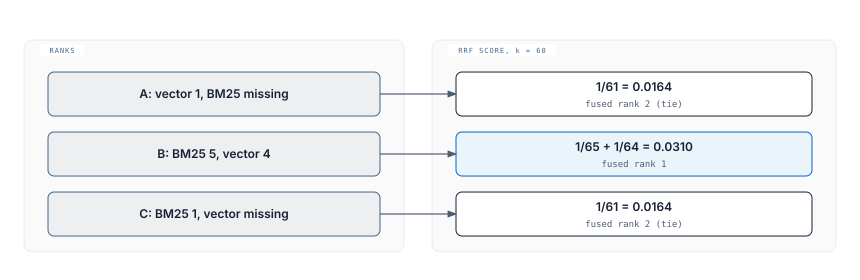
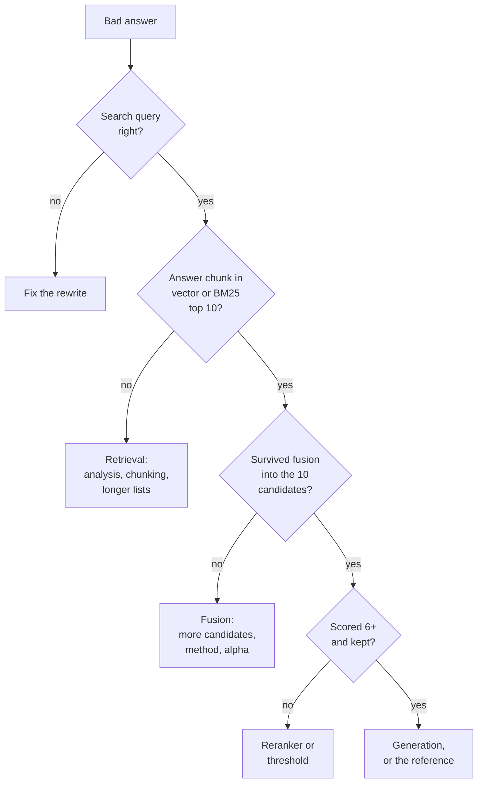

# 04. Worked Numbers, System Design and Rapid Fire

In this doc:

- Worked numbers to derive on a whiteboard
- System design: from this project to production
- Debugging a bad answer, live
- Rapid-fire round
- Mistakes that cost points

## Worked Numbers for the Whiteboard

### RRF in three lines

Say: "B is never first, but both retrievers found it, so it wins. A and C tie, so I need a tie rule." Then add the real case: the rag-corpus answer chunk was BM25 rank 4 and missing from the vector list, so it scored 1/64 = 0.0156 and landed at fused rank 8.

### More numbers

<table width="100%">
<thead><tr><th>Item</th><th>Number</th><th>How to derive it</th></tr></thead>
<tbody>
<tr><td>Weight of rank 100 relative to rank 1, k = 60</td><td>0.38</td><td>(1/160) / (1/61) = 61/160</td></tr>
<tr><td>Same with k = 0</td><td>0.01</td><td>(1/100) / (1/1)</td></tr>
<tr><td>When does agreement always beat a single list?</td><td>k > N - 2</td><td>2/(k + N) > 1/(k + 1); with N = 10, any k above 8</td></tr>
<tr><td>Min-max stretches small gaps</td><td>0.02 becomes 0.5</td><td>Cosine list from 0.50 to 0.54: a chunk at 0.52 gets (0.52 - 0.50) / 0.04 = 0.5</td></tr>
<tr><td>Theoretical min-max keeps them small</td><td>0.987</td><td>Same chunk with lower bound -1: (0.52 + 1) / (0.54 + 1)</td></tr>
<tr><td>Weighted fusion, illustrative</td><td>0.694</td><td>BM25 20 of list max 40 gives 0.5; cosine 0.6 of max 0.8 gives 1.6 / 1.8 = 0.889; alpha 0.5: 0.5 x 0.889 + 0.5 x 0.5</td></tr>
<tr><td>BM25 worked example</td><td>D1 0.991, D3 0.470, D2 0.447</td><td>"sick days" over three short documents, k1 1.2, b 0.75 (basic concepts note 03)</td></tr>
<tr><td>Overlap of the two top 10 lists</td><td>2.4 chunks on average</td><td>Union of 14 to 19 chunks per question</td></tr>
<tr><td>Time per query</td><td>BM25 0.06 ms, FAISS 0.04 ms, RRF 0.009 ms</td><td>Against 300 to 1,000 ms for one embedding call</td></tr>
<tr><td>BM25 index</td><td>About 398 KB, built in 16 ms</td><td>6,368 terms, 33,400 postings, 410 chunks</td></tr>
<tr><td>Sign test, 7 wins of 7</td><td>p = 0.0078</td><td>(1/2)^7 = 1/128 (RRF paper)</td></tr>
</tbody>
</table>

## System Design: From This Project to Production

<table width="100%">
<thead><tr><th>Concern</th><th>This project</th><th>Production</th></tr></thead>
<tbody>
<tr><td>Keyword index</td><td>BM25 in memory, rebuilt on every upload or delete</td><td>A search engine with incremental indexing (OpenSearch, Elasticsearch, Azure AI Search), or segment-based updates; rebuilding is fine only for small collections</td></tr>
<tr><td>Vector index</td><td>FAISS exact search in memory</td><td>Approximate search (HNSW) in a managed store, with metadata filters</td></tr>
<tr><td>Hybrid in one system</td><td>Two indexes joined by chunk id in our code</td><td>Many stores offer hybrid queries with built-in RRF; check which fusion and constants they use</td></tr>
<tr><td>Text analysis</td><td>Lowercase, stop words, no stemming</td><td>Per-language analysers, synonyms lists, handling of product codes and names; tested with an evaluation set</td></tr>
<tr><td>Fusion</td><td>RRF k = 60; weighted fusion as a setting</td><td>RRF until labelled queries exist, then tune alpha on a few hundred queries and A/B test</td></tr>
<tr><td>Candidate count</td><td>10 fused candidates for the LLM reranker</td><td>50 to 100 candidates for a cheap cross-encoder, which also reduces displacement</td></tr>
<tr><td>Consistency</td><td>One process updates both indexes</td><td>A single ingestion pipeline with ids, retries and a check that both indexes hold the same chunk ids</td></tr>
<tr><td>Quality</td><td>10 answerable questions, chunk-level evidence phrases</td><td>Hundreds of labelled queries, recall at k per retriever and after fusion, regression gate on every change</td></tr>
</tbody>
</table>

## Debugging a Bad Answer, Live

Say it while pointing at the trace: "First what was searched, then whether each retriever found the chunk, then whether it survived fusion, then its rerank score, then the answer." Hybrid search adds one new failure point: a chunk found by one retriever but pushed out during fusion.

## Rapid-Fire Round

<table width="100%">
<thead><tr><th>Question</th><th>Answer</th></tr></thead>
<tbody>
<tr><td>RRF formula?</td><td>Sum over lists of 1 / (60 + rank)</td></tr>
<tr><td>RRF paper?</td><td>Cormack, Clarke, Buettcher, SIGIR 2009</td></tr>
<tr><td>BM25 defaults?</td><td>k1 1.2, b 0.75</td></tr>
<tr><td>TM2C2?</td><td>Convex combination with theoretical min-max normalisation (Bruch et al. 2022)</td></tr>
<tr><td>Theoretical bounds you use?</td><td>0 for BM25, -1 for cosine</td></tr>
<tr><td>Your default fusion?</td><td>RRF, k = 60</td></tr>
<tr><td>Your weighted fusion alpha?</td><td>0.5 (vector weight), a setting</td></tr>
<tr><td>List lengths?</td><td>10 from each retriever, 10 fused candidates</td></tr>
<tr><td>Extra model calls for hybrid?</td><td>None</td></tr>
<tr><td>Average overlap of the two lists?</td><td>2.4 of 10</td></tr>
<tr><td>Blended RAG's "hybrid query"?</td><td>A multi-field Elasticsearch query, not list fusion</td></tr>
<tr><td>SPLADE in one line?</td><td>Sparse term weights and expansion learned by BERT, served from an inverted index</td></tr>
<tr><td>Why not stem?</td><td>Measured: answer chunk rank 4 to 38 with stemming; left off, testable</td></tr>
<tr><td>Fusion for recall or precision?</td><td>Recall; the reranker does precision</td></tr>
</tbody>
</table>

## Mistakes That Cost Points

- Adding BM25 and cosine scores without normalising.
- Calling RRF "parameter-free": k is a parameter, and with two lists of length N it decides whether agreement always wins (k > N - 2).
- Claiming hybrid search improves answers without a chunk-level measurement: file-level hit rate was already 10 of 10.
- Forgetting displacement: keyword candidates take slots from vector candidates when the candidate count is fixed.
- Reading Blended RAG's "hybrid query" as list fusion.
- Quoting "weighted fusion beats RRF" without the condition: tuned alpha, labelled data, and the appendices' exceptions.
- Forgetting the second index on delete: a deleted file that stays in BM25 still gets retrieved.

## Key Points

- Know the RRF example, the rag-corpus fused score (1/64 = 0.0156, rank 8) and the k > N - 2 rule.
- Know why min-max stretches gaps and theoretical min-max does not.
- In production: incremental keyword indexing, approximate vector search, more candidates for a cheap cross-encoder, one ingestion pipeline for both indexes.
- Debug in pipeline order; hybrid adds the "lost in fusion" failure point.

## Navigation

Previous: [03. Research Paper Questions and Answers](03.%20Research%20Paper%20Questions%20and%20Answers.md) | [Interview Preparation](README.md) | [Notes](../README.md)
