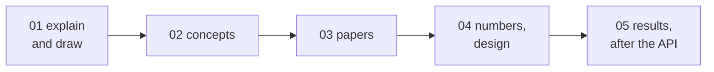

# 03. Interview Preparation

Hybrid Search RAG from an interview point of view: explanations to say out loud, the diagram to draw, questions and answers on BM25, dense retrieval, fusion and evaluation, the three papers, worked numbers, and the before-and-after story against Advanced RAG.

The preparation is split into small docs. Docs 01 to 04 use what the notes already measured on the Advanced RAG index (the same chunks the Hybrid API will use). Doc 05 needs the Hybrid API and its evaluation, so it is written after them.

<table width="100%">
<thead><tr><th>#</th><th>Doc</th><th>What it covers</th><th>Status</th></tr></thead>
<tbody>
<tr><td>1</td><td><a href="01.%20Explanations%20and%20the%20Whiteboard%20Diagram.md">Explanations and the Whiteboard Diagram</a></td><td>How to structure an answer, the 30-second and 2-minute explanations, the diagram to draw, what you can claim before the API exists</td><td>Done</td></tr>
<tr><td>2</td><td><a href="02.%20Concept%20Questions%20and%20Answers.md">Concept Questions and Answers</a></td><td>BM25, text analysis, dense blind spots, learned sparse retrieval, score scales, RRF, weighted fusion, reranking, evaluation, cost</td><td>Done</td></tr>
<tr><td>3</td><td>Research Paper Questions and Answers</td><td>RRF (2009), fusion functions (2022), Blended RAG (2024): what each claims, what the tables show, what we took from it</td><td>Planned</td></tr>
<tr><td>4</td><td>Worked Numbers, System Design and Rapid Fire</td><td>Numbers to derive on a whiteboard, production design, debugging a bad answer, rapid-fire round, mistakes that cost points</td><td>Planned</td></tr>
<tr><td>5</td><td>Project Results and Story</td><td>Evaluation against the Advanced RAG baseline, cost and latency, the project story with final numbers</td><td>Planned (after the API and evaluation)</td></tr>
</tbody>
</table>

Related: [Advanced RAG Interview Preparation](../../../02.%20Advanced%20RAG/01.%20Notes/03.%20Interview%20Preparation/).

## Navigation

Previous: [02. Research Paper Explained](../02.%20Research%20Paper%20Explained/) | [Notes](../README.md)
