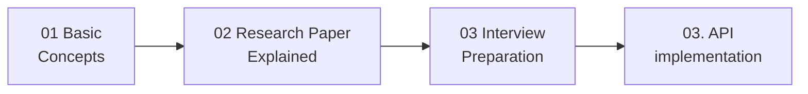

# 01. Notes

Everything needed to understand Hybrid Search RAG before building it: the concepts in simple terms, the three research papers explained section by section, and interview preparation.

## Reading order

<table width="100%">
<thead><tr><th>#</th><th>Folder</th><th>What it covers</th><th>Status</th></tr></thead>
<tbody>
<tr><td>1</td><td><a href="01.%20Basic%20Concepts/">Basic Concepts</a></td><td>From Advanced RAG to hybrid search: BM25, text analysis, dense blind spots, sparse vs dense, learned sparse retrieval, score normalisation, RRF, weighted fusion, hybrid plus reranking, evaluation, cost</td><td>Next</td></tr>
<tr><td>2</td><td><a href="02.%20Research%20Paper%20Explained/">Research Paper Explained</a></td><td>Blended RAG (IBM 2024), An Analysis of Fusion Functions for Hybrid Retrieval (2022) and Reciprocal Rank Fusion (SIGIR 2009), one note per paper section, with every figure, table and equation explained</td><td>Planned</td></tr>
<tr><td>3</td><td><a href="03.%20Interview%20Preparation/">Interview Preparation</a></td><td>Hybrid Search RAG from an interview point of view, with the results of this implementation</td><td>Planned</td></tr>
</tbody>
</table>

Prerequisite: the [Advanced RAG notes](../../02.%20Advanced%20RAG/01.%20Notes/), especially candidate retrieval, reranking and evaluation, and the [Naive RAG notes](../../01.%20Naive%20RAG/01.%20Notes/) on embeddings and retrieval.

## Navigation

[Hybrid Search RAG](../README.md) | Next: [01. Basic Concepts](01.%20Basic%20Concepts/)
